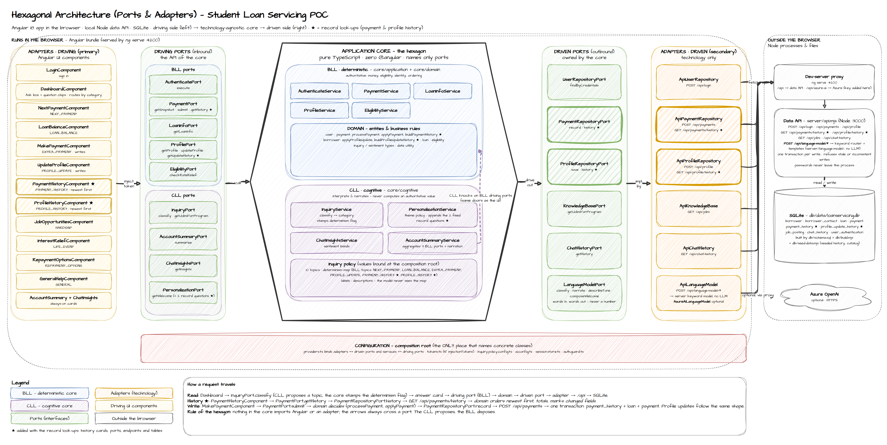

# Self-Service Loan Servicing — Hexagonal Architecture POC

__Disclaimer__: the Student Loan Portal is a fictitious application built with mock data. It uses no proprietary data or implementations, and the pattern applies to any line of business. The implementation uses generic use cases, applicable to any loan system, and synthetically generated data.

This implementation uses a popular stack for light POCs (Angular / SQLite / NodeJS) by using the design defined 
in **Alistair Cockburn's Hexagonal Architecture (Ports & Adapters)**.

The whole point of this POC is to make the **ports-and-adapters boundary** visible:
a **technology-agnostic application core** sits in the middle, and everything
outside plugs in through **ports** (interfaces) via **adapters**. There are two
**symmetric** sides:

- the **driving (primary)** side — adapters that *drive* the core (the UI, tests);
- the **driven (secondary)** side — adapters the core *drives* (a local API over SQLite — borrowers,
  payments, profile, jobs, chat history — and the model runtime).

The core holds **two regions**: the deterministic **BLL** (`core/application` +
`core/domain`) and the cognitive **CLL** (`core/cognitive`). Both are core because
both are application logic; the adapter ring holds **technology only** — the LLM
runtime included, behind `LanguageModelPort`.

> **The CLL proposes, the BLL disposes.** The cognitive region owns no
> authoritative computation and can reach one only by calling a **driving port** of
> the deterministic region — the same door the UI uses, with no privileged path.
> Delete `core/cognitive/` and its four driving ports and the deterministic
> hexagon still computes every balance, payment, and eligibility. Swap
> the keyword language model for a real LLM and no core file changes.

<sub>**Why not put the CLL in the adapter ring?** An adapter translates a
*technology* into a port. These services translate nothing — they hold policy: the
fixed determinism map, the topic labels, the sentiment bands, the rule that a
summary is exactly profile + loan + payment. Filing them as adapters put logic
where technology belongs and left the genuinely foreign thing — the model — with
no port at all.</sub>

## Architecture at a glance

[](references/hex-architecture.png)

*Click the image for full size. Editable source: [`references/hex-architecture.drawio`](references/hex-architecture.drawio)
(open in [draw.io](https://app.diagrams.net); Sketch style).*

Read it left to right: the **Angular UI** (driving adapters) calls the core only through
**driving ports**; the core — the deterministic **BLL** and the cognitive **CLL** — reaches
the outside world only through **driven ports**; each driven port is implemented by an
**adapter** that talks to a local **data API**, which alone opens the **SQLite** file. The
dashed boundary marks what runs in the browser. ★ marks the record look-ups (payment and
profile history). The sections below explain each ring in detail.

## Layering (folders under `src/app/`)

**File-suffix convention.** Each region of the core names its files after what
they *hold*, so a misplaced file is visible in a directory listing:

| Suffix | Region | Holds |
|---|---|---|
| `*.entity.ts` | `core/domain` | Invariants and money math. Enterprise rules that outlive the application. |
| `*.type.ts` | `core/domain` | **Shared kernel.** Declarations that cross rings and carry no rule of their own — the topic taxonomy, the sentiment labels, the job-posting shape. |
| `*.utility.ts` | anywhere in the core | Pure, stateless helpers that belong to no rule and decide nothing — e.g. `date.utility.ts` parses `yyyy-MM-dd` as a local calendar date. |
| `*.service.ts` | `core/application` **and** `core/cognitive` | A service implementing one driving port. **The folder, not the suffix, says which region it belongs to** — `application/` is deterministic (BLL), `cognitive/` proposes and phrases (CLL). |

The test is falsifiable for the first three: a file in `domain/` with no
invariant is in the wrong place, and one holding only declarations is a
`*.type.ts`, not an `*.entity.ts`.

> **Why `*.type.ts` is not `*.entity.ts`.** These declarations would not exist
> without *this application* — a batch statement generator over the same loans
> has no notion of an "inquiry category". They fail the entity test, and they sit
> in `domain/` for a structural reason rather than a conceptual one: it is the
> innermost ring, so every other ring may depend on it without a cycle. Calling
> them a shared kernel says that honestly.

> **Note on `*.service.ts`.** Both core regions use it, so the suffix alone does
> not tell you whether a file is authoritative. Read the folder: everything in
> `core/application` decides, everything in `core/cognitive` proposes. The
> distinction that matters is enforced by the ports, not by the filename.

```
src/app/
├── core/                         # THE HEXAGON — pure TypeScript, ZERO @angular
│   ├── domain/                   #   entities + ALL money math / rules
│   │   ├── user.entity.ts
│   │   ├── loan.entity.ts        #   paid %, months-to-maturity
│   │   ├── payment.entity.ts     #   snapshot, payoff, validation, references
│   │   ├── borrower.entity.ts    #   profile, standing, contact validation
│   │   ├── eligibility.entity.ts #   rate-relief decision + money math
│   │   ├── date.utility.ts       #   parses yyyy-MM-dd as a LOCAL calendar date
│   │   ├── inquiry.type.ts       #   shared kernel — the topic taxonomy
│   │   ├── job-posting.type.ts   #   shared kernel — crosses the whole hexagon
│   │   └── sentiment.type.ts     #   shared kernel — sentiment label + tone
│   ├── application/              # DETERMINISTIC region (BLL) — implements the BLL driving ports
│   │   ├── authenticate.service.ts   #   implements AuthenticatePort, needs UserRepositoryPort
│   │   ├── payment.service.ts        #   implements PaymentPort
│   │   ├── loan-info.service.ts      #   implements LoanInfoPort
│   │   ├── profile.service.ts        #   implements ProfilePort
│   │   └── eligibility.service.ts    #   implements EligibilityPort
│   └── cognitive/                # COGNITIVE region (CLL) — implements the CLL driving ports.
│       │                         #   Core logic, NOT an adapter: it holds policy, no technology.
│       │                         #   Reaches the BLL only through BLL driving ports; reaches the
│       │                         #   model only through LanguageModelPort.
│       ├── inquiry.policy.ts          # CONTRACT for the determinism map + labels + descriptions
│       ├── inquiry.service.ts         # APPLIES that policy; values injected by the composition root
│       ├── personalization.service.ts # owns the theme policy
│       ├── chat-insights.service.ts   # owns the sentiment bands
│       └── account-summary.service.ts # owns the aggregation policy (profile+loan+payment)
│
├── ports/                        # THE BOUNDARY — pure TypeScript interfaces, ZERO @angular
│                                 #   Each port DECLARES the DTOs it alone owns
│                                 #   (InquiryResult, CategoryDescriptor, AccountSummary, …)
│   ├── driving/                  #   inbound / primary ports — what the core EXPOSES
│   │   ├── authenticate.port.ts  #     AuthenticatePort      ─┐
│   │   ├── payment.port.ts       #     PaymentPort            │ deterministic
│   │   ├── loan-info.port.ts     #     LoanInfoPort           │ region
│   │   ├── profile.port.ts       #     ProfilePort            │
│   │   ├── eligibility.port.ts   #     EligibilityPort       ─┘
│   │   ├── inquiry.port.ts       #     InquiryPort           ─┐
│   │   ├── personalization.port.ts #   PersonalizationPort    │ cognitive region —
│   │   ├── chat-insights.port.ts  #    ChatInsightsPort       │ SAME edge, same kind
│   │   └── account-summary.port.ts #   AccountSummaryPort    ─┘ of door
│   └── driven/                   #   outbound / secondary ports — what the core REQUIRES
│       ├── user-repository.port.ts   #     UserRepositoryPort (BLL) — credentials lookup
│       ├── payment-repository.port.ts#     PaymentRepositoryPort (BLL) — stores a payment the domain decided
│       ├── profile-repository.port.ts#     ProfileRepositoryPort (BLL) — stores a contact update the domain validated
│       ├── language-model.port.ts    #     LanguageModelPort  (CLL) — the LLM behind a port
│       ├── knowledge-base.port.ts    #     KnowledgeBasePort  (CLL, read-only grounding)
│       └── chat-history.port.ts      #     ChatHistoryPort    (CLL, read-only grounding)
│
├── adapters/                     # TECHNOLOGY ONLY — no application logic lives here
│   ├── driving/                  # PRIMARY adapters — they DRIVE the core through driving ports
│   │   └── ui/                   #   Angular UI (login, dashboard, answer + summary cards,
│   │                             #   policy/ — read-only view of the determinism setting at /configuration)
│   └── driven/                   # SECONDARY adapters — the core DRIVES them through driven ports
│       ├── api-user.repository.ts     # implements UserRepositoryPort (POST /api/login)
│       ├── api-payment.repository.ts  # implements PaymentRepositoryPort (POST /api/payments)
│       ├── api-profile.repository.ts  # implements ProfileRepositoryPort (POST /api/profile)
│       ├── api-language-model.ts      # implements LanguageModelPort — calls the server keyword model (POST /api/language-model/*)
│       ├── azure-ai-language-model.ts # implements LanguageModelPort — REAL Azure OpenAI calls
│       ├── api-knowledge-base.ts      # implements KnowledgeBasePort (GET /api/jobs)
│       └── api-chat-history.ts        # implements ChatHistoryPort (GET /api/chat-history)
│
└── configuration/                # COMPOSITION ROOT (framework wiring; may import @angular)
    ├── tokens.ts                 #   InjectionTokens typed to the PORT interfaces
    ├── ai.config.ts              #   which model runtime + how to reach it (no secrets)
    ├── inquiry.policy.config.ts  #   determinism map + topic labels + topic descriptions (business settings)
    ├── providers.ts              #   binds adapters↔driven ports, both core regions↔driving ports
    ├── session.store.ts          #   signal-based SessionStore
    └── auth.guard.ts             #   authGuard on /dashboard
```

### Outside `src/app/`

```
src/assets/                       # static files
└── ai-config.example.js          #   optional Azure defaults (copy to ai-config.js; git-ignored)

db/                               # DATA — the system of record for borrowers (SQLite)
├── schema.sql                    #   borrower, borrower_contact, loan, payment (current schedule), payment_history (ledger), profile_update_history, chat_history, job_posting, user_authentication
├── build.mjs                     #   node db/build.mjs — (re)creates data/loanservicing.db from an inline seed of 6 borrowers; seeds 43 payments and 15 profile updates of history, the 20-posting job catalog and 6 chat histories
├── seed-data.mjs                 #   the job catalog (20 postings) and chat history (6 borrowers) loaded by build.mjs
└── data/loanservicing.db         #   git-ignored; opened ONLY by server/api.mjs, never sent to the browser

server/
├── api.mjs                       # local API (node:http + node:sqlite): POST /api/login, /api/payments, /api/profile, GET /api/payments/history, /api/profile/history, /api/jobs, /api/chat-history, POST /api/language-model/*; proxied from /api by proxy.conf.js
└── language-model/              # the keyword language model (no LLM): keyword-router.mjs (the framework),
                                  #   intents.mjs (the keyword registry — edit this), narration.mjs (templated copy),
                                  #   classification.cases.mjs + keyword-router.test.mjs (the regression table)

references/                       # DEEP-DIVE DOCS (markdown + a PDF rendering of each)
├── project_swagger.md            #   every component, port and operation — the "parts"
├── inquiry_scenario_end_to_end.md#   one request traced through every layer — the "journey"
├── hex-architecture.drawio       #   the architecture as one diagram (draw.io, Sketch style) — editable source
└── hex-architecture.png          #   PNG export of the diagram above
```

**Why the data sits in files.** Nothing in `core/` or `ports/` names any of those
files — only the adapter that fetches one does. Changing the job catalog or a
borrower's recap is a data edit, not a code change, which is the same property the
port ring buys at the type level. Every data set now lives in one SQLite file — borrowers, payments, profile, the
job catalog and the chat history — and got there by swapping adapters in `providers.ts`.
The browser never opens the database: the driven adapters call a small local API
(`server/api.mjs`) that owns the file, so passwords stay server-side and payments can
be written. Editing the catalog or a recap means editing `db/seed-data.mjs` and
running `npm run db:build`.

## The ports-and-adapters boundary (how it is enforced)

The boundary is the **port** — an interface owned by the core. Every interaction
crosses a port via an adapter:

- **Primary adapters depend on DRIVING ports.** The UI injects driving-port
  *tokens* (`PAYMENT_PORT`, `LOAN_INFO_PORT`, `PROFILE_PORT`, `AUTHENTICATE_PORT`,
  and equally `INQUIRY_PORT`, `ACCOUNT_SUMMARY_PORT`, …) typed to the port
  *interfaces* — never a concrete core class. **The UI cannot tell a cognitive port
  from a deterministic one**; both are just doors in the same edge.
- **The cognitive region depends on the deterministic region's DRIVING ports.**
  `AccountSummaryService` names `ProfilePort` / `LoanInfoPort` / `PaymentPort` —
  the same interfaces the UI uses. This is the inner application of the same rule,
  and it is what keeps the CLL non-authoritative.
- **Both regions depend on DRIVEN ports for technology.** `AuthenticateService`
  names only `UserRepositoryPort`; `InquiryService` names only `LanguageModelPort`
  and `KnowledgeBasePort`. Nothing in `core/` names the SQLite file, Angular, or a model.
- **The composition root** (`configuration/providers.ts`) is the single place that
  knows the concrete classes: it (a) binds driven adapters to driven-port tokens,
  (b) constructs the deterministic services and binds them to their driving-port
  tokens, and (c) constructs the cognitive services — handing them deterministic
  driving ports plus `LANGUAGE_MODEL_PORT` — and binds them to theirs.

Three invariants keep the hexagon honest — verify them yourself:

```bash
# 1. core/ and ports/ contain ZERO Angular imports:
grep -RE "^import.*@angular" src/app/core src/app/ports    # → no matches

# 2. The cognitive region reaches the deterministic one only through PORTS —
#    it never imports a deterministic service directly:
grep -RE "from '\.\./application/" src/app/core/cognitive  # → no matches

# 3. A primary adapter depends on a driving-port INTERFACE, not a concrete class:
#   src/app/adapters/driving/ui/inquiry/make-payment.component.ts
#     import { PaymentPort } from '../../../../ports/driving/payment.port';
#     private paymentPort: PaymentPort = inject(PAYMENT_PORT);
```

## How the CLL / BLL split maps

Both are **regions of the one hexagon**. What separates them is not distance from
the center but *authority*: one computes, the other phrases.

- **BLL = the deterministic region.** All money math and rules live in
  `core/domain`, exposed as services in `core/application` behind the
  **deterministic driving ports**.
- **CLL = the cognitive region** (`core/cognitive`). It *proposes* (classifies free
  text, phrases greetings, narrates a summary, interprets tone) and is core logic
  because it owns **policy**. It obtains every authoritative value by calling a
  **deterministic driving port** — exactly like the UI — and never computes money or
  eligibility.
  - `InquiryService.classify` asks `LanguageModelPort` to *propose* a category, then
    stamps the `deterministic` flag from a **fixed policy map it owns**. A wrong
    proposal can pick the wrong topic; it cannot move a topic into or out of the
    deterministic set.
  - `AccountSummaryService` aggregates `ProfilePort` + `LoanInfoPort` +
    `PaymentPort` and delegates the *sentences* to `LanguageModelPort`.
  - `ChatInsightsService` owns the score bands; the model only writes the blurb.
- **The model is not the CLL.** It is a technology behind `LanguageModelPort`,
  implemented in this POC by the server-side keyword model (`server/language-model/`,
  reached through `adapters/driven/api-language-model.ts`: weighted keyword scoring +
  string templates, no AI call). Note what that adapter is *not* allowed to
  do: every number it prints arrives already computed.
- **Grounding crosses a port too** — jobs and chat history are served by driven
  adapters through `KnowledgeBasePort` / `ChatHistoryPort`, so even the model's
  context is mediated by an interface.

## How this differs from the Clean sibling

Same feature set, same domain logic — a different *shape of the boundary*:

| Aspect | Clean (`../clean_architecture`) | Hexagonal (this project) |
| --- | --- | --- |
| Boundary metaphor | concentric rings + the **Dependency Rule** (arrows point inward) | a **hexagon** with **ports** on every edge |
| Core structure | `domain` + `application/use-cases` (one class per use case) | `core/domain` + `core/application` (one service per driving port) + `core/cognitive` |
| The interface layer | `application/ports` (outbound only); inbound side is implicit (use-case classes are the entry) | an explicit, symmetric **`ports/` layer** with `driving/` **and** `driven/` sides |
| How the UI reaches the core | injects **use-case tokens** (typed to the concrete use-case class) | injects **driving-port tokens** (typed to the port *interface*) |
| Where the CLL sits | `adapters/cll` (a detail on the outer ring) | `core/cognitive` — **inside the hexagon**, behind its own driving ports |
| Where the model sits | inside the CLL adapter | `server/language-model/` (reached via `adapters/driven/api-language-model.ts`), behind `LanguageModelPort` |
| One-line guarantee | *Dependency Rule* at compile time | *everything crosses a port* — including the CLL's calls into the BLL |

The N-Tier sibling expresses the same guarantee a third way, as a runtime
*Determinism Gate*.

## Feature scope (matches the Clean sibling exactly)

- Login with 6 demo accounts (one-click demo buttons); `authGuard` on `/dashboard`.
- Dashboard: themed welcome per user type; always-on two-card insights panel
  (Account Summary + Conversation Insights with a sentiment tone-meter); an "Ask"
  box routing free-text to answer components — `NEXT_PAYMENT`, `LOAN_BALANCE`,
  `EXTRA_PAYMENT` → make-payment, `PROFILE_UPDATE` → update-profile, `PAYMENT_HISTORY` →
  payment-history, `PROFILE_HISTORY` → profile-history, else `GENERAL`.
- Two **record look-ups**: *"Show me my payment history"* lists every payment made,
  newest first, with the running total; *"Show me my profile update history"* lists the
  contact updates, newest first, marking the fields each one changed. Both open from the
  question chips under the Ask box, and both refresh by themselves after a payment or a
  profile update.

### Omitted / simplified (identical to the Clean sibling)

- **No per-user-type personalized card matrix** (autopay / rewards / refinance /
  budget-tips / debt-counseling / hardship-assistance) — present in the N-Tier
  version, omitted here.
- **HARDSHIP / LIFE_EVENT answer UIs are present.** `JobOpportunitiesComponent`
  (hardship → matched job postings via `InquiryPort.getJobsForProgram` /
  `KnowledgeBasePort`) and `InterestReliefComponent` (life event → the rate-relief
  outcome decided by `EligibilityPort`). Both are personalized: the copy adapts to
  the borrower's standing tier, while every authoritative value still comes from
  the core.
- The knowledge base and chat history are **synthetic data served from SQLite**
  (the `job_posting` and `chat_history` tables, through the local API). The model
  behind `LanguageModelPort` defaults to the **server-side keyword model** — weighted keyword matching and
  string templates, no real LLM call — but a **real Azure OpenAI adapter ships
  alongside it** (see below) and is selected by configuration alone.

## The default language model: a server-side keyword router (no LLM)

Out of the box nothing calls an LLM and nothing calls Azure. The "language model" behind
`LanguageModelPort` is a small keyword framework that runs in the local API
(`server/language-model/`); the browser reaches it through `ApiLanguageModel`
(`POST /api/language-model/*`). It does two jobs, both without a model:

- **Propose a topic** for the borrower's words, so the right Angular card is shown.
- **Phrase** figures the core already computed (loan and payment narration, tone blurb,
  welcome copy) from string templates.

**How a question is classified** ([`keyword-router.mjs`](server/language-model/keyword-router.mjs))

1. **Normalise** — lower-case, drop apostrophes (`can't` → `cant`), strip punctuation, and
   reduce each word to a crude stem, so one keyword covers its plurals and tenses.
2. **Match** — each keyword is a pattern over the stemmed text. `*` lets up to three other
   words sit in between (`pay * off`), and `a|b` accepts either word (`faster|sooner`).
3. **Score** — a topic's score is the sum of the weights of its distinct matched keywords,
   minus the weights of its *negative* keywords (for example, `history` argues *against*
   "make a payment").
4. **Decide** — the highest score wins if it reaches `MIN_SCORE` (3); an exact tie goes to
   the topic with the higher declared `priority`; nothing above the bar is "no opinion",
   which the core turns into `GENERAL`.

**Where to tune it.** The keywords are data, in
[`intents.mjs`](server/language-model/intents.mjs) — one entry per topic with weighted
keywords, optional negatives and a priority. Nothing in the router changes when you add or
re-weight a keyword. The *core* still owns the topics, labels, descriptions and the
determinism map; it sends the list of topics it will accept with every request, and the
router ignores any other topic.

**Every decision is explainable.** `POST /api/language-model/classify` returns the winner
together with the scores and the keywords behind them:

```json
{ "category": "PROFILE_UPDATE",
  "scores":  { "PROFILE_UPDATE": 8 },
  "matched": { "PROFILE_UPDATE": [ { "term": "change * address", "weight": 5 },
                                   { "term": "mailing address",  "weight": 3 } ] } }
```

**The regression table.** [`classification.cases.mjs`](server/language-model/classification.cases.mjs)
lists questions and the topic each must reach; `npm run test:router` runs them (plus tests
of the stemmer, the wildcard, negatives and tie-breaking) with Node's built-in test runner.
When a question lands on the wrong card, add it to the table first, watch the test fail,
then tune `intents.mjs` — the older rows stop you fixing one question by breaking another.

**Limits.** It matches words, not meaning: a paraphrase that contains none of your keywords
falls through to `GENERAL`, and irregular forms (`made`/`make`) need their own keyword.
For a closed set of ten topics that is a fair trade for something predictable, explainable
and free of any external service. If the API is unreachable the adapter abstains (no topic,
neutral copy) rather than failing the page.

## Connecting the CLL to Azure AI

`AzureAiLanguageModel` implements `LanguageModelPort` against Azure OpenAI Chat
Completions. It is an ordinary secondary adapter: the core never imports it and
`providers.ts` is the only file that knows it exists.

```bash
# PowerShell
$env:AZURE_OPENAI_ENDPOINT = 'https://<resource>.openai.azure.com'
$env:AZURE_OPENAI_API_KEY  = '<key>'
npm start
# then open http://localhost:4200/?ai=proxy   (…/?ai=mock to switch back)
```

To make Azure the default instead of a query-string opt-in, copy
`src/assets/ai-config.example.js` to `src/assets/ai-config.js`, set your
deployment name, and reference it from `src/index.html`. That file is
git-ignored.

### The key never reaches the browser

`ai.config.ts` has three modes:

| mode | where the model runs | credential |
| --- | --- | --- |
| `mock` *(default)* | the server-side keyword model (no LLM) | none |
| `proxy` | Azure OpenAI via `proxy.conf.js` | held by the dev server; **never in the bundle** |
| `directKey` | Azure OpenAI straight from the browser | **exposed to anyone with devtools** — local spikes only |

(`mock` is the mode's historical name; it now selects the server-side keyword model, not an in-browser stub.)

In `proxy` mode the browser calls the same-origin path `/api/azure-ai`; the
Angular dev server rewrites it to your Azure endpoint and attaches `api-key`
server-side. `toAzureOptions()` blanks the key unless the mode is `directKey`, so
`proxy` cannot leak one by accident.

> ⚠️ **`proxy.conf.js` is dev-server only.** `ng build` emits static files with
> nothing in front of them. A deployed build needs a real server-side endpoint —
> an API route, APIM policy, or function — doing the same injection.

### What the adapter is not allowed to do

The CLL/BLL split survives the upgrade, and the adapter is where that is enforced:

- **It never computes an authoritative value.** Every figure in a prompt arrives
  already computed from the deterministic region; the system prompts forbid
  inventing, recomputing or re-rounding any number, date, rate or amount.
- **It never decides what a category means.** `classifyInquiry` proposes one of
  the nine fixed labels or `null`. An unrecognised or unparseable answer becomes
  `null` — "no opinion" — which `InquiryService` already collapses to `GENERAL`.
  The determinism policy stays in the core.
- **It never fails the user.** Any timeout, non-2xx, transport error, content
  filter or malformed payload delegates to the injected server keyword model. The
  POC therefore behaves identically with no credentials, no network, or a cold
  Azure resource — you get templated copy instead of generated copy.

### What had to change inside the hexagon — twice

`LanguageModelPort` was **synchronous**, which quietly assumed the adapter behind
it was in-process. No remote model can satisfy that shape, so the port — and the
four cognitive driving ports in front of it — now return `Promise`s.

This is worth noting honestly: the README used to claim that swapping the model
was a one-line composition-root change, and the first real swap disproved it. The
port had leaked an assumption about its adapter. Now that the contract is shaped
by the *slowest plausible* adapter, the claim is true — the keyword model and Azure are
genuinely interchangeable, and a third runtime would cost one line.

**The same lesson repeated for grounding.** `KnowledgeBasePort` and
`ChatHistoryPort` were synchronous while their adapters held hard-coded literals.
Moving the job catalog and the chat recaps out of code and into a data store (first
files, now the `job_posting` and `chat_history` tables) — a change of *storage*, with
no new logic — forced both ports to `Promise` as well. `UserRepositoryPort` never had this problem: it was
async from the start because it always read from outside the process (a file at first, now an API).

The generalisable point is that a port's synchronicity is part of its contract,
and picking it from the adapter you happen to have first is how the abstraction
leaks. Shape it for the most distant adapter you can plausibly imagine, and
swapping really is a composition-root change.

## Run it

```bash
cd hexagonal_architecture
npm install
npm run db:build      # creates db/data/loanservicing.db (git-ignored; Node 22+). Re-running it discards payments and profile updates made in the app and restores the seeded history.
npm run api           # data API at http://127.0.0.1:3000 — keep it running (own terminal)
npm run test:router    # regression table for the keyword language model
npm run build         # production build → dist/loan-servicing-poc
npm start             # dev server at http://localhost:4200, proxies /api to the data API
```

All six demo accounts use the password **demo123**.

**Payments and profile updates are real.** Submitting the Make Payment form records a row in
`payment_history` and updates the borrower's `loan` and `payment` rows in one
transaction. The domain decides (validation, balance, schedule change) in
`core/domain/payment.entity.ts`; `PaymentRepositoryPort` only stores the result. The
API also refuses a stale or inconsistent write. Saving the Update Profile form works the
same way: the domain validates (`applyProfileUpdate`), `ProfileRepositoryPort` stores the
new contact details in `borrower_contact` and logs the reference in `profile_update_history`. `ng build` output has no proxy, so a
deployed build needs the data API behind the same `/api` path.

### Questions to try

| Ask | Lands on |
| --- | --- |
| *When is my next payment due?* | `NEXT_PAYMENT` |
| *I want to make an extra payment* | `EXTRA_PAYMENT` |
| *Show me my payment history* · *What payments have I made?* | `PAYMENT_HISTORY` |
| *I want to update my profile* | `PROFILE_UPDATE` |
| *Show me my profile update history* · *What have I changed on my profile?* | `PROFILE_HISTORY` |
| *I lost my job and can't make payments* | `HARDSHIP` |

The two history questions are also offered as chips on every borrower's welcome panel.
They are added by the core (`PersonalizationService`), so they appear whichever language
model is bound.

## Further reading

| Document | What it covers |
| --- | --- |
| [`references/hex-architecture.png`](references/hex-architecture.png) | The whole architecture on one page: driving UI → driving ports → core (BLL + CLL) → driven ports → adapters → data API → SQLite. Editable source: [`hex-architecture.drawio`](references/hex-architecture.drawio) (open in draw.io; Sketch style). |
| [`PORTS.md`](PORTS.md) | The interface reference — every port, operation and schema. The Swagger page for the core. |
| [`references/project_swagger.md`](references/project_swagger.md) | The full component inventory: all 56 files by ring, the wiring table, sequence flows. |
| [`references/inquiry_scenario_end_to_end.md`](references/inquiry_scenario_end_to_end.md) | One borrower request followed through every layer, naming each object as it is constructed. |

Both `references/` documents ship with a PDF rendering alongside the markdown.
