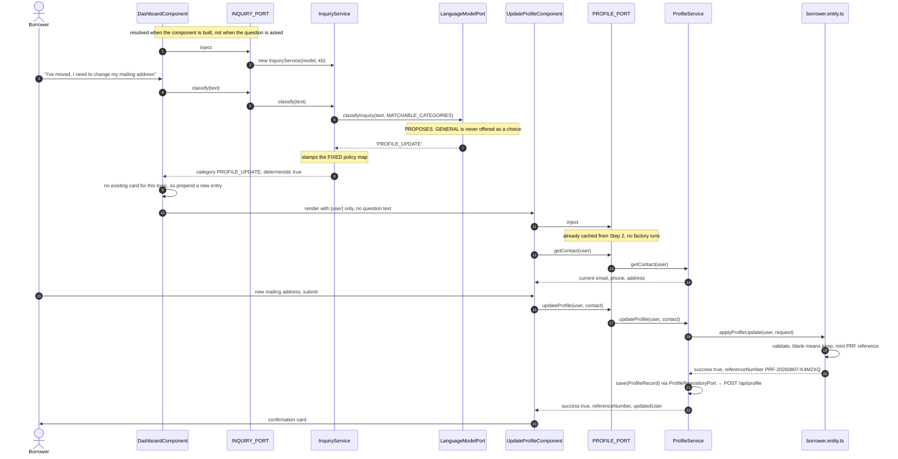

# One Inquiry, End to End

**Scenario** A borrower types *"I've moved — I need to change my mailing address."*
**Outcome** A confirmation card with reference `PRF-20260807-K4M2XQ`.

This document follows that single sentence through every layer of the application —
naming each file, each binding key, each object as it is constructed, and each
decision as it is made. It is the companion to
[`project_swagger.md`](project_swagger.md): that document describes the *parts*,
this one describes *one journey through them*.

Read it to answer questions of the form "what actually happens when…" — including
the ones that matter architecturally: where does the model get consulted, where does
it get overruled, and at what point is a figure allowed to become authoritative.

---

## Contents

1. [Preconditions — how the borrower got here](#1-preconditions--how-the-borrower-got-here)
2. [Step 0 — Bootstrap: recipes, not instances](#step-0--bootstrap-recipes-not-instances)
3. [Step 1 — The dashboard is constructed](#step-1--the-dashboard-is-constructed)
4. [Step 2 — The always-on cards resolve first](#step-2--the-always-on-cards-resolve-first)
5. [Step 3 — The borrower asks](#step-3--the-borrower-asks)
6. [Step 4 — The model proposes](#step-4--the-model-proposes)
7. [Step 5 — The core disposes](#step-5--the-core-disposes)
8. [Step 6 — The dashboard places the card](#step-6--the-dashboard-places-the-card)
9. [Step 7 — The template selects the component](#step-7--the-template-selects-the-component)
10. [Step 8 — The card resolves its own port](#step-8--the-card-resolves-its-own-port)
11. [Step 9 — Pre-fill](#step-9--pre-fill)
12. [Step 10 — Submit](#step-10--submit)
13. [Step 11 — The domain decides](#step-11--the-domain-decides)
14. [Step 12 — Confirmation](#step-12--confirmation)
15. [Injector state timeline](#injector-state-timeline)
16. [The whole journey as a sequence](#the-whole-journey-as-a-sequence)
17. [What never happened](#what-never-happened)

---

## 1. Preconditions — how the borrower got here

The dashboard is unreachable without a session. `authGuard` runs first
([auth.guard.ts:9-17](../../src/app/configuration/auth.guard.ts#L9-L17)):

```ts
export const authGuard: CanActivateFn = () => {
  const session = inject(SessionStore);
  const router  = inject(Router);
  if (session.isAuthenticated()) return true;
  return router.createUrlTree(['/login']);
};
```

`SessionStore` holds a whole `User` — one borrower assembled from `assets/loanservicing.db` — placed
there by `LoginComponent` after `AuthenticatePort.execute()` returned it. For this
walkthrough:

```ts
user = { username: 'alice', firstName: 'Alice', lastName: 'Thompson', userType: 1,
         programOfStudy: 'Computer Science', city: 'Toronto', province: 'ON',
         currentBalance: 18450, /* …16 more fields… */ }
```

**Why the whole entity and not an id.** Every port operation in the application takes
`user: User`. Because one `User` already carries balance, rate, payment counts and
program of study, no port ever needs to re-fetch — which is why four of the five
deterministic services are constructed with no dependencies at all.

---

## Step 0 — Bootstrap: recipes, not instances

[main.ts:13-19](../../src/main.ts#L13-L19)

```ts
bootstrapApplication(AppComponent, {
  providers: [
    provideZoneChangeDetection({ eventCoalescing: true }),
    provideRouter(routes),
    ...hexagonalProviders,        // ← all 15 bindings
  ],
});
```

`hexagonalProviders` is an array of **recipes**. Each says "under key *K*, build a
value using factory *F*, which itself needs keys *D₁…Dₙ*."

> **Nothing in the hexagon has been constructed yet.** No `InquiryService`, no
> `ApiLanguageModel`, no `ProfileService`. The injector holds a table of
> instructions and 13 empty instance slots. Every object below is created lazily,
> on first request.

---

## Step 1 — The dashboard is constructed

The borrower navigates to `/dashboard`. Angular constructs `DashboardComponent`,
whose field initialisers run **in declaration order**
([dashboard.component.ts:84-87](../../src/app/adapters/driving/ui/dashboard/dashboard.component.ts#L84-L87)):

```ts
private session         = inject(SessionStore);
private inquiry         = inject(INQUIRY_PORT);          // ← resolves NOW
private personalization = inject(PERSONALIZATION_PORT);
private router          = inject(Router);
```

> **Note the timing.** `INQUIRY_PORT` resolves when the *component is built* — not
> when the borrower types. By the time anyone asks a question, the entire cognitive
> chain already exists.

### Resolving `INQUIRY_PORT`

```
inject(INQUIRY_PORT)
│
├─ root injector: recipe found. Instance cached? NO → run the factory
│                 (providers.ts:101-106)
│
├─ the factory declares deps, so resolve those FIRST, left to right:
│  │
│  ├─ [1] LANGUAGE_MODEL_PORT ── run ITS factory (providers.ts:73-85)
│  │        resolveAiConfig()        → { mode:'mock', deployment:'gpt-4o-mini', … }
│  │                                   (memoised — every consumer sees this object)
│  │        new ApiLanguageModel()   → ALWAYS built: in Azure mode it becomes
│  │                                   the offline fallback
│  │        usesAzure(cfg)?          → false → return it
│  │        ✔ cached under LANGUAGE_MODEL_PORT
│  │
│  └─ [2] KNOWLEDGE_BASE_PORT ── new ApiKnowledgeBase()
│           the constructor does NO I/O: /api/jobs is requested on the
│           first getJobsForProgram() call and the promise is cached per program
│           ✔ cached under KNOWLEDGE_BASE_PORT
│
├─ call the factory with the resolved values:
│     new InquiryService(apiLanguageModel, apiKnowledgeBase)
│
├─ ✔ cached under INQUIRY_PORT
└─ return it, statically typed as InquiryPort
```

The constructor that finally runs
([inquiry.service.ts:117-121](../../src/app/core/cognitive/inquiry.service.ts#L117-L121)):

```ts
export class InquiryService implements InquiryPort {
  constructor(
    private readonly languageModel: LanguageModelPort,   // ← the keyword model, as an interface
    private readonly knowledgeBase: KnowledgeBasePort
  ) {}
```

It receives **ports, not adapters.** `InquiryService` imports neither
`ApiLanguageModel` nor `AzureAiLanguageModel` and cannot discover which it got.

### Resolving `PERSONALIZATION_PORT` — the second one is cheaper

```
inject(PERSONALIZATION_PORT)
├─ deps: [LANGUAGE_MODEL_PORT]
│    └─ already cached ✔ → returns THE SAME ApiLanguageModel object
└─ new PersonalizationService(sameModelInstance)
```

One model instance, four eventual consumers. This is also why `resolveAiConfig()`
memoises: *"Resolved once: every consumer must see the same runtime for the
session."*

---

## Step 2 — The always-on cards resolve first

`DashboardComponent`'s template renders two cards before the borrower does anything
([dashboard.component.html:125-126](../../src/app/adapters/driving/ui/dashboard/dashboard.component.html#L125-L126)):

```html
<app-account-summary [user]="u" />
<app-chat-insights   [user]="u" />
```

`AccountSummaryComponent` calls `inject(ACCOUNT_SUMMARY_PORT)`, and **this is where
the deterministic services get built**:

```
inject(ACCOUNT_SUMMARY_PORT)                       (providers.ts:118-127)
├─ [1] PROFILE_PORT      → new ProfileService(profileRepo)
├─ [2] LOAN_INFO_PORT    → new LoanInfoService()    ← no deps
├─ [3] PAYMENT_PORT      → new PaymentService(paymentRepo)
├─ [4] LANGUAGE_MODEL_PORT → cached ✔
└─ new AccountSummaryService(profile, loan, payment, model)
```

`ChatInsightsComponent` resolves `CHAT_INSIGHTS_PORT` the same way, which builds
`new ApiChatHistory()` behind `CHAT_HISTORY_PORT`. Both grounding adapters are now
API-backed, so this is the point at which the two requests, `/api/jobs` and
`/api/chat-history`, become possible — but neither has fired yet. Each adapter caches
the in-flight promise per key (program, borrower), so however many consumers ask,
each request is made **once per session**.

> **Remember `ProfileService` exists now.** It was constructed to satisfy the
> *cognitive* layer. In [Step 8](#step-8--the-card-resolves-its-own-port) the profile
> form will ask for `PROFILE_PORT` and receive **this very object** — the same
> instance, already in memory. That is what "the CLL knocks on the same doors the UI
> does" means in literal terms: not an equivalent service, the identical one.

---

## Step 3 — The borrower asks

The borrower types into the box and presses enter. `ask()` runs
([dashboard.component.ts:123-131](../../src/app/adapters/driving/ui/dashboard/dashboard.component.ts#L123-L131)):

```ts
async ask(): Promise<void> {
  const query = this.inquiryText.trim();       // "I've moved — I need to change my mailing address."
  if (!query || this.asking()) return;         // guard: empty, or a call already in flight
  this.inquiryText = '';                       // clear the box immediately
  this.asking.set(true);                       // disables the button across the round trip
  try {
    const result = await this.inquiry.classify(query);
```

Two details worth noting. The input is cleared **before** the await, so the UI stays
responsive across what may be a network call. And `asking` exists because
`InquiryPort.classify` is `Promise`-returning *by contract* — the port was shaped for
the slowest plausible adapter, so the UI is already built for latency even when the
keyword model answers in a millisecond.

---

## Step 4 — The model proposes

Inside `InquiryService.classify()`
([inquiry.service.ts:123-140](../../src/app/core/cognitive/inquiry.service.ts#L123-L140)):

```ts
const category =
  (await this.languageModel.classifyInquiry(text, MATCHABLE_CATEGORIES)) ?? 'GENERAL';
```

`MATCHABLE_CATEGORIES` is built in the **core** from `CATEGORY_DESCRIPTION`, and
travels with every request — so no adapter holds a copy of the taxonomy. `GENERAL` is
deliberately excluded from it: it is the *absence* of a match, not a match.

The bound adapter is `ApiLanguageModel`: it POSTs the sentence, plus just the candidate topic
*names*, to `/api/language-model/classify` on the local API. There a **keyword router** — no
LLM — normalises and stems the text, matches the weighted keywords in
`server/language-model/intents.mjs`, and scores each topic. The topics the core sent are an
allow-list; the descriptions are not used. Our sentence lands on `PROFILE_UPDATE`, and the
response says exactly why:

```json
{ "category": "PROFILE_UPDATE",
  "scores":   { "PROFILE_UPDATE": 8 },
  "matched":  { "PROFILE_UPDATE": [ { "term": "change * address", "weight": 5 },
                                    { "term": "mailing address",  "weight": 3 } ] },
  "normalized": "ive mov i need to chang my mail address" }
```

No other topic reached the threshold of 3, so there is no tie to break. (Topic order no longer
matters: *"payment history"* wins because it scores higher than the broad next-payment
keywords, not because its rule was listed first.)


> **Had Azure been bound instead** (`?ai=proxy`), the same line would have issued an
> HTTPS request whose system prompt carries the core's own category descriptions, and
> any failure — timeout, bad status, unparseable body — would silently delegate to
> this same server-side keyword model. The return type is `Promise<InquiryCategory | null>` either way.
> `null` means *abstain*, and abstention is a legitimate answer.

---

## Step 5 — The core disposes

Back in the core, the proposal is turned into a decision
([inquiry.service.ts:135-139](../../src/app/core/cognitive/inquiry.service.ts#L135-L139)):

```ts
return {
  category,                                   // 'PROFILE_UPDATE'
  deterministic: DETERMINISM_POLICY[category], // true   ← FIXED map, not the model
  label:         CATEGORY_LABEL[category],     // 'Update your profile'
};
```

`DETERMINISM_POLICY` and `CATEGORY_LABEL` are constants inside the hexagon. The model
never sees either.

> **This is the invariant in three lines.** A wrong proposal could have shown the
> borrower the wrong card. It could **not** have made a deterministic topic
> non-deterministic, invented a label, or promoted itself past the policy map. The
> model chose *which*; the business owns *what it means*.

The dashboard receives:

```ts
{ category: 'PROFILE_UPDATE', deterministic: true, label: 'Update your profile' }
```

---

## Step 6 — The dashboard places the card

([dashboard.component.ts:142-159](../../src/app/adapters/driving/ui/dashboard/dashboard.component.ts#L142-L159))

```ts
const existing = this.entries().find((e) => e.result.category === result.category);
if (existing) {
  const isRepeat = existing.queries.some((q) => sameQuestion(q, query));
  if (!isRepeat) {
    this.entries.update((list) => list.map((e) =>
      e.id === existing.id ? { ...e, queries: [...e.queries, query] } : e));
  }
  this.scrollToEntry(existing.id);
  return;
}
this.entries.update((list) => [{ id: this.nextId++, queries: [query], result }, ...list]);
```

**One card per topic.** Every answer component renders from `[user]` alone — none
receives the question text — so a second `PROFILE_UPDATE` card would be byte-identical
to the first. Clutter, not information. Instead the existing card absorbs the new
phrasing and is flashed and scrolled to, so nothing the borrower asked disappears.
`sameQuestion()` normalises case, whitespace and trailing punctuation before deciding
a question is a repeat.

First ask on this topic, so: a new entry, prepended.

---

## Step 7 — The template selects the component

([dashboard.component.html:86-116](../../src/app/adapters/driving/ui/dashboard/dashboard.component.html#L86-L116))

```html
@if (!entry.result.deterministic) { <app-ai-badge /> }   ← false here, so NO badge

@switch (entry.result.category) {
  @case ('PROFILE_UPDATE') { <app-update-profile [user]="u" /> }
  …
}
```

Two things are decided by that `deterministic` flag, and both are business-controlled:
whether the AI badge appears, and — via the switch — which component renders. Because
`PROFILE_UPDATE` is deterministic, the borrower sees **no AI badge**. The honesty
marker is driven by the core's policy map, not by the model that did the classifying.

---

## Step 8 — The card resolves its own port

`UpdateProfileComponent` is constructed
([update-profile.component.ts:6-7, 156-158](../../src/app/adapters/driving/ui/inquiry/update-profile.component.ts#L6-L7)):

```ts
import { ProfilePort }  from '../../../../ports/driving/profile.port';   // the CONTRACT (type)
import { PROFILE_PORT } from '../../../../configuration/tokens';         // the KEY (value)

export class UpdateProfileComponent implements OnInit {
  @Input({ required: true }) user!: User;
  private profilePort: ProfilePort = inject(PROFILE_PORT);
}
```

### Resolving `PROFILE_PORT` — contrast with Step 1

```
inject(PROFILE_PORT)
├─ root injector: recipe found  (providers.ts:95)
├─ instance cached? YES ✔ — built in Step 2 for AccountSummaryService
└─ return that same ProfileService object. No factory runs. No deps resolved.
```

Compare the two recipes:

```ts
// needs collaborators — factory + deps
{ provide: INQUIRY_PORT,
  useFactory: (m: LanguageModelPort, kb: KnowledgeBasePort) => new InquiryService(m, kb),
  deps: [LANGUAGE_MODEL_PORT, KNOWLEDGE_BASE_PORT] }

// needs only the driven port that stores an accepted update
{ provide: PROFILE_PORT,
  useFactory: (repo: ProfileRepositoryPort) => new ProfileService(repo),
  deps: [PROFILE_REPOSITORY_PORT] }
```

`ProfileService` takes one dependency, `ProfileRepositoryPort`, so an accepted update can be
stored. Everything it *decides* is still pure computation over the `User` it is handed, so a
test stubs one small interface.

---

## Step 9 — Pre-fill

```ts
ngOnInit(): void { this.prefill(); }     // → this.profilePort.getContact(this.user)
```

`ProfileService.getContact` delegates to `currentContact()` in the domain
([borrower.entity.ts:57-63](../../src/app/core/domain/borrower.entity.ts#L57-L63)), which
returns the contact details carried on the `User` (loaded from `borrower_contact` at login):

```ts
{ email: 'alice.thompson@example.com',
  phone: '',
  mailingAddress: '128 Maple Street, Toronto, Ontario, ON  M5V 2T6' }
```

The form renders with these as current values. The card's own copy tells the borrower
*"Leave a field unchanged to keep its current value"* — a promise the domain keeps in
Step 11, not the component.

---

## Step 10 — Submit

The borrower types a new address and submits
([update-profile.component.ts:171-183](../../src/app/adapters/driving/ui/inquiry/update-profile.component.ts#L171-L183)):

```ts
async submit(): Promise<void> {
  const res = await this.profilePort.updateProfile(this.user, {
    email: this.email,                 // '' — untouched
    phone: this.phone,                 // '' — untouched
    mailingAddress: this.mailingAddress, // '90 Bay Street, Toronto, Ontario, ON  M5J 2T3'
  });
  if (res.success) { this.error.set(null); this.result.set(res); this.session.setUser(res.updatedUser!); }
  else             { this.error.set(res.message); }
}
```

> **Look at what the component does not do.** It does not check the email format, the
> phone length, or whether at least one field was supplied. It passes three raw
> strings through the port and renders whichever branch comes back. All the judgement
> lives on the far side of the interface.

---

## Step 11 — The domain decides

`ProfileService.updateProfile` → `applyProfileUpdate()`
([borrower.entity.ts:70-102](../../src/app/core/domain/borrower.entity.ts#L70-L102)):

```ts
const current = currentContact(user);
const email   = request.email.trim();
const phone   = request.phone.trim();
const mailingAddress = request.mailingAddress.trim();

if (!email && !phone && !mailingAddress)
  return { success: false, message: 'Please provide at least one detail to update.' };
if (email && !/^[^\s@]+@[^\s@]+\.[^\s@]+$/.test(email))
  return { success: false, message: 'Please enter a valid email address.' };
const digits = phone.replace(/\D/g, '');
if (phone && (digits.length < 10 || digits.length > 15))
  return { success: false, message: 'Please enter a valid phone number (10–15 digits).' };

const updated: ProfileContact = {
  email:          email          || current.email,      // ← blank means "keep"
  phone:          phone          || current.phone,
  mailingAddress: mailingAddress || current.mailingAddress,
};

return { success: true, message: 'Your profile has been updated.',
         referenceNumber: generateReference(), updated };
```

Three validations, each returning a **value** rather than throwing — because a failed
update is an expected outcome, not an exceptional one. Blank fields fall back to
current values, which is where the form's promise is actually kept. The reference is
minted here, in the domain: `PRF-` + `YYYYMMDD` + six characters from an alphabet with
`I`, `L`, `O` and `0` removed so it can be read aloud without ambiguity.

Result of the decision (the service then stores it — see below):

```ts
{ success: true,
  message: 'Your profile has been updated.',
  referenceNumber: 'PRF-20260807-K4M2XQ',
  updated: { email: 'alice.thompson@example.com',        // unchanged, filled from current
             phone: '',
             mailingAddress: '90 Bay Street, Toronto, Ontario, ON  M5J 2T3' } }
```

**Then it is stored.** `ProfileService` hands the accepted update to `ProfileRepositoryPort.save()`.
The adapter POSTs it to `/api/profile`, where one transaction updates `borrower_contact` and
logs the reference in `profile_update_history`. The reply carries the borrower **as now
stored**, which becomes `updatedUser` on the result. If the write fails, the result is
`{ success: false, message }` — a confirmation is never shown for an update that was not saved.

---

## Step 12 — Confirmation

`result.set(res)` flips the template's `@if (!result()?.success)` branch
([update-profile.component.ts:53-78](../../src/app/adapters/driving/ui/inquiry/update-profile.component.ts#L53-L78)):

```html
<div class="confirm__check">✓</div>
<h3>Profile updated</h3>
<p>Thanks, {{ user.firstName }} — your contact details are up to date.</p>
<strong class="ref">{{ result()!.referenceNumber }}</strong>
<span>{{ result()!.updated!.mailingAddress }}</span>
```

Every rendered value comes from the result object the domain returned. The component
composes no message and derives no field — `res.message` and `res.referenceNumber` are
printed as given.

---

## Injector state timeline

What exists in memory, and when. **✔** = constructed and cached, **·** = still only a recipe.

| Binding key | After bootstrap | After Step 1 | After Step 2 | After Step 8 |
|---|:---:|:---:|:---:|:---:|
| `LANGUAGE_MODEL_PORT` | · | ✔ | ✔ | ✔ |
| `KNOWLEDGE_BASE_PORT` | · | ✔ | ✔ | ✔ |
| `INQUIRY_PORT` | · | ✔ | ✔ | ✔ |
| `PERSONALIZATION_PORT` | · | ✔ | ✔ | ✔ |
| `PROFILE_PORT` | · | · | ✔ | ✔ *(reused)* |
| `LOAN_INFO_PORT` | · | · | ✔ | ✔ |
| `PAYMENT_PORT` | · | · | ✔ | ✔ |
| `ACCOUNT_SUMMARY_PORT` | · | · | ✔ | ✔ |
| `CHAT_HISTORY_PORT` | · | · | ✔ | ✔ |
| `CHAT_INSIGHTS_PORT` | · | · | ✔ | ✔ |
| `USER_REPOSITORY_PORT` | · | ✔ *(at login)* | ✔ | ✔ |
| `AUTHENTICATE_PORT` | · | ✔ *(at login)* | ✔ | ✔ |
| `ELIGIBILITY_PORT` | · | · | · | · |

`ELIGIBILITY_PORT` is never constructed in this scenario. Its recipe sits unused
unless the borrower asks something that routes to the rate-relief card — laziness
means an unasked question costs nothing.

---

## The whole journey as a sequence



---

## What never happened

The clearest way to see the architecture is to list what the journey *avoided*.

| Never happened | Why it structurally could not |
|---|---|
| The model computed or altered a value | `LanguageModelPort` returns prose, an enum, or `null` — **never a number**. Nothing in its signature can carry one back. |
| The model decided the topic's meaning | It returned a label. `DETERMINISM_POLICY` and `CATEGORY_LABEL` are constants in the core, and the model never sees them. |
| A UI component validated anything | `UpdateProfileComponent` passes three raw strings and renders the reply. The regex, the digit range and the "at least one field" rule all live in the domain. |
| A UI component named a concrete class | It imports `ProfilePort` (a type) and `PROFILE_PORT` (a key). Grep the codebase for `ProfileService` and you get three hits: its own definition and two lines of `providers.ts`. |
| The core learned which model runtime it got | `InquiryService` holds a `LanguageModelPort`. The keyword model or Azure is decided in the composition root and is invisible from inside. |
| An exception was thrown for a bad input | Every failure is a value: `{ success: false, message }`. Failure is an outcome, not an exception. |
| The borrower's record was written anywhere | The core never wrote it. `ProfilePort.updateProfile` decides, then hands the outcome to `ProfileRepositoryPort`; the write itself happens in an adapter and the API behind it. |

**Change one line of `providers.ts`** — bind `PROFILE_PORT` to an `AuditedProfileService`,
or `LANGUAGE_MODEL_PORT` to Azure — and every step above proceeds unchanged. That is
the property the whole structure exists to buy.
