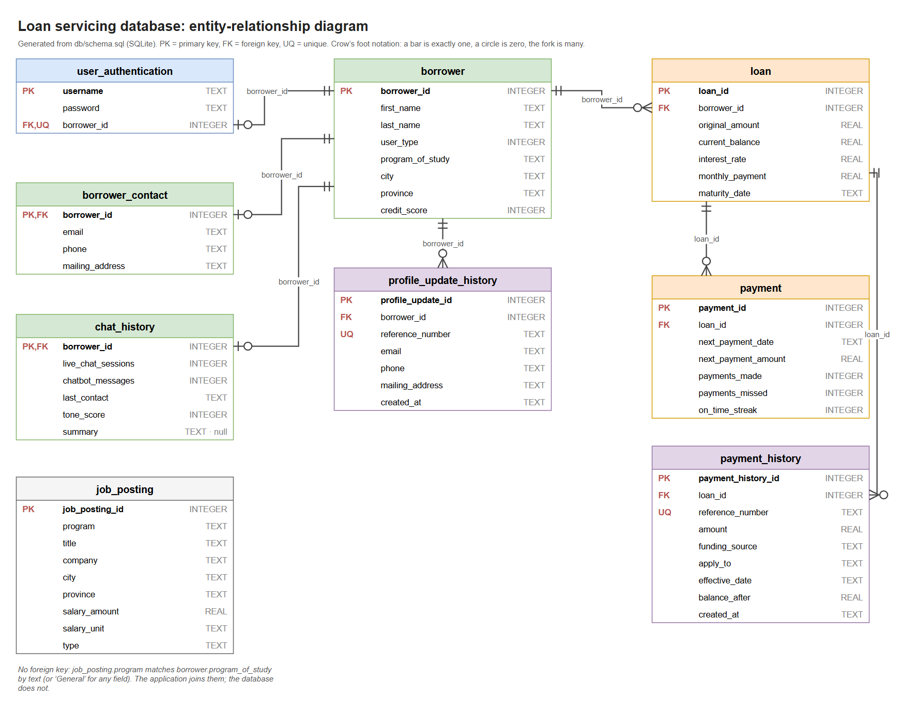
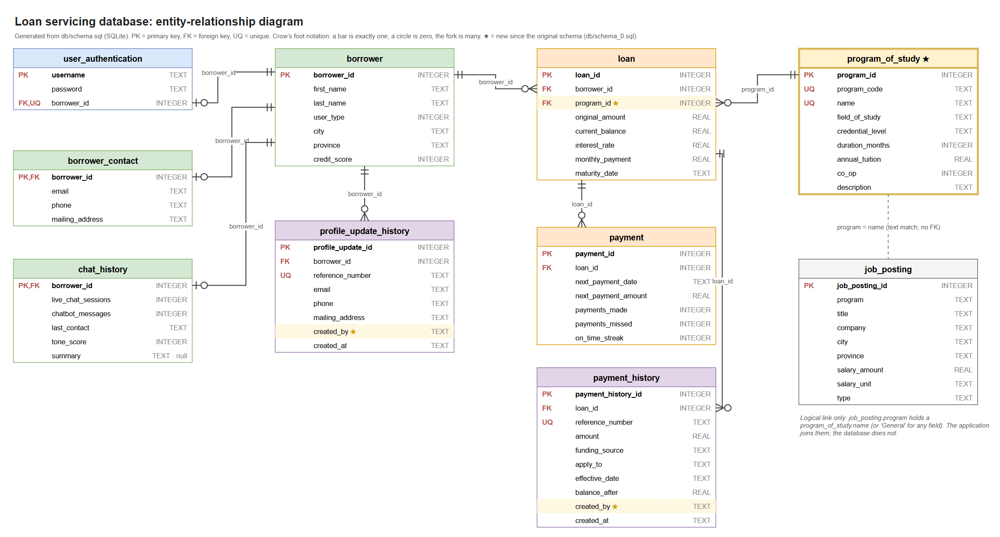
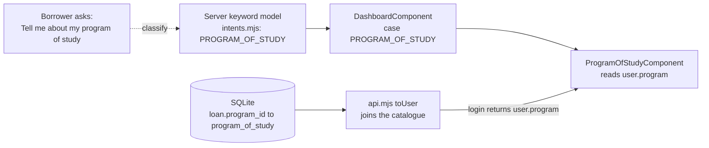
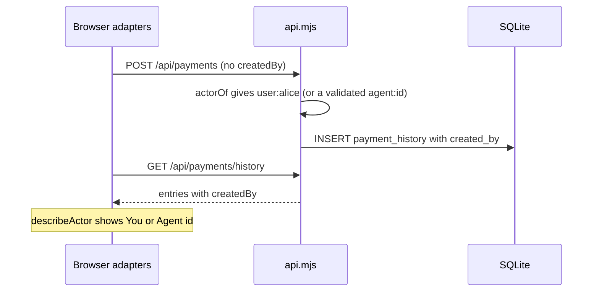

# Change manifest: realigning the architect references

**Folder:** `architect_references/realignment_01/` · **Compared:** the artifacts in `architect_references/original/` against the current code and database (`db/schema.sql`) · **Date:** 2026-10-27

This folder holds regenerated copies of the reference artifacts, under the same names they have in `original/`. Nothing in `original/` was touched. This file records what was compared, what changed, why, and what was left alone.

---

## 1. Summary

| | |
|---|---|
| Artifacts reviewed | **5** (9 files: each diagram as `.drawio` + `.png`, each document as `.md` + `.pdf`, plus one text file) |
| Artifacts with changes | **5 of 5**, so all 9 files were regenerated |
| Edits to the two long documents | **79** (48 in `project_swagger.md`, 31 in `inquiry_scenario_end_to_end.md`) |
| Caused by the new feature work | **30** (program of study, `created_by`, the new answer card) |
| Corrections of statements that were **already wrong** in the originals | **50** |
| Line citations that moved or were repaired | **12** of 15 in the scenario document |

> **The point to take from the numbers:** the new feature work accounts for just under two-fifths of the edits. The rest correct statements that the original documents already got wrong against the committed code, mostly in how the services are wired and in the line citations. A regeneration that only added the new feature would have left those in place.

(`both` = one edit that fixes a new-feature change and an older inaccuracy together; it is counted in both rows.)

---

## 2. What changed in the system

### 2.1 Code and database

| Area | Change |
|---|---|
| **Database** | New table `program_of_study` (catalogue, 6 programs). `loan.program_id` is a required foreign key to it. The free-text `borrower.program_of_study` column is gone. `payment_history` and `profile_update_history` gain `created_by` (must look like `user:<name>` or `agent:<id>`). The previous schema is kept as `db/schema_0.sql`. |
| **API** (`server/api.mjs`) | The user query joins the catalogue and returns a `program` object. Payment and profile writes accept an optional `createdBy` (default `user:<username>`; a malformed value is `400`). Both history endpoints return `createdBy`. |
| **Keyword model** | New `PROGRAM_OF_STUDY` intent and 8 regression cases. |
| **Core** | `ProgramOfStudy` type and `User.program`; `createdBy` on both history entry types; new `actor.utility.ts` (`describeActor`); `InquiryCategory` grows from 10 to **11** topics; the welcome screen offers a third fixed question. |
| **UI** | New `ProgramOfStudyComponent` card; the loan balance card shows the program; the payment and profile history cards show **Recorded by** (You, or Agent plus id). |
| **Folders** | `references/` is now `architect_references/`, with `original/` and `realignment_01/`. |

### 2.2 The database, before and after

| Before (`schema_0.sql`, from `original/`) | After (`schema.sql`, regenerated) |
|---|---|
|  |  |

In the new diagram a star marks what is new: the `program_of_study` table, `loan.program_id`, and the two `created_by` columns. The dashed line is the one relationship the database does not enforce: `job_posting.program` still matches a program name by text.

### 2.3 How the new pieces connect

> `created_by` records a **claim**, not proof: the API still has no authentication, so a caller can name any agent. It becomes evidence only when the identity comes from a verified session.

---

## 3. Artifact by artifact

| Artifact (same name as in `original/`) | Status | What changed |
|---|---|---|
| `erd-schema.drawio` / `.png` | **Regenerated** | Rebuilt from the current `schema.sql`: 10 tables, 8 foreign keys (was 9 and 7). Adds `program_of_study`, `loan.program_id`, `created_by` on both history tables; new items are starred; `borrower.program_of_study` is gone; the dashed logical link to `job_posting` moved to the catalogue. |
| `hex-architecture.drawio` / `.png` | **Edited** (11 text and layout edits) | New `ProgramOfStudyComponent` box (the UI column is re-spaced from 8 px to 4 px gaps so it still fits); "10 topics" is now 11 and the list gains `PROGRAM_OF_STUDY`; "+ 2 record questions" is now 3 (twice); the domain box lists `ProgramOfStudy` and the actor utility; the SQLite box lists `program_of_study` and `created_by`; the subtitle and star legend are extended. One older error fixed: `tokens.ts` has **16** injection tokens, the diagram said 15. Sketch style and the 1.5x export scale are kept. |
| `project_swagger.md` / `.pdf` | **Edited** (48 edits, 28 for the new work, 19 corrections, 1 both) | New inventory rows and a new `ProgramOfStudy` schema; `User`, both history entry schemas, the determinism table and category descriptions updated; section 4.5 now describes eleven answer cards; the data API is described in section 3. Corrections are listed in section 4 below. The inventory grows from 56 to 60 rows. |
| `inquiry_scenario_end_to_end.md` / `.pdf` | **Edited** (31 edits, 1 for the new work, 30 corrections) | Almost entirely corrections: the `InquiryService` excerpts, the provider recipes, the injector timeline, the confirmation screen and 15 line citations. The one new-work edit records that a profile save now also writes `created_by`. |
| `sample-questions.txt` | **Extended** | New section E with 12 program-of-study questions (66 to 77), each checked against the live keyword model; a note on questions 60 and 61 (see section 6). |

---

## 4. Statements that were already wrong in the originals

These are not caused by the new work. They were found by checking every claim against the code, and they are fixed in the regenerated copies. Grouped by theme (the full list is in the appendix):

### Other statements that no longer matched the code (11)

- **A-01**: The document says the app has no HTTP API and no server; a local data API (server/api.mjs) sits behind the driven adapters.
- **A-06**: There are no in-memory driven adapters; every driven adapter calls the local API or Azure OpenAI.
- **A-19**: NextPaymentComponent renders amount due, due date, regular monthly payment, payments made and a past-due note; it shows no on-time streak.
- **A-20**: LoanBalanceComponent shows balance, original amount, rate, maturity date, % paid and (new) program of study; it does not render months to maturity.
- **C-06**: The regression table holds 74 questions (4 expect none), not ~70.
- **C-07**: Postings are matched on the program name, which is the program catalogue name.
- **D-07**: Edges for the two history components (see D-06).
- **S-01**: The example user has 22 fields (8 shown, so 14 more), not 16.
- **S-10**: The third constructor argument is a plain business-settings value, worth stating beside the port statement.
- **S-25**: The reference alphabet is ABCDEFGHJKMNPQRSTUVWXYZ23456789: I, L, O, 0 and also 1 are removed.
- **S-28**: The confirmation heading and thanks line are fixed template text and the greeting uses user.firstName; res.message is shown only on the failure branch.

### Which BLL services depend on driven ports (4)

- **A-02**: PaymentService and ProfileService take repository ports (and call record/history/save), so the BLL reaches driven ports through three services, not one.
- **A-04**: Payment and Profile services now take a repository port; only LoanInfo and Eligibility take no constructor dependencies, at providers.ts:114 and :120 (the cited 93-96 is the wrong range).
- **A-05**: Only LoanInfoService and EligibilityService are constructed with no dependencies; Payment and Profile take repositories, and some operations (history reads, writes) do reach a driven port.
- **S-02**: Only LoanInfoService and EligibilityService take no dependencies; Authenticate, Payment and Profile services each take a repository.

### Inventory, token and route tables that were incomplete or miscounted (8)

- **A-03**: The BLL has 12 driving operations (getHistory and getUpdateHistory exist), not 10; the diagram label shows 7 and omits 5.
- **A-08**: DeterminismPolicyComponent (src/app/adapters/driving/ui/policy/determinism-policy.component.ts, route /configuration) is a real file missing from the inventory.
- **A-10**: inquiry.policy.ts (the InquiryPolicy contract) is a real file under core/cognitive missing from the inventory.
- **A-13**: There are seven driven adapter classes (three repositories, ApiLanguageModel, AzureAiLanguageModel, ApiKnowledgeBase, ApiChatHistory); five are data-backed.
- **A-15**: Section 3 omits the local data API that is the application real server and the dev-proxy rule that reaches it.
- **A-16**: The app.routes.ts table omits the unguarded /configuration route (DeterminismPolicyComponent), declared before the wildcard.
- **D-06**: PaymentHistoryComponent (PAYMENT port) and ProfileHistoryComponent (PROFILE port) exist and inject ports but were missing from the dependency map.
- **S-29**: Timeline omitted two port keys that are constructed in Step 2: PAYMENT_REPOSITORY_PORT and PROFILE_REPOSITORY_PORT.

### InquiryService now takes the business policy as an injected value (11)

- **A-12**: tokens.ts declares 16 InjectionTokens (including INQUIRY_POLICY_CONFIG), not 15; inquiry.policy.config.ts is also missing from the inventory.
- **C-13**: tokens.ts also defines PAYMENT_REPOSITORY_PORT, PROFILE_REPOSITORY_PORT and the INQUIRY_POLICY_CONFIG value key.
- **C-14**: providers.ts also binds INQUIRY_POLICY_CONFIG as a value.
- **S-03**: hexagonalProviders now has 16 entries (15 port bindings plus the INQUIRY_POLICY_CONFIG value).
- **S-04**: There are 15 port keys to hold instances (the policy is a bound value, not an instance slot).
- **S-08**: InquiryService now takes a third argument, the business policy INQUIRY_POLICY.
- **S-14**: classify() is at inquiry.service.ts:56-74 (file is 84 lines); the candidate list is the instance field matchableCategories, not a MATCHABLE_CATEGORIES constant, built at construction from the injected policy descriptions.
- **S-16**: DETERMINISM_POLICY and CATEGORY_LABEL live in configuration/inquiry.policy.config.ts and are injected into the core as the policy; they are not constants inside the hexagon.
- **S-21**: The INQUIRY_PORT recipe now passes INQUIRY_POLICY as a third constructor argument.
- **S-30**: MATCHABLE_CATEGORIES no longer exists; the argument is this.matchableCategories.
- **S-31**: DETERMINISM_POLICY and CATEGORY_LABEL are injected business settings, not constants in the core.

### Line citations that no longer pointed at the described code (16)

- **S-05**: DashboardComponent injects are at lines 90-93.
- **S-06**: INQUIRY_PORT recipe is at providers.ts:125-133.
- **S-07**: LANGUAGE_MODEL_PORT factory is at providers.ts:89-101.
- **S-09**: Constructor citation pointed past the end of the file; constructor is at lines 44-48 and now has a third parameter, the policy.
- **S-11**: Always-on cards are at html lines 161-164 and the account summary is now wrapped in an @for keyed by the user object.
- **S-12**: ACCOUNT_SUMMARY_PORT recipe is at providers.ts:145-154.
- **S-13**: ask() is at dashboard.component.ts:129-137.
- **S-15**: The decision lines are at inquiry.service.ts:69-73 and read the injected policy (this.policy.determinism / this.policy.labels), not module constants.
- **S-17**: Card placement code is at dashboard.component.ts:148-165.
- **S-18**: The deterministic badge check and switch through the PROFILE_UPDATE case are at html lines 100-126.
- **S-19**: Class declaration of UpdateProfileComponent is at lines 159-161 (the imports remain at 6-7).
- **S-20**: PROFILE_PORT recipe is at providers.ts:115-119.
- **S-22**: currentContact() is at borrower.entity.ts:102-105.
- **S-23**: submit() is at update-profile.component.ts:176-197 and now has a busy guard, try/finally and a guarded setUser.
- **S-24**: applyProfileUpdate() is at borrower.entity.ts:113-146.
- **S-27**: Confirmation template is at update-profile.component.ts:56-81 and shows a receipt (confirmation number, email, phone, mailing address) with fixed headings.

---

## 5. Line citations in the scenario document

`project_swagger.md` had 5 line citations and now has 7 (the new ones point at the `providers.ts` factories that the corrected dependency text refers to). The scenario document has 15. 3 of the originals pointed **past the end of the file** (`inquiry.service.ts` is 84 lines long); the rest had shifted. Every visible label (`file:lines`) now agrees with its `#L` anchor.

| # | File | Original lines | Now | Result |
|---|---|---|---|---|
| 1 | `src/app/configuration/auth.guard.ts` | 9-17 | 9-17 | unchanged |
| 2 | `src/main.ts` | 13-19 | 13-19 | unchanged |
| 3 | `src/app/adapters/driving/ui/dashboard/dashboard.component.ts` | 84-87 | 90-93 | moved |
| 4 | `src/app/core/cognitive/inquiry.service.ts` | 117-121 (past the end of the file, 83 lines) | 44-48 | was broken |
| 5 | `src/app/adapters/driving/ui/dashboard/dashboard.component.html` | 125-126 | 161-164 | moved |
| 6 | `src/app/adapters/driving/ui/dashboard/dashboard.component.ts` | 123-131 | 129-137 | moved |
| 7 | `src/app/core/cognitive/inquiry.service.ts` | 123-140 (past the end of the file, 83 lines) | 56-74 | was broken |
| 8 | `src/app/core/cognitive/inquiry.service.ts` | 135-139 (past the end of the file, 83 lines) | 69-73 | was broken |
| 9 | `src/app/adapters/driving/ui/dashboard/dashboard.component.ts` | 142-159 | 148-165 | moved |
| 10 | `src/app/adapters/driving/ui/dashboard/dashboard.component.html` | 86-116 | 100-126 | moved |
| 11 | `src/app/adapters/driving/ui/inquiry/update-profile.component.ts` | 6-7 | 6-7 | unchanged |
| 12 | `src/app/core/domain/borrower.entity.ts` | 57-63 | 102-105 | moved |
| 13 | `src/app/adapters/driving/ui/inquiry/update-profile.component.ts` | 171-183 | 176-197 | moved |
| 14 | `src/app/core/domain/borrower.entity.ts` | 70-102 | 113-145 | moved |
| 15 | `src/app/adapters/driving/ui/inquiry/update-profile.component.ts` | 53-78 | 56-81 | moved |

---

## 6. Observations and follow-ups (not changed here)

| # | Observation | Suggested action |
|---|---|---|
| 1 | `README.md` still says the component inventory covers "all 56 files". The regenerated document has 60 rows. | Update the README line when the new set replaces `original/`. |
| 2 | The README picture and links still point at `architect_references/original/`. | Repoint them when the regenerated set is adopted. |
| 3 | Questions 60 and 61 in the sample list ask who made a change ("by me or by someone else", "by whom"). The history card now shows that, but the keyword model sends this wording to **PROFILE_UPDATE**, not PROFILE_HISTORY. | Add terms such as "by whom" to the PROFILE_HISTORY intent, with regression cases. This is a code change, so it was not made here. |
| 4 | The `threat_model/` documents still say history rows carry no actor, and cite line numbers in the old `schema.sql` (9 citations). `created_by` exists now, but it is unauthenticated. | Update those references and the threat T5 wording. |
| 5 | The regenerated PDFs are 51 pages (was 53) and 14 pages (was 22). The originals were Chrome prints; these are the same kind of print from the same text, but the page styling is mine, so pagination differs. Content is identical to the `.md` files. | Compare visually if the exact layout matters. |
| 6 | `DeterminismPolicyComponent` (route `/configuration`) was missing from the inventory and the route table; it is added there, but it is still absent from the dependency map in section 11.6. | Add it to the map if you want it complete. |

## 7. How this was checked

- **Baseline.** The originals were written for the committed code (git `HEAD`). The working tree differs from `HEAD` by 17 modified files, 3 new source files and the schema swap (`git diff HEAD`).
- **Line by line.** Four reviewers each took a consecutive part of `project_swagger.md` and one took the whole scenario document. They checked every statement the code can confirm (names, counts, signatures, field lists, tables, sequences, citations) against the **current** code, and returned exact text edits. They changed no repository files.
- **Applying the edits.** Edits are applied by exact position in the original text: each must match exactly once and none may overlap. All 79 applied cleanly.
- **Independent checks after that.** Every relative link resolves; every `#L` anchor lies inside its file; every visible `file:lines` label agrees with its anchor; every in-page heading anchor has a heading; all 8 Mermaid diagrams render. Statements the reviewers could not verify (the Azure adapter prompt rules, the key-header mode, the `maxTokens` default, the `AccountSummaryService` wiring claim, the write transaction) were checked against the code by hand.
- **The question list.** Each new question was run through the real keyword router. One draft ("What program does my loan finance?") matched nothing and was replaced.
- **Diagrams.** The ERD is generated from `db/schema.sql` itself. The architecture diagram was edited in place and exported at the same scale as the original.
- **Not independently re-derived:** the reviewers' "no change needed" judgements on statements they found correct. A second pass over those would be the way to raise confidence further.

---

## Appendix: every edit

Kind: **change** = caused by the new work; **drift** = already wrong in the original; **both** = fixes both at once. The line is the line in the original document.

### `project_swagger.md`

| ID | Kind | Line | What and why |
|---|---|---|---|
| A-01 | drift | 7 | The document says the app has no HTTP API and no server; a local data API (server/api.mjs) sits behind the driven adapters. |
| A-02 | drift | 82 | PaymentService and ProfileService take repository ports (and call record/history/save), so the BLL reaches driven ports through three services, not one. |
| A-03 | drift | 94 | The BLL has 12 driving operations (getHistory and getUpdateHistory exist), not 10; the diagram label shows 7 and omits 5. |
| A-04 | drift | 101 | Payment and Profile services now take a repository port; only LoanInfo and Eligibility take no constructor dependencies, at providers.ts:114 and :120 (the cited 93-96 is the wrong range). |
| A-05 | drift | 174 | Only LoanInfoService and EligibilityService are constructed with no dependencies; Payment and Profile take repositories, and some operations (history reads, writes) do reach a driven port. |
| A-06 | drift | 234 | There are no in-memory driven adapters; every driven adapter calls the local API or Azure OpenAI. |
| A-07 | change | 260 | actor.utility.ts joins the shared kernel, making five types in the grouped row. |
| A-08 | drift | 269 | DeterminismPolicyComponent (src/app/adapters/driving/ui/policy/determinism-policy.component.ts, route /configuration) is a real file missing from the inventory. |
| A-09 | change | 274 | New answer component ProgramOfStudyComponent (program-of-study.component.ts) added to the inventory. |
| A-10 | drift | 304 | inquiry.policy.ts (the InquiryPolicy contract) is a real file under core/cognitive missing from the inventory. |
| A-11 | change | 310 | actor.utility.ts (Actor, parseActor, describeActor) is a new shared-kernel file. |
| A-12 | drift | 316 | tokens.ts declares 16 InjectionTokens (including INQUIRY_POLICY_CONFIG), not 15; inquiry.policy.config.ts is also missing from the inventory. |
| A-13 | drift | 322 | There are seven driven adapter classes (three repositories, ApiLanguageModel, AzureAiLanguageModel, ApiKnowledgeBase, ApiChatHistory); five are data-backed. |
| A-14 | change | 328 | The database now has a program_of_study catalogue (6 programs, referenced by loan.program_id) and created_by on both ledgers. |
| A-15 | drift | 363 | Section 3 omits the local data API that is the application real server and the dev-proxy rule that reaches it. |
| A-16 | drift | 388 | The app.routes.ts table omits the unguarded /configuration route (DeterminismPolicyComponent), declared before the wildcard. |
| A-17 | change | 478 | dashboard.component.html adds @case PROGRAM_OF_STUDY after PROFILE_HISTORY, rendering app-program-of-study; DETERMINISM_POLICY.PROGRAM_OF_STUDY = true. |
| A-18 | change | 490 | There are now eleven answer components, and two of them (GeneralHelp, ProgramOfStudy) inject no port and implement no ngOnInit. |
| A-19 | drift | 497 | NextPaymentComponent renders amount due, due date, regular monthly payment, payments made and a past-due note; it shows no on-time streak. |
| A-20 | both | 498 | LoanBalanceComponent shows balance, original amount, rate, maturity date, % paid and (new) program of study; it does not render months to maturity. |
| A-21 | change | 501 | payment-history.component.ts adds a "Recorded by" column (describeActor of createdBy). |
| A-22 | change | 502 | profile-history.component.ts adds a "Recorded by" line per update; ProgramOfStudyComponent is a new answer component needing a table row. |
| B-01 | change | 724 | PersonalizationService now appends three fixed record look-up questions (payment history, profile update history, program of study), not two. |
| C-01 | change | 861 | The user query now also joins program_of_study and the returned User carries a program object. |
| C-02 | change | 893 | Payment write accepts an optional createdBy (malformed value is 400); history entries carry createdBy. |
| C-03 | change | 899 | Each ledger entry now carries createdBy. |
| C-04 | change | 905 | Profile write accepts optional createdBy. |
| C-05 | change | 910 | Profile history entries now carry createdBy. |
| C-06 | drift | 964 | The regression table holds 74 questions (4 expect none), not ~70. |
| C-07 | drift | 1008 | Postings are matched on the program name, which is the program catalogue name. |
| C-08 | change | 1075 | user.entity.ts now exports ProgramOfStudy and User carries it. |
| C-09 | change | 1077 | payment.entity.ts also exports PaymentApplyTo and applyPayment; entries carry createdBy. |
| C-10 | change | 1078 | borrower.entity.ts also exports the profile-history types and builder; entries carry createdBy. |
| C-11 | change | 1080 | InquiryCategory now has 11 topics including PROGRAM_OF_STUDY. |
| C-12 | change | 1083 | New domain file actor.utility.ts. |
| C-13 | drift | 1152 | tokens.ts also defines PAYMENT_REPOSITORY_PORT, PROFILE_REPOSITORY_PORT and the INQUIRY_POLICY_CONFIG value key. |
| C-14 | drift | 1161 | providers.ts also binds INQUIRY_POLICY_CONFIG as a value. |
| D-06 | drift | 1373 | PaymentHistoryComponent (PAYMENT port) and ProfileHistoryComponent (PROFILE port) exist and inject ports but were missing from the dependency map. |
| D-07 | drift | 1407 | Edges for the two history components (see D-06). |
| D-08 | change | 1416 | ProgramOfStudyComponent injects nothing (only @Input user), like GeneralHelpComponent. |
| D-01 | change | 1425 | The user query now also joins program_of_study (the program catalogue). |
| D-02 | change | 1431 | User gains `program: ProgramOfStudy`; `programOfStudy` is kept and equals program.name. |
| D-03 | change | 1439 | New ProgramOfStudy schema, in the shape of its neighbours, placed right after User. |
| D-04 | change | 1522 | PaymentHistoryEntry gains createdBy, placed between balanceAfter and recordedAt. |
| D-05 | change | 1540 | ProfileUpdateHistoryEntry (via ProfileUpdateEntry) gains createdBy, before recordedAt. |
| D-09 | change | 1675 | InquiryCategory now has 11 values, PROGRAM_OF_STUDY after PROFILE_HISTORY. |
| D-10 | change | 1693 | Determinism policy has PROGRAM_OF_STUDY = true, label 'Program of study'. |
| D-11 | change | 1715 | New category description for PROGRAM_OF_STUDY. |

### `inquiry_scenario_end_to_end.md`

| ID | Kind | Line | What and why |
|---|---|---|---|
| S-01 | drift | 61 | The example user has 22 fields (8 shown, so 14 more), not 16. |
| S-02 | drift | 66 | Only LoanInfoService and EligibilityService take no dependencies; Authenticate, Payment and Profile services each take a repository. |
| S-03 | drift | 80 | hexagonalProviders now has 16 entries (15 port bindings plus the INQUIRY_POLICY_CONFIG value). |
| S-04 | drift | 90 | There are 15 port keys to hold instances (the policy is a bound value, not an instance slot). |
| S-05 | drift | 99 | DashboardComponent injects are at lines 90-93. |
| S-06 | drift | 118 | INQUIRY_PORT recipe is at providers.ts:125-133. |
| S-07 | drift | 122 | LANGUAGE_MODEL_PORT factory is at providers.ts:89-101. |
| S-08 | drift | 136 | InquiryService now takes a third argument, the business policy INQUIRY_POLICY. |
| S-09 | drift | 143 | Constructor citation pointed past the end of the file; constructor is at lines 44-48 and now has a third parameter, the policy. |
| S-10 | drift | 154 | The third constructor argument is a plain business-settings value, worth stating beside the port statement. |
| S-11 | drift | 174 | Always-on cards are at html lines 161-164 and the account summary is now wrapped in an @for keyed by the user object. |
| S-12 | drift | 185 | ACCOUNT_SUMMARY_PORT recipe is at providers.ts:145-154. |
| S-13 | drift | 211 | ask() is at dashboard.component.ts:129-137. |
| S-14 | drift | 234 | classify() is at inquiry.service.ts:56-74 (file is 84 lines); the candidate list is the instance field matchableCategories, not a MATCHABLE_CATEGORIES constant, built at construction from the injected policy descriptions. |
| S-15 | drift | 277 | The decision lines are at inquiry.service.ts:69-73 and read the injected policy (this.policy.determinism / this.policy.labels), not module constants. |
| S-16 | drift | 287 | DETERMINISM_POLICY and CATEGORY_LABEL live in configuration/inquiry.policy.config.ts and are injected into the core as the policy; they are not constants inside the hexagon. |
| S-17 | drift | 305 | Card placement code is at dashboard.component.ts:148-165. |
| S-18 | drift | 334 | The deterministic badge check and switch through the PROFILE_UPDATE case are at html lines 100-126. |
| S-19 | drift | 355 | Class declaration of UpdateProfileComponent is at lines 159-161 (the imports remain at 6-7). |
| S-20 | drift | 371 | PROFILE_PORT recipe is at providers.ts:115-119. |
| S-21 | drift | 381 | The INQUIRY_PORT recipe now passes INQUIRY_POLICY as a third constructor argument. |
| S-22 | drift | 403 | currentContact() is at borrower.entity.ts:102-105. |
| S-23 | drift | 421 | submit() is at update-profile.component.ts:176-197 and now has a busy guard, try/finally and a guarded setUser. |
| S-24 | drift | 445 | applyProfileUpdate() is at borrower.entity.ts:113-146. |
| S-25 | drift | 475 | The reference alphabet is ABCDEFGHJKMNPQRSTUVWXYZ23456789: I, L, O, 0 and also 1 are removed. |
| S-26 | change | 490 | The profile save also records who created the entry: created_by, defaulting to user:<username> (api.mjs actorOf). |
| S-27 | drift | 499 | Confirmation template is at update-profile.component.ts:56-81 and shows a receipt (confirmation number, email, phone, mailing address) with fixed headings. |
| S-28 | drift | 509 | The confirmation heading and thanks line are fixed template text and the greeting uses user.firstName; res.message is shown only on the failure branch. |
| S-29 | drift | 527 | Timeline omitted two port keys that are constructed in Step 2: PAYMENT_REPOSITORY_PORT and PROFILE_REPOSITORY_PORT. |
| S-30 | drift | 563 | MATCHABLE_CATEGORIES no longer exists; the argument is this.matchableCategories. |
| S-31 | drift | 597 | DETERMINISM_POLICY and CATEGORY_LABEL are injected business settings, not constants in the core. |
