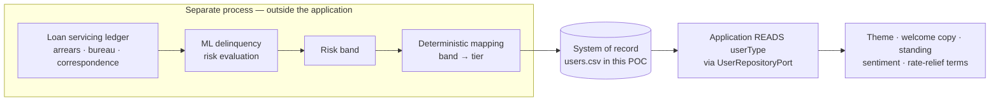
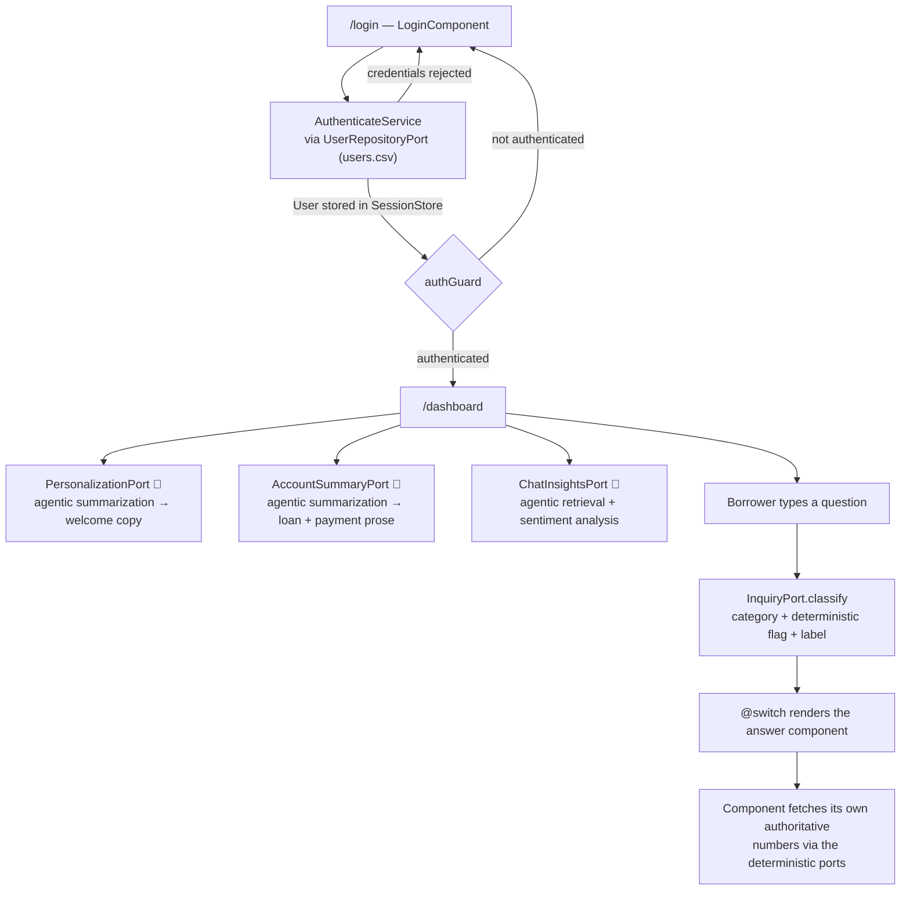
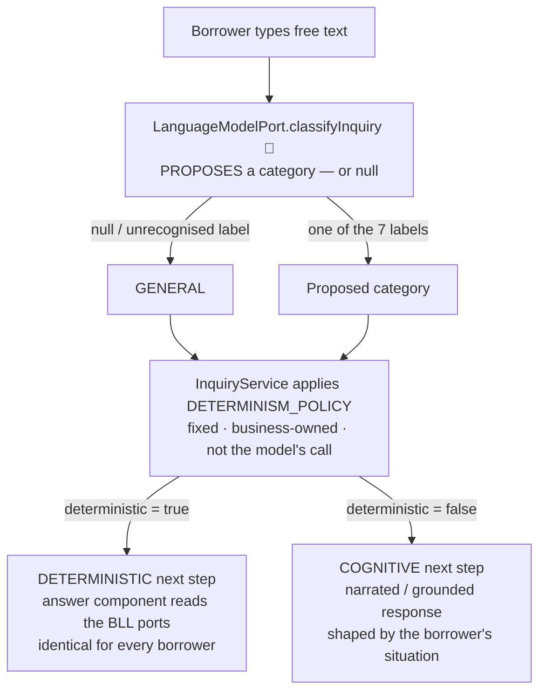

# Application Workflows — Loan Servicing POC

How a borrower moves through the self-service application, and how the three
borrower types differ along the way. The flow described here is identical in all
three architecture variants ([N-Tier](ntier_component_architecture.md),
[Clean](clean_component_architecture.md),
[Hexagonal](hexagonal_component_architecture.md)) — the port and service names
below use the Hexagonal vocabulary.

> **User type is data, not a code path.** It is a column in `assets/users.csv`,
> populated upstream (see below), and the entire application branches on it in
> only **six** places. Everything else — routing, classification, the answer
> components, the money math — is the same for every borrower.

## Where user type comes from

The application never computes the tier and never writes it. `userType` arrives
in the data store **already populated**, produced by an **ML-driven delinquency
risk evaluation that runs as a separate process**, entirely outside the request
path.

That process scores each borrower from their servicing history — payments made
and missed, on-time streak, days past due, balance trajectory, credit bureau
data, and any unstructured evidence such as hardship correspondence — and maps
the resulting risk band onto the three tiers the application understands.

| Risk band | `userType` | Label |
|---|---|---|
| Low | 1 | Excellent Standing |
| Elevated | 2 | Delinquency Grade 1 |
| High | 3 | Delinquency Grade 2 |

### Why it is a separate process

- **Cadence.** The tier changes on ledger events — a payment posting or being
  missed — not on page load. Recomputing per request would be work no one asked
  for.
- **Consistency.** Every read within a session must see one tier. A value
  recomputed per call could flip mid-session and change what the borrower is
  told.
- **Auditability.** The tier gates money, so the decision needs to be recorded
  and replayable — value, model version, inputs, effective date — rather than
  regenerated on the fly.
- **No write path by design.** The application reaches its system of record
  through a **read-only** port (`UserRepositoryPort` exposes only `getUsers` and
  `findByCredentials`). Nothing in the app can write the column, which is what
  keeps the scoring pipeline authoritative.

### What the model decides — and what it does not

The risk evaluation produces a **score and a band**. The mapping from band to
tier, and everything the tier then gates, stay deterministic:
`checkRateReliefEligibility` reads `userType` to select the rate reduction
(0.75% / 0.5% / 0.35%) and to apply the `paymentsMade >= 6` gate, and those rules
live in the core. The model's output enters the system as *data on a record*,
never as a live participant in a decision — the same "CLL proposes, BLL disposes"
boundary the application applies internally, drawn one system further out.

> **Not implemented in this repository.** The scoring pipeline is upstream
> context, not POC code. `users.csv` is hand-authored and stands in for that
> process's output, which is why the six demo borrowers have tiers that are
> stable and repeatable. See [Known gaps before demoing](#known-gaps-before-demoing)
> for the consequences of that fixed data.

## The path every user takes

1. **Login** — `/login`. Credentials are checked by `AuthenticateService` against
   `UserRepositoryPort`, which parses `assets/users.csv`. The resulting `User`
   lands in `SessionStore`.
2. **Guard** — `authGuard` admits `/dashboard` only if a borrower is
   authenticated; otherwise it redirects to login.
3. **Dashboard init** — three cognitive driving ports fire, and **all three are
   AI-backed**: `PersonalizationPort` (welcome copy + theme),
   `AccountSummaryPort` (loan and payment narration), and `ChatInsightsPort`
   (conversation retrieval + sentiment). See
   [AI in the cognitive ports](#ai-in-the-cognitive-ports).
4. **Ask** — free text goes to `InquiryPort.classify`, which returns a category,
   the fixed `deterministic` flag, and a display label.
5. **Render** — the dashboard's `@switch` selects the matching answer component.
6. **Answer** — that component fetches its own authoritative values through the
   deterministic driving ports. The cognitive region never computes them.

## AI in the cognitive ports

All three cognitive driving ports are AI-backed. They differ in *which* AI
technique they use and in what each one is permitted to influence.

| Port | AI technique | Produces | Stays deterministic |
|---|---|---|---|
| `PersonalizationPort` | Agentic AI — summarization | Greeting, invitation question, 3 suggested prompts | Theme class (`theme-1/2/3`) |
| `AccountSummaryPort` | Agentic AI — summarization | Loan sentence, payments sentence | Every figure, and the standing label |
| `ChatInsightsPort` | Agentic AI — retrieval, plus **sentiment analysis** | Conversation recap, tone score, supportive blurb | Sentiment bands, counts, and the fact the reading is advisory only |

### `PersonalizationPort` — agentic summarization

`PersonalizationService` calls `composeWelcome(user)` on `LanguageModelPort`. The
agent receives the borrower's first name and standing tier and returns a
structured welcome panel — greeting, invitation question, and three suggested
prompts — summarized to the tone the tier warrants.

The **theme policy stays in the core**: the service stamps
`theme-${user.userType}` onto the result itself. The agent is also explicitly
barred from stating or implying an amount, rate, date or eligibility outcome,
because it has none of those facts.

### `AccountSummaryPort` — agentic summarization over computed facts

`AccountSummaryService` resolves the authoritative values **first**, through the
deterministic driving ports (`ProfilePort`, `LoanInfoPort`, `PaymentPort`), then
issues two narration calls concurrently via `Promise.all`: `narrateLoan` and
`narratePayments`.

The ordering is the whole point. The agent summarizes a finished fact set; it
never receives a computation to perform. The shared narration guardrail forbids
inventing, recomputing or re-rounding any number, date, rate or amount — and the
card renders its figures from the authoritative values returned alongside the
prose, not from the sentence, so a hallucinated number could not reach a stat
tile even if one were produced.

### `ChatInsightsPort` — agentic retrieval plus sentiment analysis

This port uses AI twice, for two different jobs:

1. **Agentic retrieval.** An agent gathers the borrower's conversation history
   across both channels — **live chat and chatbot** — behind `ChatHistoryPort`,
   returning session counts, last contact, and a consolidated recap of what was
   discussed. This is grounding: the port is a read-only source, never a system
   of record.
2. **Sentiment analysis.** The retrieved conversations are scored into a raw
   0–100 tone signal.

`ChatInsightsService` then applies the **business-owned bands** — 80+ very
positive, 60+ positive, 45+ neutral, 25+ negative, below that very negative — to
turn the score into a label, emoji and severity tone, and asks the model for a
supportive blurb *for the band it has already chosen*. The model never selects
the band and cannot dispute or re-score it.

Critically, the sentiment reading is a **signal for the UI, never an input to a
decision**: nothing in the deterministic region reads it, and no money or
eligibility outcome may depend on it.

> **Implementation status.** The seams are real and the ports are async, so any
> of these can be served by a live model — `LanguageModelPort` is bound to Azure
> OpenAI in `proxy`/`directKey` mode. What ships in the repo is narrower than the
> design above: `InMemoryChatHistory` is a synthetic stand-in rather than a
> retrieval agent over real chat systems, its tone score is a formula rather than
> a sentiment model, and the live-model calls are single completions rather than
> multi-step agent runs. Swapping any of them is a composition-root change in
> `providers.ts`.

## From question to next step

When a borrower types a question, the answer is chosen in **three stages**, and
the split between them is the single most important boundary in the application:
AI proposes *what the question is about*, and fixed business policy decides
*what kind of answer that earns*.

1. **Analyze (AI).** `classifyInquiry(text)` asks the model to pick exactly one
   of seven labels, or reply `NONE`. The reply is normalised and matched against
   the allow-list; anything unrecognised becomes `null` — a genuine "no opinion"
   rather than a guess.
2. **Decide (business policy).** `InquiryService` turns `null` into `GENERAL`,
   then looks the category up in `DETERMINISM_POLICY` — a fixed map owned by the
   business — and attaches the `deterministic` flag and a display label.
3. **Render.** The dashboard's `@switch` selects the answer component, and the
   badge reads *"Standard response · same for all borrowers"* or *"Personalized
   for your account"* straight off that flag.

### The policy map

| Category | `deterministic` | Next step |
|---|---|---|
| `NEXT_PAYMENT` | ✅ true | `NextPaymentComponent` — figures from `PaymentPort` |
| `LOAN_BALANCE` | ✅ true | `LoanBalanceComponent` — figures from `LoanInfoPort` |
| `EXTRA_PAYMENT` | ✅ true | `MakePaymentComponent` — validation + money math in `PaymentPort` |
| `PROFILE_UPDATE` | ✅ true | `UpdateProfileComponent` — validation in `ProfilePort` |
| `HARDSHIP` | ⬜ false | `JobOpportunitiesComponent` — grounded job postings via `KnowledgeBasePort` |
| `LIFE_EVENT` | ⬜ false | `InterestReliefComponent` — outcome decided by `EligibilityPort` |
| `GENERAL` | ⬜ false | `GeneralHelpComponent` — grounded via `KnowledgeBasePort` |

### Worked examples

**"What's the balance of my loan and when's the maturity date?"**
→ proposed `LOAN_BALANCE` → **deterministic**. The balance, rate, paid-off
percentage and maturity date all come from `LoanInfoPort`. Two different
borrowers see different *numbers* but the identical *component and layout* — the
AI contributed the routing decision and nothing else.

**"I just moved and need to update my mailing address."**
→ proposed `PROFILE_UPDATE` → **deterministic**. The update form and its
validation rules live in `ProfilePort` / `borrower.entity`. The AI recognised
"I just moved" as an address change; it has no say in what counts as a valid
address or what reference number the confirmation carries.

**"I'd like to put an extra payment toward my loan balance."**
→ proposed `EXTRA_PAYMENT` → **deterministic**. Note the trap: the sentence
contains the word *balance*, so a naïve match would route it to
`LOAN_BALANCE`. Both classifiers guard against it — the mock rules check
`EXTRA_PAYMENT` first, and the Azure prompt states the tiebreak explicitly. The
borrower wants to *pay*, not to *ask*.

**"I may not be able to make payments for the time being as I lost my job."**
→ proposed `HARDSHIP` → **cognitive**. The badge switches to *"Personalized for
your account"* and `JobOpportunitiesComponent` renders: the hardship messaging
adapts to the borrower's tier, and the job postings are matched to their program
of study and location through `KnowledgeBasePort`. Nothing here is authoritative
— it is grounding plus tone.

**"Can you help me find work in my field?"**
→ no label matches, model returns `NONE` → `null` → `GENERAL` → **cognitive**.
The general help card grounds its answer in `KnowledgeBasePort`, looking up
postings by the borrower's program of study and location. A no-match is a normal
outcome, not an error.

### The guarantee

The model chooses the *topic*. It cannot choose the *treatment*. Even a
completely wrong proposal cannot promote a cognitive topic into the deterministic
set or demote a deterministic one out of it, because `DETERMINISM_POLICY` is a
constant in the core that the model never sees and cannot write to.

The practical consequence: a misclassification shows the borrower the **wrong
screen**, which is visible and recoverable — they simply ask again. It can never
cause an authoritative figure to be computed by AI, because the deterministic
components fetch their own numbers from the BLL ports regardless of how they were
routed there. That is the "CLL proposes, BLL disposes" rule doing its actual job.

## Where user type branches

| # | Where | Effect |
|---|---|---|
| 1 | `USER_TYPE_LABEL` | Topbar pill text and colour |
| 2 | `standing()` in `borrower.entity` | Standing label, tone and summary on the Account Summary card |
| 3 | `PersonalizationService` | `theme-1` / `theme-2` / `theme-3` CSS class on the whole shell |
| 4 | `composeWelcome` (mock rules, or the Azure prompt's "Standing tier") | Greeting, question, three suggested prompts |
| 5 | `InMemoryChatHistory` | Tone score, session counts, recap length |
| 6 | `checkRateReliefEligibility` | Rate reduction and the eligibility gate |

## Type 1 — Excellent Standing

*Demo accounts: `alice`, `grace`*

Green theme, `tone: 'good'`. The welcome is celebratory — *"you're in excellent
standing! 🎉"* — with forward-looking suggestions such as a lower rate or loyalty
rewards. Chat history returns 6 live sessions and roughly 40 chatbot messages,
with a tone score of `min(96, 86 + streak/12)` → **91, "Very positive"**, and a
long, engaged recap. `isPastDue` is false, because the next payment equals the
regular monthly amount. Rate relief applies a **0.75%** reduction and the tier is
always eligible.

## Type 2 — Delinquency Grade 1

*Demo accounts: `bob`, `henry`*

Amber theme, `tone: 'warn'`. The welcome is neutral and supportive — *"good to
see you"* — and the suggestions include *"I may miss a few payments — what are my
options?"*. The standing summary explicitly reassures the borrower they are *"not
in serious trouble"*. Chat history returns 2 live sessions with a tone score of
`max(28, 42 − 2 × missed)` → **36–38, "Negative"**, and a brief, slightly tense
recap. Not past due. Rate relief applies a **0.5%** reduction and the tier is
always eligible.

## Type 3 — Delinquency Grade 2

*Demo accounts: `carol`, `irene`*

Red theme, `tone: 'bad'`. The welcome leads with empathy — *"we understand things
can get tough"* — and the suggestions surface hardship and rate relief first.

This is the only tier where `isPastDue` is true, because `nextPaymentAmount >
monthlyPayment` (Carol: 637.80 against a 318.90 monthly), so the payment
narration names the past-due portion explicitly. Chat history returns a tone
score of `max(8, 20 − missed)` → **11–13, "Very negative"**. Rate relief applies
a **0.35%** reduction, and this is the only tier with an eligibility gate:
`paymentsMade >= 6`.

`irene` is a distinct sub-case. With 9 missed payments she trips the `noHistory`
branch, which yields 0 live sessions and a `null` summary — so her Conversation
Insights card renders the *"not enough recent conversation to summarize yet"*
empty state.

### At a glance

| | Type 1 | Type 2 | Type 3 |
|---|---|---|---|
| Label | Excellent Standing | Delinquency Grade 1 | Delinquency Grade 2 |
| Standing tone / theme | `good` / green | `warn` / amber | `bad` / red |
| Demo accounts | `alice`, `grace` | `bob`, `henry` | `carol`, `irene` |
| Tone score | `min(96, 86 + streak/12)` | `max(28, 42 − 2 × missed)` | `max(8, 20 − missed)` |
| Observed score | 91 | 36–38 | 11–13 |
| Sentiment band | Very positive | Negative | Very negative |
| Live chat sessions | 6 | 2 | 1 (0 when ≥ 9 missed) |
| Past due | No | No | **Yes** |
| Rate reduction | 0.75% | 0.50% | 0.35% |
| Eligibility gate | none | none | `paymentsMade >= 6` |

## Known gaps before demoing

- **The rate-relief denial path is unreachable.** The gate is
  `userType !== 3 || paymentsMade >= 6`, but Carol has 11 payments made and Irene
  8 — both pass. The *"your account is currently past due; clearing the balance
  unlocks eligibility"* message cannot be triggered by any shipped account.
  Showing it would require a type-3 row with fewer than 6 payments made.
- **Two of the five sentiment bands never appear.** Observed scores cluster at
  91, 36–38 and 11–13, so "Positive" (60–79) and "Neutral" (45–59) are never
  rendered. The meter only ever shows very positive, negative, or very negative.
- ~~`HARDSHIP` and `LIFE_EVENT` have no dedicated answer component.~~
  **Fixed.** Both now render `JobOpportunitiesComponent` and
  `InterestReliefComponent` respectively, in the Hexagonal and Clean POCs alike —
  matching the N-Tier original, which had them all along.
