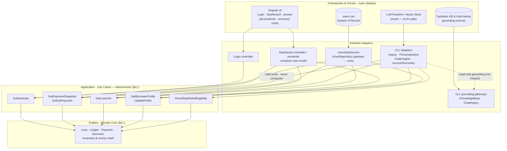

# Component Diagram — Clean Architecture

This diagram shows the **same POC** as [ntier_component_diagram.md](ntier_component_diagram.md), but re-expressed in **Robert C. "Uncle Bob" Martin's Clean Architecture** — concentric rings governed by the **Dependency Rule**: source-code dependencies point **inward only**. The deterministic **BLL** *is* the inner core (Entities + Use Cases); the cognitive **CLL** is just another **outer-ring detail** — a plug-in adapter, exactly like the database or the UI. Instead of a runtime *Determinism Gate*, the boundary is enforced **structurally, at compile time**, by the direction of dependencies. See [The Dependency Rule](#the-dependency-rule) below for detail.

## Components (by ring, outer → inner)

### Frameworks & Drivers (outermost — replaceable details)
- **Angular runtime & UI components** — `AppComponent`/Router, `LoginComponent`, `DashboardComponent`, the inquiry-answer components (NextPayment, LoanBalance, MakePayment, UpdateProfile, JobOpportunities, InterestRelief, GeneralHelp), the personalized components, and the shared **AccountSummary** / **ChatInsights** cards. The delivery mechanism.
- **LLM runtime / vector store** — where a real cognitive model would run (mock in this POC; no AI calls). Drives the CLL adapter.
- **users.csv** — the System of Record (one row per user).
- **Synthetic Knowledge Base & chat history** — job catalog, rate-relief rules, and Live Chat/Chatbot transcripts (grounding sources).

### Interface Adapters (controllers · presenters · gateways · the CLL adapter)
- **Dashboard controller/presenter** — turns UI intent into use-case calls and formats the resulting view model (the composition logic).
- **Login controller** — adapts the login form to the Authenticate use case.
- **CLL adapters** *(cognitive "details")* — `InquiryService` (classify intent, narrate), `PersonalizationService` (tone/theme), `ChatInsightsService` (summarize + sentiment), `AccountSummaryService` (narrate the aggregated facts). Each **consumes use-case ports** and provides an insight/presentation port.
- **Repository gateway (core)** — `UserDataService` implementing the `UserRepository` port (CSV read/parse) that the deterministic use cases depend on.
- **CLL grounding gateways** — read-only **KnowledgeBase** and **ChatHistory** gateways consumed by the **CLL adapters** (`InquiryService` / `ChatInsightsService`). Grounding only — never a system of record, and never wired into the use cases or entities.

### Application — Use Cases / Interactors (deterministic; define the ports)
- **Authenticate** — verify credentials.
- **GetPaymentSnapshot / SubmitPayment** — money math, validation, reference numbers.
- **GetLoanInfo** — balances, rate, maturity, paid %.
- **GetBorrowerProfile / UpdateProfile** — profile, standing, contact updates.
- **CheckRateReliefEligibility** — deterministic eligibility outcome.

### Entities — Domain Core (enterprise business rules)
- **Loan · Ledger · Payment · Borrower** — the invariants and **money math** that must always hold, independent of any framework, database, or AI.

## Interactions

- **Login & guarding:** `LoginComponent` (framework) calls the **Login controller**, which invokes the **Authenticate** use case; Authenticate reads through the `UserRepository` gateway (`UserDataService`) backed by `users.csv`. Route guarding is a framework concern in the outer ring.
- **Composition (CLL proposes, core disposes):** `DashboardComponent` hands intent to the **Dashboard controller**; the **CLL adapter** (`InquiryService`) *proposes* a category and component set, but the controller obtains every authoritative value by invoking the **deterministic use cases** through their ports. The presenter formats a view model — the CLL never computes it.
- **Authoritative actions:** `MakePayment → SubmitPayment` use case → `Payment` entity money math; `UpdateProfile → UpdateProfile` use case → `Borrower` entity. The UI reaches these only through ports.
- **Narrated summary (CLL over core):** `AccountSummaryService` (CLL adapter) calls the **GetBorrowerProfile**, **GetLoanInfo**, and **GetPaymentSnapshot** ports and *narrates* the result; it aggregates and phrases, but the numbers originate in the use cases/entities.
- **Chat insights:** `ChatInsightsService` (CLL adapter) reads the **ChatHistory** gateway read-only and produces a summary + sentiment — a pure outer-ring detail.
- **Grounding (CLL-owned):** `InquiryService` and `ChatInsightsService` read the **KnowledgeBase** / **ChatHistory** gateways for grounding only. These gateways belong to the **CLL adapters**, not the deterministic core — they feed narration/classification and never flow inward to the use cases or entities.

## The Dependency Rule

### What it is

The **Dependency Rule** is Clean Architecture's core constraint and the structural equivalent of the N-Tier version's *Determinism Gate*: **all source-code dependencies point inward**, toward higher-level policy. Each ring may name only the ring inside it; nothing inner may name anything outer.

- **Inner rings** (Entities, Use Cases) = the deterministic **BLL** — the authoritative money math, eligibility, and status logic.
- **Outer rings** (Adapters, Frameworks) = replaceable **details** — the UI, the database… **and the CLL**.

### What it does

It makes "the AI can't decide anything authoritative" a **compile-time fact**, not a runtime hope. Reading the edges in the diagram, every arrow points inward:

- `UI` → controllers, `LLM runtime` → **CLL adapter**, `users.csv` → repository: the frameworks depend on the adapters.
- controllers / **CLL adapter** / repositories → **Use Cases**: the adapter *consumes the use-case ports*, never the reverse.
- Use Cases → **Entities**: application rules depend on enterprise rules.

Because the **CLL Adapter depends on the use-case ports** (and not the reverse), the AI is **non-load-bearing by construction**: it has no path to the ledger except through a deterministic port.

### In plain terms

The **domain core has no knowledge that an AI exists.** The CLL is a plug-in on the outer ring, just like the DB or the UI — it may *call* a port and *phrase* the result, but it structurally **cannot** compute a balance, a payment, or an eligibility decision. **Delete the CLL adapter and every balance, payment, and eligibility still computes correctly.** That is the Dependency Rule doing the same job the Determinism Gate does at runtime — but enforced by the compiler and the direction of the arrows.

> **Dependency Rule in action:** every arrow points inward. The **CLL Adapter depends on the use-case ports**, never the reverse — the domain core has *no knowledge that an AI exists*. Delete the CLL adapter and the platform still computes every balance, payment, and eligibility correctly. This is the compile-time counterpart of the N-Tier **Determinism Gate**; compare with [ntier_component_diagram.md](ntier_component_diagram.md).
