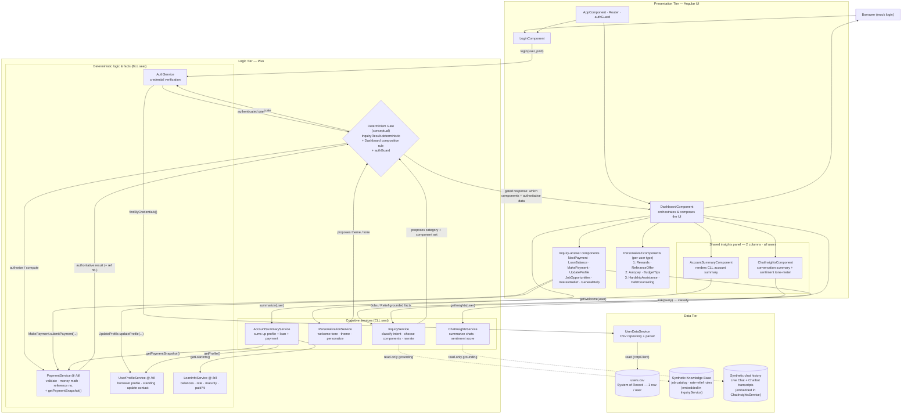

# Component Diagram

This diagram shows the POC as a three-tier system in the **Plus** architecture, where the Logic Tier is split into two "seats": a **CLL seat** (cognitive/AI services that *propose*) and a **BLL seat** (deterministic services that *compute authoritative facts*). A conceptual **Determinism Gate** separates them so the AI layer never decides anything authoritative. See [The Determinism Gate](#the-determinism-gate) below for detail on the gate itself.

## Components

### Presentation Tier — Angular UI
- **AppComponent · Router · authGuard** — application shell; routes between login and dashboard and guards protected routes.
- **LoginComponent** — collects credentials and initiates authentication.
- **DashboardComponent** — the orchestrator; composes the UI by choosing which answer and personalized components to render.
- **Shared insights panel** (all users, 2 columns):
  - **AccountSummaryComponent** — renders the CLL-narrated account summary.
  - **ChatInsightsComponent** — conversation summary plus a sentiment tone-meter.
- **Inquiry-answer components** — NextPayment, LoanBalance, MakePayment, UpdateProfile, JobOpportunities, InterestRelief, GeneralHelp.
- **Personalized components** (per user type) — e.g. Rewards/RefinanceOffer, Autopay/BudgetTips, HardshipAssistance/DebtCounseling.

### Logic Tier — Plus
- **CLL seat (cognitive)** — propose, narrate, personalize; never authoritative:
  - **InquiryService** — classifies intent, chooses components, narrates answers.
  - **PersonalizationService** — welcome tone, theme, personalization.
  - **ChatInsightsService** — summarizes chats and scores sentiment.
  - **AccountSummaryService** — aggregates the deterministic BLL fact collectors into a summary.
- **Determinism Gate** *(conceptual)* — the trust boundary: `InquiryResult.deterministic` + Dashboard composition rule + `authGuard`.
- **BLL seat (deterministic)** — authoritative computation and facts:
  - **PaymentService** `@ /bll` — validation, money math, reference numbers, `getPaymentSnapshot()`.
  - **AuthService** — credential verification.
  - **UserProfileService** `@ /bll` — borrower profile, standing, contact updates.
  - **LoanInfoService** `@ /bll` — balances, rate, maturity, paid %.

### Data Tier
- **UserDataService** — CSV repository and parser.
- **users.csv** — the System of Record (one row per user).
- **Synthetic Knowledge Base** — job catalog and rate-relief rules (embedded in InquiryService).
- **Synthetic chat history** — Live Chat and Chatbot transcripts (embedded in ChatInsightsService).

## Interactions

- **Login & guarding:** the borrower reaches `LoginComponent`, which calls `AuthService.login(...)`; `AuthService` verifies credentials via `UserDataService`, which reads `users.csv`. The `authGuard` protects the dashboard route.
- **Composition through the gate:** `DashboardComponent` asks `InquiryService` to classify a query and asks `PersonalizationService` for the welcome tone. Both *propose* to the Determinism Gate, which authorizes/computes against the BLL services and returns a **gated response** — which components to show plus authoritative data — back to the Dashboard.
- **Authoritative actions:** answer components call the BLL directly for anything that matters — `MakePayment → PaymentService.submitPayment(...)` and `UpdateProfile → UserProfileService.updateProfile(...)`.
- **Narrated summary (CLL over BLL):** `AccountSummaryComponent` calls `AccountSummaryService.summarize(user)`, which aggregates read-only facts from `UserProfileService.getProfile()`, `LoanInfoService.getLoanInfo()`, and `PaymentService.getPaymentSnapshot()`. The CLL narrates these facts but never decides them.
- **Chat insights:** `ChatInsightsComponent` calls `ChatInsightsService.getInsights(user)`, grounded read-only on the synthetic chat history.
- **Grounding:** `InquiryService` and `ChatInsightsService` read (dashed edges) their embedded knowledge base and chat history for grounding only — never as a system of record.

## The Determinism Gate

### What it is

The **Determinism Gate** (the `GATE` node in the diagram below) is a **conceptual control point** sitting in the Logic Tier *between* the two "seats" of the Plus architecture:

- **CLL seat** (Cognitive) — `InquiryService`, `PersonalizationService`, etc. These *propose* things: what category a query is, which UI components to show, what tone/theme to use.
- **BLL seat** (Deterministic) — `PaymentService`, `AuthService`, `UserProfileService`, `LoanInfoService`. These *compute authoritative facts*: money math, credential checks, balances.

The gate is defined as three things combined:
> `InquiryResult.deterministic` + Dashboard composition rule + `authGuard`

### What it does

It's the boundary that ensures the **cognitive/AI layer never decides anything authoritative** — it can only suggest. Reading the edges in the diagram:

- `IS` and `PS` → GATE: the AI services *"propose category + component set"* and *"propose theme/tone"*.
- GATE → `PAY` / `AUTH`: the gate then *"authorize / compute"* and *"authenticate"* against the deterministic BLL services.
- `PAY` / `AUTH` → GATE: those return the *"authoritative result (+ ref no.)"* and the *"authenticated user"*.
- GATE → `DASH`: it emits the *"gated response: which components + authoritative data"* to the Dashboard.

### In plain terms

It's the **trust boundary / gatekeeper**: the LLM-driven side proposes *what to show and how to phrase it*, but every value that actually matters (payments, auth, balances) must pass through the gate to be computed or verified by deterministic code before it reaches the UI. The philosophy: *"the CLL narrates, it never decides."*

It's marked **"(conceptual)"** because it isn't a single class in the codebase — it's an emergent rule enforced by three real mechanisms: the `InquiryResult.deterministic` flag, the Dashboard's composition logic, and the `authGuard`.

