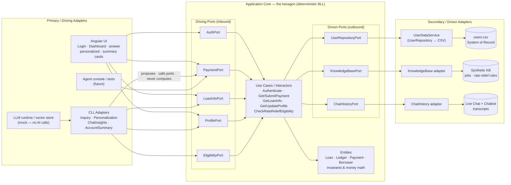

# Component Diagram — Hexagonal Architecture (Ports & Adapters)

This diagram shows the **same POC** as [ntier_component_diagram.md](ntier_component_diagram.md) and [clean_component_architecture.md](clean_component_architecture.md), re-expressed in **Alistair Cockburn's Hexagonal (Ports & Adapters) Architecture**. A **technology-agnostic application core** sits in the middle; everything outside plugs in through **ports** (interfaces) via **adapters**. There are two symmetric sides: **driving (primary)** adapters that *drive* the core, and **driven (secondary)** adapters that the core *drives*. The deterministic **BLL** is the core; the cognitive **CLL** is **just another driving adapter** — swappable like the UI or a test harness. Instead of a runtime *Determinism Gate* or a compile-time *Dependency Rule*, the boundary here is the **port**: nothing reaches the domain except through one.

## Components (by hexagonal role)

### Primary / Driving side — adapters that *drive* the core
- **Angular UI** — `LoginComponent`, `DashboardComponent`, the inquiry-answer components, the personalized components, and the shared **AccountSummary** / **ChatInsights** cards. The human-facing driver.
- **CLL adapters** *(cognitive drivers)* — `InquiryService`, `PersonalizationService`, `ChatInsightsService`, `AccountSummaryService`, powered by an **LLM runtime / vector store** (mock in this POC). They drive the core through the **same driving ports** as the UI.
- **Servicing-agent console & automated tests** *(future / dev)* — additional primary adapters that drive the identical ports.

### Driving Ports (inbound — the interfaces the core exposes)
- **AuthPort · PaymentPort · LoanInfoPort · ProfilePort · EligibilityPort** — the use-case interfaces any driver calls. These are the *only* way in.

### Application Core (the hexagon) — deterministic BLL
- **Use Cases / Interactors** — Authenticate; GetPaymentSnapshot / SubmitPayment; GetLoanInfo; GetBorrowerProfile / UpdateProfile; CheckRateReliefEligibility.
- **Entities** — `Loan · Ledger · Payment · Borrower`: the invariants and **money math**. The core names only ports — never a framework, a UI, a DB, or an LLM.

### Driven Ports (outbound — the interfaces the core requires)
- **UserRepositoryPort · KnowledgeBasePort · ChatHistoryPort** — what the core needs from the outside world, expressed as interfaces it owns.

### Secondary / Driven side — adapters the core *drives*
- **UserDataService** (CSV repository) → `users.csv` — implements `UserRepositoryPort`.
- **KnowledgeBase adapter** → synthetic job/rate-relief catalog — implements `KnowledgeBasePort`.
- **ChatHistory adapter** → Live Chat/Chatbot transcripts — implements `ChatHistoryPort`.

## Interactions

- **Login & guarding:** the **UI** (primary adapter) calls **`AuthPort`**, driving the **Authenticate** use case, which reads through **`UserRepositoryPort`** → `UserDataService` → `users.csv`.
- **Composition (CLL proposes, core disposes):** both the **UI** and the **CLL adapter** are drivers; the CLL *proposes* a category/component set, but obtains every authoritative value by calling **`PaymentPort` / `LoanInfoPort` / `ProfilePort`**. It drives the core through the same doors as the UI — no privileged path.
- **Authoritative actions:** `MakePayment → PaymentPort.submitPayment(...)` → `Payment` entity money math; `UpdateProfile → ProfilePort.updateProfile(...)` → `Borrower` entity.
- **Narrated summary (CLL over core):** `AccountSummaryService` (driving adapter) calls **`ProfilePort` + `LoanInfoPort` + `PaymentPort`** and *narrates* the aggregate — it phrases, it does not compute.
- **Grounding stays behind ports:** the CLL's read-only grounding (chat history, knowledge base) is served by **secondary adapters** through **`ChatHistoryPort` / `KnowledgeBasePort`**, so even the AI's context is mediated by the hexagon — nothing bypasses a port.

## The Ports & Adapters Boundary

### What it is

The boundary is the **port** — an interface owned by the core. It is the hexagonal counterpart of the N-Tier *Determinism Gate* and the Clean *Dependency Rule*: the core is defined purely in terms of ports, and **every interaction crosses a port via an adapter**. Drivers plug into **driving ports** (left); the core reaches the world through **driven ports** (right).

### What it does

It makes the core **independent of every technology** and makes the CLL **symmetrically replaceable**. Reading the diagram:

- Primary adapters (`UI`, **`CLL`**, agent console) → **driving ports** → the core: the AI enters through the *same* `PaymentPort` / `LoanInfoPort` as the UI.
- The core → **driven ports** → secondary adapters (`UserDataService`, KB, chat history): the domain never names `users.csv` or an LLM — only the interfaces.

Because the CLL is a **driving adapter that can only call driving ports**, it can *invoke* an authoritative operation but never *become* one. Money math lives inside the hexagon, unreachable except through a port.

### In plain terms

The **CLL is just another adapter plugged into the outside of the hexagon** — no more privileged than the UI, a test, or a future agent console. It can *propose* by calling the core's ports; the core *disposes*. **Swap the LLM, or unplug the CLL adapter entirely, and the UI still drives the same ports and the core still computes every balance, payment, and eligibility.** Symmetric, testable, and technology-agnostic — the same guarantee the Determinism Gate gives at runtime and the Dependency Rule gives at compile time, expressed here as *"everything crosses a port."*

> **Ports & Adapters in action:** the **CLL enters through the same driving ports as the UI** and reaches data only through the core's driven ports — it is one adapter among several, not a privileged path. Unplug it and the UI still drives the identical hexagon. This is the runtime **Determinism Gate** ([ntier_component_diagram.md](ntier_component_diagram.md)) and the compile-time **Dependency Rule** ([clean_component_architecture.md](clean_component_architecture.md)) expressed a third way: *every interaction crosses a port.*
