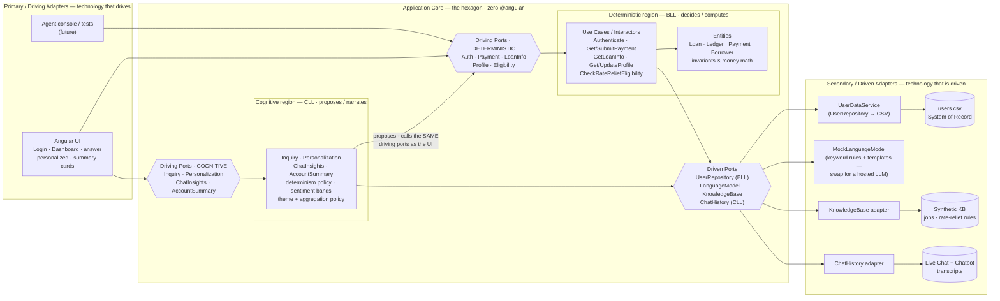

# Component Diagram — Hexagonal Architecture (Ports & Adapters)

This diagram shows the **same POC** as [ntier_component_diagram.md](ntier_component_diagram.md) and [clean_component_architecture.md](clean_component_architecture.md), re-expressed in **Alistair Cockburn's Hexagonal (Ports & Adapters) Architecture**. A **technology-agnostic application core** sits in the middle; everything outside plugs in through **ports** (interfaces) via **adapters**. There are two symmetric sides: **driving (primary)** adapters that *drive* the core, and **driven (secondary)** adapters that the core *drives*.

**Both the deterministic BLL and the cognitive CLL are inside the hexagon** — as two named **regions** of one core. The adapter ring holds *technology only*: the Angular UI on the driving side; the CSV system of record, the grounding sources, and the **LLM runtime** on the driven side. Instead of a runtime *Determinism Gate* or a compile-time *Dependency Rule*, the boundary here is the **port**: nothing reaches either region except through one.

> **Why the CLL is in the core.** An adapter's job is to translate a *technology* into a port. The CLL services translate nothing — they hold application logic and business policy: the fixed determinism map, the topic labels, the sentiment bands, the rule that a summary is exactly profile + loan + payment. Filing them in the adapter ring put logic where technology belongs and left the genuinely foreign thing — the model runtime — with no port at all. The cognitive region fixes both: the *policy* is in the core, the *model* is an adapter behind `LanguageModelPort`.

## Components (by hexagonal role)

### Primary / Driving side — adapters that *drive* the core
- **Angular UI** — `LoginComponent`, `DashboardComponent`, the inquiry-answer components, the personalized components, and the shared **AccountSummary** / **ChatInsights** cards. The human-facing driver, and the only primary adapter in the POC.
- **Servicing-agent console & automated tests** *(future / dev)* — additional primary adapters that drive the identical ports.

### Driving Ports (inbound — the interfaces the core exposes)
- **Deterministic region (BLL):** **AuthPort · PaymentPort · LoanInfoPort · ProfilePort · EligibilityPort** — the authoritative use-case interfaces.
- **Cognitive region (CLL):** **InquiryPort · PersonalizationPort · ChatInsightsPort · AccountSummaryPort** — the cognitive interfaces, on the **same edge of the hexagon**. A driver cannot tell the two sets apart: both are just driving ports, and neither can be reached except through one.

### Application Core (the hexagon) — two regions, one core
- **Deterministic region — BLL** (`core/application` + `core/domain`)
  - **Use Cases / Interactors** — Authenticate; GetPaymentSnapshot / SubmitPayment; GetLoanInfo; GetBorrowerProfile / UpdateProfile; CheckRateReliefEligibility.
  - **Entities** — `Loan · Ledger · Payment · Borrower`: the invariants and **money math**.
- **Cognitive region — CLL** (`core/cognitive`)
  - `InquiryService` *(owns the fixed determinism policy + topic labels)*, `PersonalizationService` *(owns the theme policy)*, `ChatInsightsService` *(owns the sentiment bands)*, `AccountSummaryService` *(owns the aggregation policy)*.
  - It reaches the deterministic region **only through that region's driving ports** — the very doors the UI uses. No privileged path, no shortcut into the entities.

Neither region names a framework, a UI, a DB, or an LLM. `core/` and `ports/` contain zero `@angular` imports.

### Driven Ports (outbound — what the core requires of the world)
- **UserRepositoryPort** — required by the *deterministic* region: the system of record for credentials and profile data.
- **LanguageModelPort** — required by the *cognitive* region: classification proposals and prose. The narrow contract is the point — the model is handed values that are **already computed** and asked only for words or a suggestion.
- **KnowledgeBasePort · ChatHistoryPort** — required by the *cognitive* region, read-only: grounding for narration and intent classification. Never a system of record, never an authoritative decision.

### Secondary / Driven side — adapters behind the ports
- **UserDataService** (CSV repository) → `users.csv` — implements `UserRepositoryPort`.
- **MockLanguageModel** → keyword rules + string templates — implements `LanguageModelPort`. This is where the "LLM" actually lives in the POC; swap it for a hosted model and nothing inside the hexagon moves.
- **KnowledgeBase adapter** → synthetic job/rate-relief catalog — implements `KnowledgeBasePort`.
- **ChatHistory adapter** → Live Chat/Chatbot transcripts — implements `ChatHistoryPort`.

## Interactions

- **Login & guarding:** the **UI** calls **`AuthPort`**, driving the **Authenticate** use case, which reads through **`UserRepositoryPort`** → `UserDataService` → `users.csv`.
- **Composition (CLL proposes, BLL disposes):** the UI asks **`InquiryPort`** to classify free text. Inside, the cognitive region asks the model (through `LanguageModelPort`) to *propose* a category, then stamps `deterministic` from a **fixed policy map it owns**. A wrong model proposal can pick the wrong topic; it cannot promote a topic into — or out of — the deterministic set.
- **Authoritative actions:** `MakePayment → PaymentPort.submitPayment(...)` → `Payment` entity money math; `UpdateProfile → ProfilePort.updateProfile(...)` → `Borrower` entity. The cognitive region contributes nothing to either.
- **Narrated summary (CLL over BLL):** the UI calls **`AccountSummaryPort`**; `AccountSummaryService` obtains every figure through **`ProfilePort` + `LoanInfoPort` + `PaymentPort`** — the same doors the UI uses — and delegates the sentences to `LanguageModelPort`. It phrases, it does not compute.
- **Grounding crosses a port too:** `InquiryService` / `ChatInsightsService` read the synthetic knowledge base and chat history through **`KnowledgeBasePort` / `ChatHistoryPort`**, so even the model's context is mediated by an interface.

## The Ports & Adapters Boundary

### What it is

The boundary is the **port** — an interface owned by the core. It is the hexagonal counterpart of the N-Tier *Determinism Gate* and the Clean *Dependency Rule*: the core is defined purely in terms of ports, and **every interaction crosses a port via an adapter**. Drivers plug into **driving ports** (left); the core reaches the world through **driven ports** (right).

There is a **second, inner** application of the same rule: the cognitive region is a *client* of the deterministic region's driving ports. So the boundary that keeps the AI non-authoritative is not a special mechanism — it is the ordinary port rule applied one level in.

### What it does

It makes the core **independent of every technology** and makes the model **replaceable without touching a line of logic**. Reading the diagram:

- Primary adapters (`UI`, agent console) → **driving ports** → the core: the UI reaches narration and money math through the same *kind* of door, and cannot reach the inside of either region.
- The cognitive region → the deterministic region's **driving ports**: the CLL can *invoke* an authoritative operation but never *become* one. Money math lives in the deterministic entities, unreachable except through a port.
- The core → its **driven ports** → the world: `UserRepositoryPort` → `users.csv`, `LanguageModelPort` → the model runtime, `KnowledgeBasePort` / `ChatHistoryPort` → grounding. The domain never names any of them.

### In plain terms

The CLL is **not a peripheral detail — it is application logic, and it belongs in the core.** What is peripheral is the *model*, and that now sits in the adapter ring behind `LanguageModelPort` where every other technology sits. The old guarantee survives intact, and states more precisely what it always meant: **the cognitive region owns no authoritative computation and can only reach one by calling a port.** Delete `core/cognitive/` and its four driving ports and the deterministic hexagon compiles and computes untouched — every balance, payment, and eligibility. Swap `MockLanguageModel` for a real LLM and no core file changes.

> **Ports & Adapters in action:** the hexagon holds **two regions** — cognitive and deterministic — and the adapter ring holds **only technology**, the model runtime included. The CLL is core logic that must knock on the deterministic region's driving ports like any other driver; it is not a plug-in, and the *model* is. This is the runtime **Determinism Gate** ([ntier_component_diagram.md](ntier_component_diagram.md)) and the compile-time **Dependency Rule** ([clean_component_architecture.md](clean_component_architecture.md)) expressed a third way: *every interaction crosses a port — including the CLL's.*
