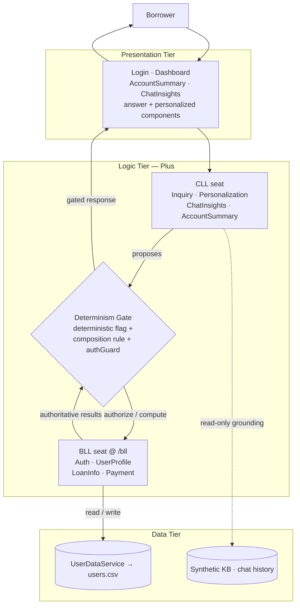
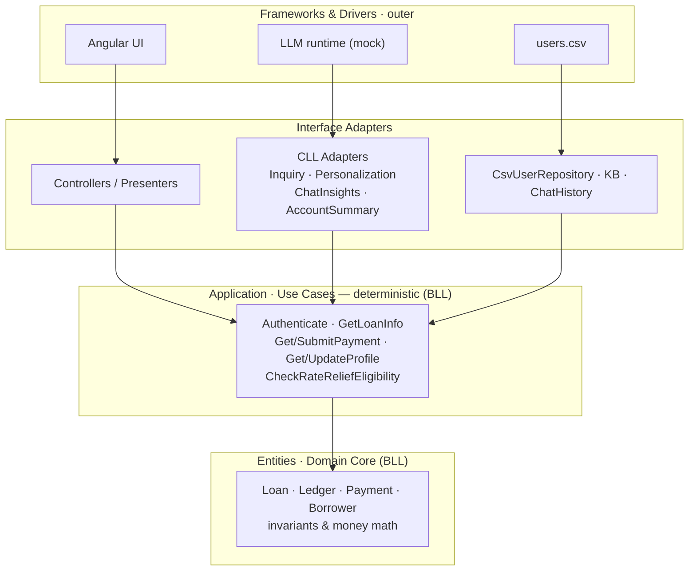
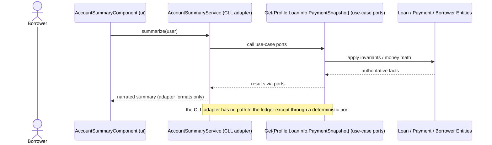
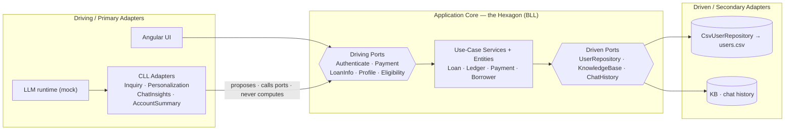
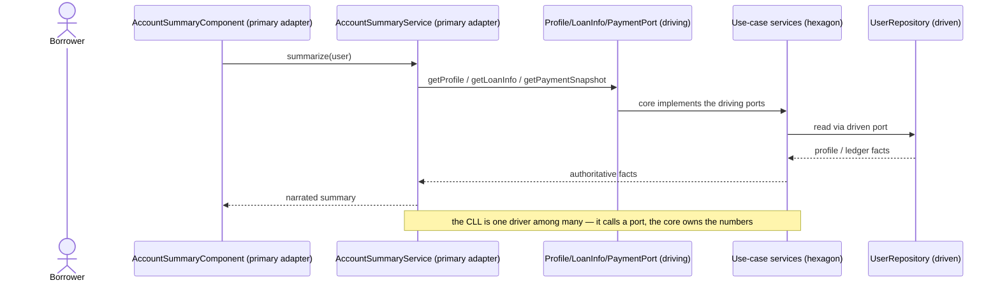
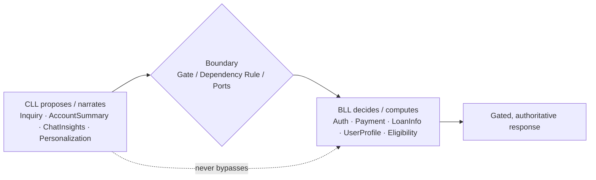

# The "Plus" Architecture — Aggregating BLL and CLL

This note treats the **Business Logic Layer (BLL)** and the **Cognitive Logic Layer (CLL)** as two reusable **building blocks** and shows how **three** mainstream architectural styles — **N-Tier**, **Clean**, and **Hexagonal (Ports & Adapters)** — each become a *"Plus"* variant by **aggregating a CLL alongside the deterministic BLL**.

Everything below is grounded in the three working Angular POCs under `POC/`, which implement the **same loan-servicing app** three different ways:

* [`../ntier_architecture/`](../ntier_architecture/) — Option #1 (see [ntier_component_diagram.md](ntier_component_diagram.md))
* [`../clean_architecture/`](../clean_architecture/) — Option #2 (see [clean_component_architecture.md](clean_component_architecture.md))
* [`../hexagonal_architecture/`](../hexagonal_architecture/) — Option #3 (see [hexagonal_component_architecture.md](hexagonal_component_architecture.md))

Deeper background: the deterministic catalogue [bll_use_cases.md](bll_use_cases.md), the cognitive catalogue [cll_use_cases.md](cll_use_cases.md), and the side-by-side [architectures_comparison.md](architectures_comparison.md).

> **The invariant that must hold in all three architectures:** *the CLL proposes; the BLL disposes.* Every number that touches money, every gate that touches access, and every regulatory determination is produced by the BLL. The CLL is grounded before it reasons and gated before its output reaches the user. The styles differ only in **where** the CLL is placed and **how** the boundary is enforced — never in **whether** it holds.

***

## The two building blocks

As implemented in the POCs, the two blocks are concrete sets of services:

```mermaid
flowchart LR
  subgraph sgCLL["CLL — Cognitive Logic Layer · proposes / narrates"]
    C1["AccountSummaryService<br/>narrate profile + loan + payment"]
    C2["ChatInsightsService<br/>summarize chats · sentiment tone-meter"]
    C3["InquiryService<br/>classify intent · choose components"]
    C4["PersonalizationService<br/>welcome tone · theme"]
  end
  subgraph sgBLL["BLL — Business Logic Layer · decides / computes"]
    B1["PaymentService<br/>money math · snapshot · submit · reference no."]
    B2["LoanInfoService<br/>balance · rate · maturity · paid %"]
    B3["UserProfileService<br/>profile · standing · contact"]
    B4["AuthService + EligibilityService<br/>credentials · rate-relief decision"]
  end
  sgCLL -->|"requests grounded facts &amp; decisions"| sgBLL
  sgBLL -->|"returns authoritative truth"| sgCLL
```



**Contract between the blocks.** The BLL exposes a set of pure operations the CLL may *call* and *phrase* but never *substitute* for:

```text
authenticate(username, password)      getPaymentSnapshot(user)
getBorrowerProfile(user) / update()   submitPayment(user, request) → reference no.
getLoanInfo(user)                     checkRateReliefEligibility(user)
```

This single contract is what all three architectures below preserve.

***

## What the POC implements (shared across all three)

Every option ships the **same borrower-facing features**, so the diagrams and proofs below describe real, running behaviour — not hypotheticals:

* **Login & guarded dashboard** — `authenticate()` against 6 demo users in `users.csv`; an `authGuard` protects `/dashboard`; the signed-in borrower lives in a `SessionStore`.
* **Always-on insights panel** (rendered before any question is asked):
  * **Account Summary** — the CLL `AccountSummaryService` narrates a plain-English summary by aggregating the BLL facts (`getBorrowerProfile` + `getLoanInfo` + `getPaymentSnapshot`). It **invents no numbers**.
  * **Conversation Insights** — the CLL `ChatInsightsService` summarizes the borrower's (synthetic) chat history and renders a **sentiment tone-meter** (a *signal*, never a decision).
* **Free-text inquiry → component composition** — `InquiryService` classifies the question and stamps an `InquiryResult.deterministic` flag from a **fixed policy** (not the model). The dashboard then composes answer components:
  * **Deterministic topics** — Next Payment, Loan Balance, Make a Payment, Update Profile — render the *same* components for every borrower, backed by the BLL.
  * **Personalized topics** — the answer **plus** a per-user-type set. *(Full personalized matrix + Job Opportunities / Interest Relief screens are implemented in `ntier_architecture`; the clean & hexagonal POCs recognise these intents and keep eligibility/jobs wired in the core, routing the UI to General Help.)*
* **Authoritative actions** — Make a Payment (`submitPayment` → validation, money math, reference number) and Update Profile (`updateProfile`) go straight to the BLL/core.

The three options differ only in **how the boundary between CLL and BLL is structured and enforced** — described next, each in its own section.

***

# Option #1 - N-Tier Plus Architecture

## Technical description

**Core elements:** three horizontal tiers — **Presentation → Logic → Data** — with the **CLL and BLL as peer "seats" inside the Logic tier**, separated by a runtime **Determinism Gate**.

* **Presentation tier** — `LoginComponent`, `DashboardComponent` (orchestrator), the always-on `AccountSummaryComponent` / `ChatInsightsComponent`, and the inquiry-answer + personalized components. Renders whatever the gate returns.
* **Logic tier (Plus)** — two collaborating seats:
  * **CLL seat** — `InquiryService`, `PersonalizationService`, `ChatInsightsService`, `AccountSummaryService`: interpret, ground, recommend, narrate.
  * **BLL seat** (`@ /bll`) — `AuthService`, `UserProfileService`, `LoanInfoService`, `PaymentService`: all decisions and calculations.
  * **Determinism Gate** — *conceptual*, enforced by three real mechanisms: the `InquiryResult.deterministic` flag, the Dashboard composition rule, and the `authGuard`. The CLL cannot put a consequential result on screen without the BLL producing/authorizing it.
* **Data tier** — `UserDataService` + `users.csv` (system of record), plus the synthetic knowledge base and chat history used read-only for grounding.



## Proof — the Account Summary, traced through the tiers

```mermaid
sequenceDiagram
  actor B as Borrower
  participant DASH as DashboardComponent
  participant AS as AccountSummaryService (CLL)
  participant GATE as Determinism boundary
  participant BLL as UserProfile/LoanInfo/Payment (BLL)
  B->>DASH: sign in → dashboard loads
  DASH->>AS: summarize(user)  (always-on card)
  AS->>GATE: request grounded facts
  GATE->>BLL: getProfile() · getLoanInfo() · getPaymentSnapshot()
  BLL-->>GATE: balances, rate, paid %, next payment (to the cent)
  GATE-->>AS: authoritative facts
  AS-->>DASH: plain-English narration — no invented numbers
  DASH-->>B: Account Summary card
  Note over AS,BLL: CLL phrases the facts; BLL owns every figure
```

Swap the wording (or the model) tomorrow and the figures are unchanged — that is the gate doing its job.

## Strengths / trade-offs

* ✅ **Low friction to adopt** — the CLL slots into an existing tier; teams keep their layering mental model.
* ✅ **Obvious enforcement point** — the gate is a single, testable seam.
* ⚠️ **Coupling risk** — tiers know their neighbours concretely, so a sloppy CLL could reach around the gate straight into Data. Discipline is **procedural, not structural**.
* ⚠️ **BLL not intrinsically isolated** from infrastructure; it shares the tier and often the data access.

***

# Option #2 - Clean Plus Architecture

## Technical description

**Core elements:** **concentric rings** governed by the **Dependency Rule** — source-code dependencies point **inward only**. The BLL *is* the inner core; the CLL is just another outer-ring adapter.

* **Entities (core)** — `Loan`, `Ledger`, `Payment`, `Borrower`: invariants and money math. Pure TypeScript, **zero `@angular` imports**.
* **Use Cases / Interactors (application)** — `Authenticate`, `GetLoanInfo`, `GetPaymentSnapshot`, `SubmitPayment`, `GetBorrowerProfile`, `UpdateProfile`, `CheckRateReliefEligibility`. They define the **ports**. Also pure.
* **Interface Adapters** — controllers/presenters, the repositories (`CsvUserRepository`, in-memory KB / chat history), **and the CLL adapters** (`InquiryService`, `PersonalizationService`, `ChatInsightsService`, `AccountSummaryService`) which *consume* the use-case ports.
* **Frameworks & Drivers (outer)** — the Angular UI, `users.csv`, and the (mock) LLM runtime as swappable infrastructure. Wiring lives in `infrastructure/` (`InjectionToken`s + provider composition root).

Because the CLL sits in the outer rings, **the core cannot depend on it** — the determinism boundary is enforced by the *compiler and the dependency direction*, not by a runtime gate you must remember to call.



> **Dependency Rule in action:** every arrow points inward. The **CLL adapters depend on the use-case ports**, never the reverse. The domain core has *no knowledge that an AI exists* — delete the CLL adapters and the app still computes every balance, payment, and eligibility.

## Proof — the Account Summary, as an outer adapter calling inner ports



Identical guarantee to N-Tier Plus, but here the CLL *structurally cannot* produce the number.

## Strengths / trade-offs

* ✅ **Boundary is structural** — the Dependency Rule makes "AI can't decide money" a compile-time fact. *(Verified: `domain/` and `application/` contain zero `@angular` imports.)*
* ✅ **Swappable AI** — the LLM/runtime is outer infrastructure; replace or remove it without touching the core.
* ✅ **Core is trivially testable** — pure use cases, no AI or infra in the way.
* ⚠️ **More upfront design** — ports, adapters, tokens, and inversion cost ceremony; overkill for thin CRUD.
* ⚠️ **Orchestration ambiguity** — deciding what belongs in a use case vs. the CLL adapter needs care so rules don't leak outward.

***

# Option #3 - Hexagonal Plus Architecture

## Technical description

**Core elements:** a **technology-agnostic core (the hexagon)** surrounded by **ports** (interfaces) and **adapters**, split symmetrically into a **driving (primary)** side and a **driven (secondary)** side. The BLL is the hexagon; the CLL is *just another driving adapter*.

* **Application core (the hexagon)** — entities (`Loan`/`Ledger`/`Payment`/`Borrower`, money math) + use-case services that **implement the driving ports**. Pure, **zero `@angular`**.
* **Driving (primary) ports** — inbound interfaces the core exposes: `AuthenticatePort`, `PaymentPort`, `LoanInfoPort`, `ProfilePort`, `EligibilityPort`.
* **Driving (primary) adapters** — the Angular UI **and the CLL adapters** (`InquiryService`, `PersonalizationService`, `ChatInsightsService`, `AccountSummaryService`). They *call* the driving ports; no more privileged than a test harness or agent console.
* **Driven (secondary) ports** — outbound interfaces the core requires: `UserRepositoryPort`, `KnowledgeBasePort`, `ChatHistoryPort`.
* **Driven (secondary) adapters** — `CsvUserRepository` → `users.csv`, in-memory KB and chat history. Wiring lives in `configuration/`.

The CLL enters only through a driving port and the domain names only ports, so the AI is **non-load-bearing by construction** — the same guarantee as Clean Plus, framed as adapter symmetry rather than rings.



> **Ports & Adapters in action:** the **CLL drives the core through the same inbound ports as the UI**, and touches data only through the core's outbound ports. Unplug the CLL adapter (or swap the LLM behind it) and the UI still drives the identical hexagon.

## Proof — the Account Summary, as a primary adapter



## Strengths / trade-offs

* ✅ **Cleanest conceptual fit** — the CLL/BLL split *is* the pattern: BLL = core, CLL = one more driving adapter, "propose/dispose" = "cross a port." *(Verified: `core/` and `ports/` contain zero `@angular` imports; the UI depends on driving ports, not concrete services.)*
* ✅ **Symmetric & swappable** — UI, tests, agents, and the LLM are interchangeable adapters; the core is fully technology-agnostic.
* ✅ **Boundary is structural** — like Clean, the core depends only on ports.
* ⚠️ **Most interfaces to maintain** — driving *and* driven ports for everything; overkill for thin CRUD.
* ⚠️ **Primary/secondary distinction** can confuse teams new to the style.

***

# The proofs, generalized

The same real POC capabilities hold the determinism boundary in **all three** architectures. In each, the CLL contribution is genuinely valuable *and* strictly non-authoritative.

| Borrower-visible capability (in the POC) | CLL contribution (proposes / narrates) | BLL / core authority (decides / computes) |
|---|---|---|
| **Account Summary** card | `AccountSummaryService` narrates profile + loan + payment in plain English | `UserProfile` / `LoanInfo` / `Payment` supply balance, rate, paid %, next payment — to the cent |
| **Conversation Insights** + sentiment | `ChatInsightsService` summarizes chats & scores tone | *signal only* — grounding is read-only; it changes no account state |
| **Ask-box** inquiry composition | `InquiryService` classifies intent & proposes the component set | `InquiryResult.deterministic` policy + BLL answers; deterministic topics render identically for all |
| **Make a Payment** | *(nothing authoritative)* | `PaymentService.submitPayment` validates, does money math, returns a reference number |
| **Rate-relief eligibility** | narrates / explains the outcome | `CheckRateReliefEligibility` decides eligibility deterministically |

**Determinism-flag trace (all styles):** `InquiryService` proposes a category → a **fixed policy map** (never the model) sets `deterministic` → the composition rule (N-Tier), a use-case port (Clean), or a driving port (Hexagonal) yields the authoritative answer. The CLL chooses *what to show and how to phrase it*; it never decides the money or the access.



***

# Choosing between them

| Dimension | N-Tier *Plus* | Clean *Plus* | Hexagonal *Plus* |
|---|---|---|---|
| **POC implementation** | [`../ntier_architecture/`](../ntier_architecture/) | [`../clean_architecture/`](../clean_architecture/) | [`../hexagonal_architecture/`](../hexagonal_architecture/) |
| CLL placement | Peer of BLL in the logic tier | Outer-ring adapter (a "detail") | A driving (primary) adapter |
| Boundary enforcement | Runtime **Determinism Gate** | Compile-time **Dependency Rule** | The **Port** (every call crosses one) |
| BLL isolation from infra | Partial (shares tier / data access) | Strong (pure core) | Strong (pure core) |
| Adoption cost | Low — fits existing layering | Higher — ports/adapters ceremony | Higher — driving + driven ports |
| Conceptual fit for CLL/BLL | Adequate (bolt-on gate) | Strong (AI is an outer ring) | **Strongest** (AI is just another adapter) |
| Best when | Evolving an existing app toward AI | Regulated domain; auditability paramount | Designing for many interchangeable drivers |

All three are legitimate. **N-Tier Plus** is the pragmatic on-ramp for an existing platform; **Clean Plus** and **Hexagonal Plus** make the determinism boundary a property of the **structure** rather than of **discipline** — Clean framing it as inward-pointing rings, Hexagonal as a technology-agnostic core behind symmetric ports. See [architectures_comparison.md](architectures_comparison.md) for the full head-to-head.

***

> **Closing principle:** BLL and CLL are composable, not competing. Whichever of the three styles you pick, aggregate them so the AI is *grounded, gated, and non-load-bearing for decisions* — the CLL makes the platform **understandable and adaptive**, while the BLL keeps it **correct, reproducible, and provable**.
