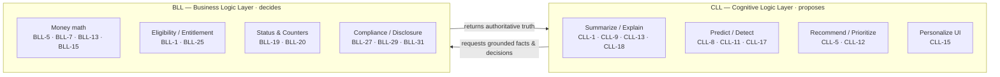
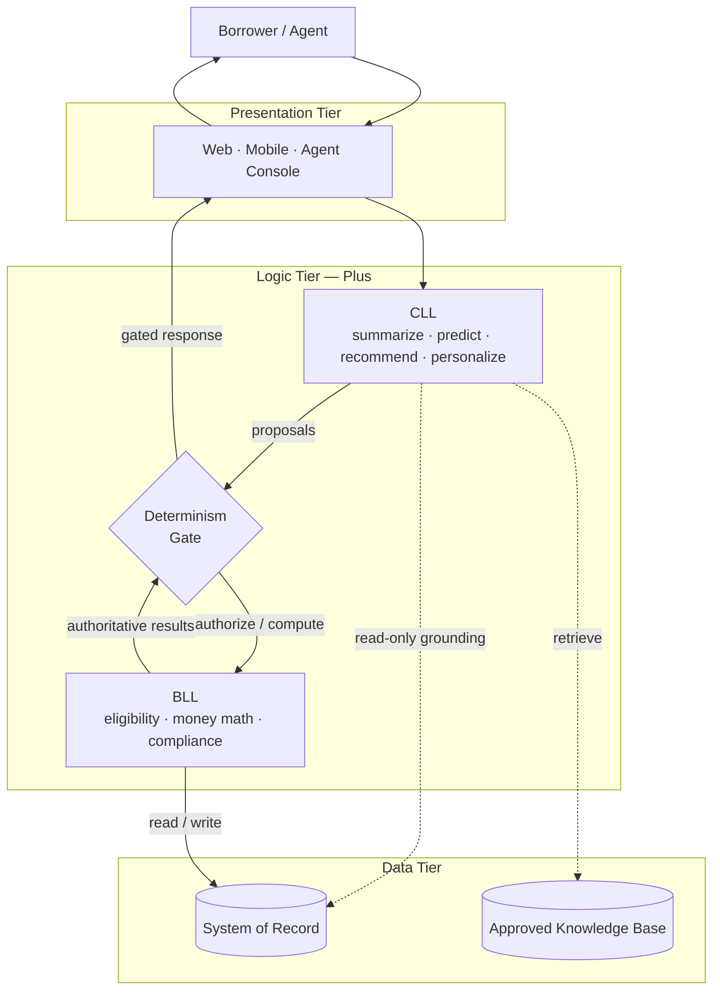
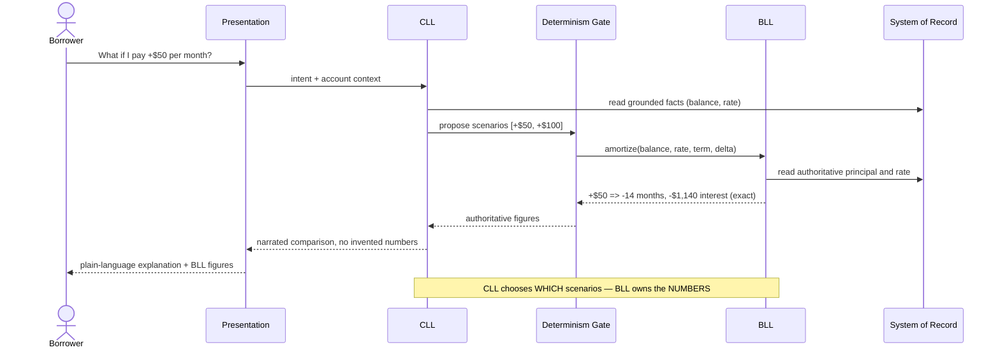
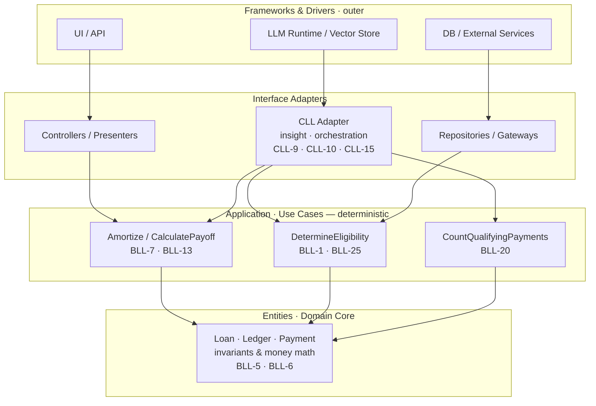
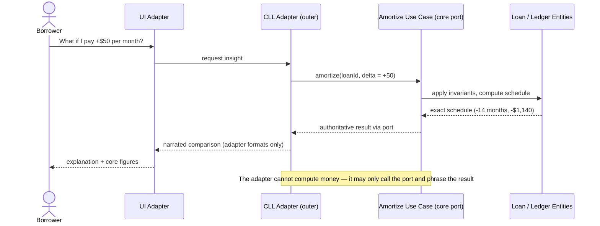
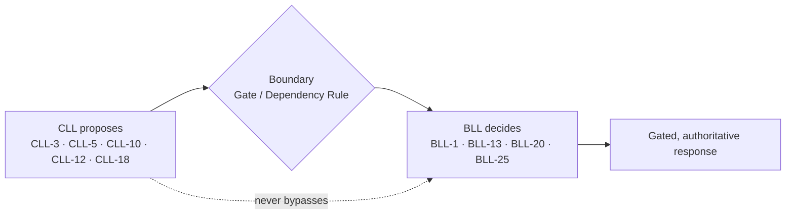

# The "Plus" Architecture — Aggregating BLL and CLL

This note treats the **Business Logic Layer (BLL)** and the **Cognitive Logic Layer (CLL)** as two reusable **building blocks** and shows how two mainstream architectural styles — **N-Tier** and **Clean** — each become a *"Plus"* variant by **aggregating a CLL alongside the deterministic BLL**.

The blocks come straight from the companion files:

* **BLL** — deterministic, reproducible, auditable decisions. See [bll_use_cases.md](bll_use_cases.md) (referenced below as **BLL-*n***).
* **CLL** — cognitive: summarize, predict, explain, prioritize, personalize. See [cll_use_cases.md](cll_use_cases.md) (referenced as **CLL-*n***).

> **The invariant that must hold in *both* architectures:** *the CLL proposes; the BLL disposes.* Every number that touches money, every gate that touches access, and every regulatory determination is produced by the BLL. The CLL is grounded before it reasons and gated before its output reaches the user. The styles differ only in **where** the CLL is placed and **how** the boundary is enforced — never in **whether** it holds.

***

## The two building blocks

**Contract between the blocks.** The BLL exposes a set of pure, versioned operations (e.g., `amortize(balance, rate, term)`, `determineEligibility(profile)`, `qualifyingPaymentCount(loanId)`). The CLL may *call* these operations and *phrase* their results, but may never *substitute* for them. This single contract is what both architectures below preserve.

***

# Architecture 1 — N-Tier *Plus*

## Technical description

Classic N-Tier is strictly **horizontal**: Presentation → Logic → Data, each tier depending only on the one beneath it. The *Plus* variant keeps that shape and adds the **CLL as a peer of the BLL inside the logic tier**, with an explicit **Determinism Gate** between them.

* **Presentation tier** — web/mobile/agent console. Sends borrower/agent intent to the logic tier; renders whatever the gate returns.
* **Logic tier (Plus)** — two collaborating components:
  * **CLL** handles interpretation, grounding (retrieval), recommendation, and narration.
  * **BLL** owns all decisions and calculations.
  * **Determinism Gate** — the CLL cannot return a consequential result to Presentation without it being produced or authorized by the BLL. The gate is where the invariant is *mechanically* enforced.
* **Data tier** — system of record (authoritative, read-write for the BLL; read-only "grounding" for the CLL) plus an approved knowledge base for RAG.

## Proof — trace a core case through the tiers

**Case:** *"What happens if I increase payments by $50?"* — **CLL-10** (present scenarios) composed with **BLL-13** (amortization) and **BLL-5** (accrual).

The borrower experiences a conversational feature (CLL-10), but every dollar and month originates in BLL-13/BLL-5. Swap the model tomorrow and the figures are unchanged — that is the gate doing its job.

## Strengths / trade-offs

* ✅ **Low friction to adopt** — the CLL slots into an existing tier; teams keep their layering mental model.
* ✅ **Obvious enforcement point** — the gate is a single, testable seam.
* ⚠️ **Coupling risk** — because tiers know their neighbors concretely, a sloppy CLL can reach around the gate straight into Data or grow chatty with the BLL. Discipline is procedural, not structural.
* ⚠️ **The BLL is not intrinsically isolated** from infrastructure; it lives in the same tier as the CLL and often shares data access.

***

# Architecture 2 — Clean *Plus*

## Technical description

Clean Architecture is **concentric**, governed by the **Dependency Rule**: source-code dependencies point **inward only**. The center is pure domain; the outer rings are replaceable details.

The *Plus* insight is that **the BLL *is* the inner core** (Entities + Use Cases) and **the CLL is just another outer-ring detail** — a plug-in adapter, exactly like the database or the UI.

* **Entities (core)** — `Loan`, `Ledger`, `Payment`; invariants and money math (BLL-5, BLL-6).
* **Use Cases / Interactors (application)** — deterministic orchestration: `Amortize`/`CalculatePayoff` (BLL-7, BLL-13), `DetermineEligibility` (BLL-1, BLL-25), `CountQualifyingPayments` (BLL-20). These define **ports** (interfaces).
* **Interface Adapters** — controllers, presenters, repositories… **and the CLL adapter**, which *consumes* the use-case ports and *provides* an insight/presentation port (CLL-9, CLL-10, CLL-15).
* **Frameworks & Drivers (outer)** — UI, DB, and the **LLM runtime + vector store** as swappable infrastructure.

Because the CLL sits in the outer rings, **the core cannot depend on it**. The AI becomes non-load-bearing by construction: the determinism boundary is enforced by the *compiler and the dependency direction*, not by a runtime gate you must remember to call.

> **Dependency Rule in action:** every arrow points inward. The **CLL Adapter depends on the use-case ports**, never the reverse. The domain core has *no knowledge that an AI exists* — you could delete the CLL adapter and the platform still computes every balance, payment, and eligibility correctly.

## Proof — same case, contrasted placement

**Case:** *"What happens if I increase payments by $50?"* — again **CLL-10** + **BLL-13**, now expressed as an outer adapter calling an inner port.

Identical guarantee as N-Tier Plus, but here the CLL *structurally cannot* produce the number — it has no path to the ledger except through the deterministic port.

## Strengths / trade-offs

* ✅ **Boundary is structural** — the Dependency Rule makes "AI can't decide money" a compile-time fact, not a code-review hope.
* ✅ **Swappable AI** — LLM/runtime is outer infrastructure; replace or remove it without touching the core.
* ✅ **Core is trivially testable** — pure use cases, no AI or infra in the way.
* ⚠️ **More upfront design** — ports, adapters, and inversion cost ceremony; overkill for thin CRUD.
* ⚠️ **Orchestration ambiguity** — deciding what belongs in a use case vs. the CLL adapter (e.g., multi-step agentic flows) needs care so business rules don't leak outward into the adapter.

***

# The proofs, generalized

Three core cases, shown to hold the determinism boundary in **both** architectures. In each, the CLL contribution is genuinely valuable *and* strictly non-authoritative.

| Borrower-visible capability | CLL contribution (proposes) | BLL authority (decides) | What would break if swapped |
|---|---|---|---|
| Repayment scenarios / payment target | **CLL-10 · CLL-3** choose & narrate scenarios | **BLL-13 · BLL-5 · BLL-7** compute months, interest, payoff | Figures would drift from statements/ledger |
| Feature & program relevance | **CLL-5 · CLL-12** rank by usefulness | **BLL-25 · BLL-1** grant access / eligibility | User could see or be offered something they can't have |
| Forgiveness progress | **CLL-18** explain *why* a payment didn't count | **BLL-20** hold the qualifying-payment count | An over-optimistic count → real consumer harm |

**Eligibility trace (both styles):** CLL-12 ranks *candidate* assistance programs → the gate (N-Tier) or the `DetermineEligibility` port (Clean) calls **BLL-1/BLL-25** → only rule-granted programs are rendered, each with its authoritative status. The CLL never widens the set; it only orders it.

**Regulated-counter trace (both styles):** CLL-18 retrieves the borrower's payment ledger and explains disqualifying reasons → **BLL-20** supplies the count. The CLL may say *"three payments in 2023 didn't count because the plan wasn't qualifying"*; it may never say *"you have 118 of 120"* on its own authority.

***

# Choosing between them

| Dimension | N-Tier *Plus* | Clean *Plus* |
|---|---|---|
| CLL placement | Peer of BLL in the logic tier | Outer-ring adapter (a "detail") |
| Boundary enforcement | Runtime **Determinism Gate** | Compile-time **Dependency Rule** |
| BLL isolation from infra | Partial (shares tier/data access) | Strong (pure core) |
| Adoption cost | Low — fits existing layering | Higher — ports/adapters ceremony |
| Blast radius of AI change | Contained to logic tier | Contained to outer ring |
| Best when | Evolving an existing N-Tier app toward AI | Building AI-augmented systems where auditability is paramount |

Both are legitimate. **N-Tier Plus** is the pragmatic on-ramp for an existing platform; **Clean Plus** is the stronger long-term stance for a regulated domain because it makes the determinism boundary a property of the *structure* rather than of *discipline*.

***

> **Closing principle:** BLL and CLL are composable, not competing. Whichever style you pick, aggregate them so the AI is *grounded, gated, and non-load-bearing for decisions* — the CLL makes the platform **understandable and adaptive**, while the BLL keeps it **correct, reproducible, and provable**.
