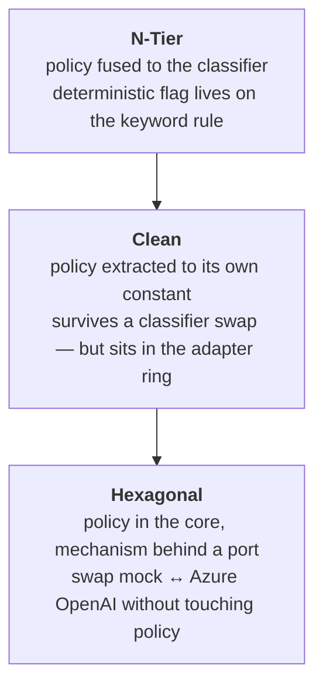

# What Drives It All — The Determinism Policy

All three POCs in this repository — [N-Tier](ntier_component_architecture.md),
[Clean](clean_component_architecture.md) and
[Hexagonal](hexagonal_component_architecture.md) — answer the same question in
the same way, and it is the question every AI-bearing system eventually has to
answer: **which parts of an answer may a model produce, and which parts must the
business own?**

The architectures differ in where they *file* that answer and how hard they make
it to violate. They do not differ on the answer itself. This document is about
the invariant underneath all three.

## The test is authority, not technology

The deciding question is never "is AI involved here?" — the cognitive layer is
involved in every single request, because it is what turns free text into a
topic. The question is:

> **What does a wrong answer cost?**
>
> Money, eligibility, or a system-of-record fact → **BLL**.
> Comprehension or tone → **CLL**.

Each cognitive service in the codebase states its permitted verb in its own
header, and each states the same limit:

| Service | Verb | Declared in the source |
|---|---|---|
| `InquiryService` | **PROPOSES** | *"It PROPOSES; it does not decide."* |
| `AccountSummaryService` | **NARRATES** | *"It NARRATES; it does not decide."* |
| `ChatInsightsService` | **INTERPRETS** | *"It INTERPRETS; it does not decide."* |

Propose, narrate, interpret — never decide, never compute. The deterministic
side is the mirror image: `eligibility.entity.ts` carries the note *"the
eligibility OUTCOME is decided here, in the core — never by the CLL/AI, which may
only phrase the result."*

## Two questions that are easy to conflate

The design actually answers **two** independent questions. Keeping them apart is
what makes it coherent:

1. **BLL or CLL?** — decided by *authority*. Does this produce an authoritative
   value?
2. **Where does the CLL itself belong?** — decided by *policy versus technology*.

The second question is where the three architectures genuinely diverge, and it
is the one most often got wrong. A cognitive service holds **policy** — the
determinism map, the sentiment bands, the aggregation rule. The **model** is
**technology**. They are not the same thing and do not belong in the same place.
The Hexagonal README puts it bluntly: *"The model is not the CLL."*

## The policy itself

The map is the single most important constant in the system. **N-Tier and Clean
carry seven categories; Hexagonal carries eight** — `REPAYMENT_OPTIONS` was added
there first.

Adding a category is not free anywhere: the shared `InquiryCategory` union grows,
and **both** classifier adapters must learn to propose the new label — the mock's
keyword rules and the Azure prompt's allow-list alike. What *is* free is the part
that matters here. Deciding whether the new category is deterministic was a
one-line addition to a constant in the core, made without touching a classifier,
and unreachable by the model either way.

| Category | `deterministic` | Consequence |
|---|---|---|
| `NEXT_PAYMENT` | ✅ | Same component and layout for every borrower |
| `LOAN_BALANCE` | ✅ | Same component and layout for every borrower |
| `EXTRA_PAYMENT` | ✅ | Same component; validation and money math in the BLL |
| `PROFILE_UPDATE` | ✅ | Same component; validation rules in the BLL |
| `HARDSHIP` | ⬜ | Personalized — grounding and tone |
| `LIFE_EVENT` | ⬜ | Personalized, but the **outcome** is a BLL decision |
| `REPAYMENT_OPTIONS` *(Hexagonal only)* | ⬜ | Scenario and qualifying-condition guidance; shows no projection it cannot source |
| `GENERAL` | ⬜ | Personalized fallback |

The model never sees this map. That is the whole point: a wrong proposal can
pick the wrong topic, but it cannot move a topic across the line.

## Where each architecture files it

The same policy, protected three different ways — this is the clearest
side-by-side the three POCs offer.

| | Location | Form | What protects it |
|---|---|---|---|
| **N-Tier** | `services/inquiry.service.ts` | A `deterministic: boolean` field **on each rule object**, sitting beside that rule's regexes | Convention only |
| **Clean** | `adapters/cll/inquiry.service.ts` | A separate `DETERMINISM_POLICY` constant — but the CLL sits in the **adapter ring** | The Dependency Rule, which does not reach the adapter ring |
| **Hexagonal** | `core/cognitive/inquiry.service.ts` | A separate `DETERMINISM_POLICY` constant **inside the hexagon**, with the classifier behind `LanguageModelPort` | Ports — nothing reaches either region except through one |

Read top to bottom, that is a progression in separating **policy** from
**mechanism**:

- **N-Tier** interleaves them. The `deterministic` flag is a property of the
  keyword rule, so replacing the classifier with a real model would carry the
  policy out of the building with it. Nothing prevents that but discipline.
- **Clean** extracts the policy into a constant, so it survives a classifier
  swap. But filing the whole cognitive service under `adapters/` puts *logic*
  where *technology* belongs, and the Dependency Rule protects the rings, not the
  adapter ring.
- **Hexagonal** keeps the policy in the core and pushes the mechanism out behind
  `LanguageModelPort`. That is what let the model be swapped from an in-process
  stub to Azure OpenAI as a composition-root change, with the determinism map
  untouched.

## What actually enforces it in the strongest case

In the Hexagonal POC the rule is not merely documented:

- **The port contract makes computation unaskable.** `LanguageModelPort` only
  ever *hands over* finished values — `narrateLoan(profile, loan)`,
  `describeTone(label)`. There is no method through which the model could be
  asked to calculate anything.
- **The CLL has no privileged path.** It reaches the BLL through the same driving
  ports the UI uses. The README calls this *"what keeps the CLL
  non-authoritative."*
- **Authoritative values travel alongside the prose.** `AccountSummary` returns
  `profile`, `loan` and `payment` *and* the sentences, so stat tiles render from
  the BLL side. A hallucinated figure cannot reach one.
- **Grounding crosses a port too.** Job postings and chat history arrive through
  `KnowledgeBasePort` / `ChatHistoryPort` — read-only sources, never systems of
  record.

## The edge case: prose that belongs to the BLL

The line is *not* "text goes to the CLL". `borrower.entity.ts` — a domain file in
all three POCs — contains human copy:

> *"Your account is mostly on track but has a few missed payments (grade 1
> delinquency). You're not in serious trouble…"*

That sentence is a **rule-derived statement about account standing**. Getting it
wrong misstates the borrower's position, so authorship belongs where the rule
lives. Contrast `describeTone()`, also a supportive sentence, but decorative —
that one goes to the model.

The same file shows the pattern again in `applyProfileUpdate`: validation
regexes, the `PRF-YYYYMMDD-XXXXXX` reference number and the confirmation message
all sit in the domain, tagged *"Pure rule-based validation — no cognition."*

So the operative question for text is not "is this prose?" but:

> **Does this text assert something the business is accountable for?**

## Where the line is soft

Two honest weaknesses, worth naming rather than defending:

- **`PersonalizationService` owns almost nothing.** Its only deterministic
  contribution is a one-line `theme-${userType}` template. It earns its place as
  a seam rather than as a holder of real policy — thinner justification than the
  other three cognitive services have.
- **N-Tier's fusion is a latent trap.** Because the `deterministic` flag lives on
  the same object as the keyword regexes, the natural refactor when adopting a
  real model — replace the rules array — silently deletes the policy. The Clean
  and Hexagonal extraction is what makes that refactor safe.
