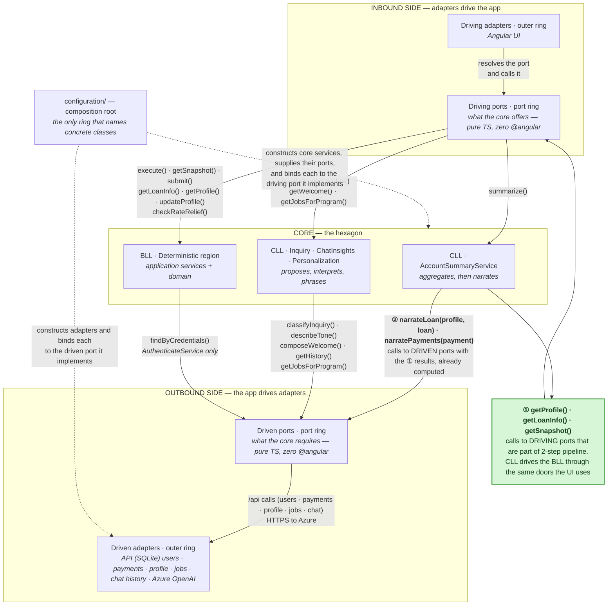
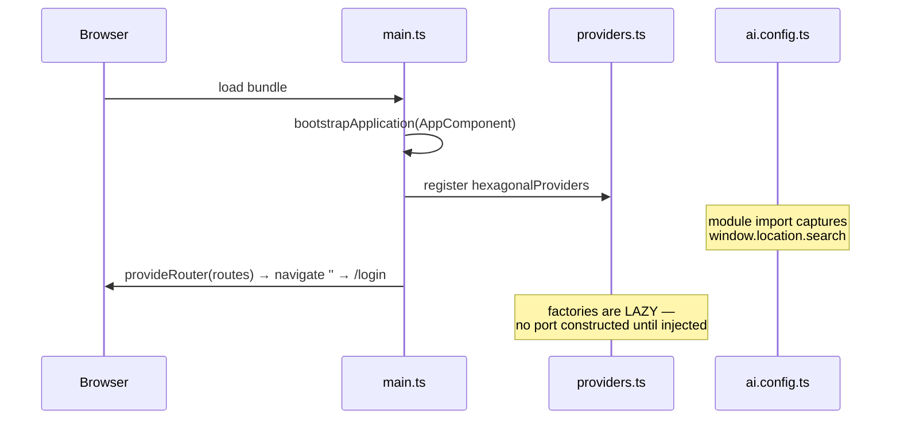
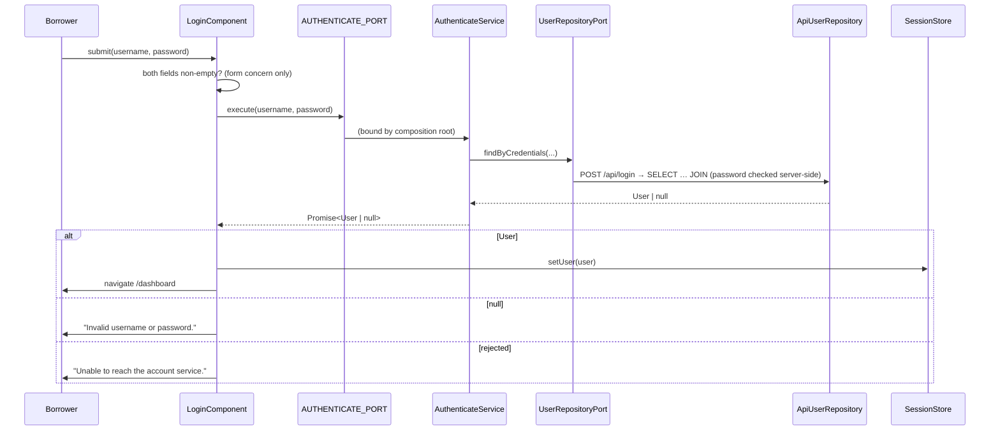
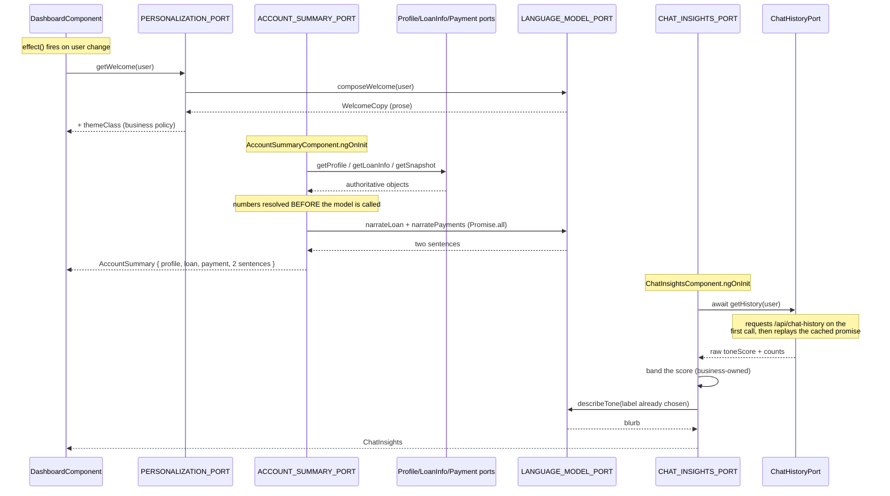
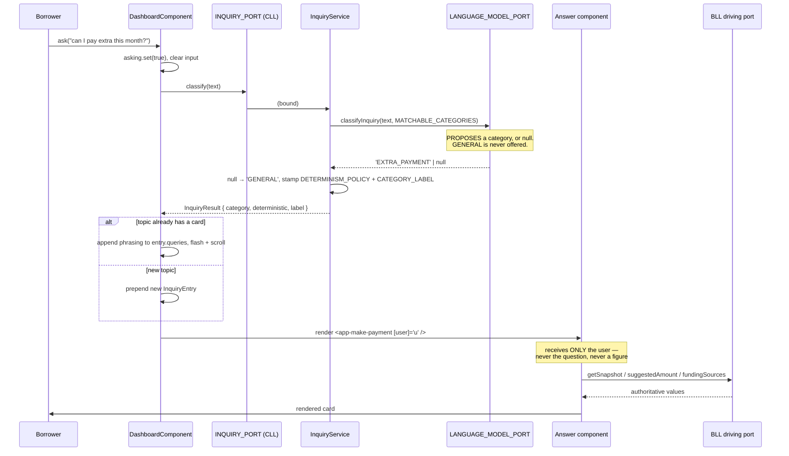
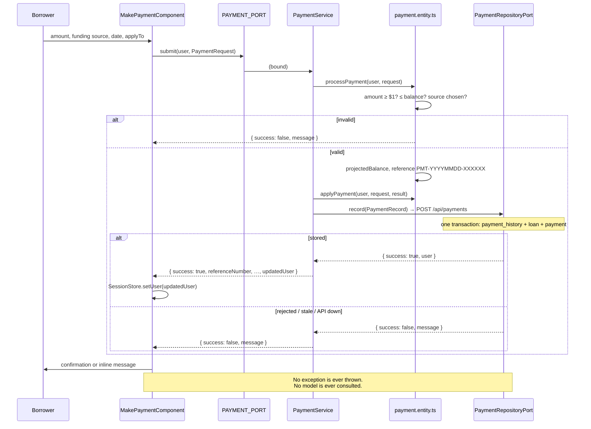
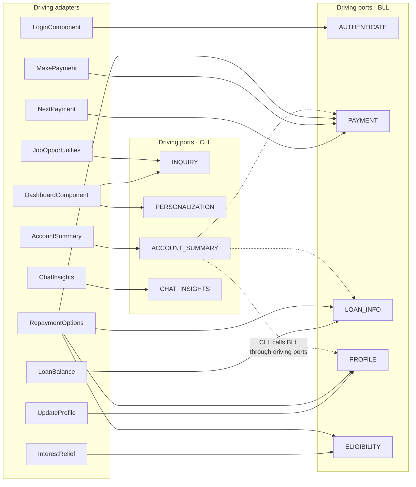

# Project Swagger — Hexagonal Loan Servicing POC

**Version** 1.0.0 · **Runtime** Angular 18 standalone (browser bundle) · **Source of truth** `src/app`

A Swagger page answers three questions about a service: *what components exist*,
*what each one accepts and returns*, and *how they call each other*. This document
answers those three questions for an application that has **no HTTP API at all**.

There is no server here. But in Ports & Adapters the **port is the API** — a typed
interface the compiler enforces, which is a stricter contract than a URL. So every
"endpoint" below is a port operation, every "server" is a binding key, and
every "client" is an adapter.

> **Related document.** [`../PORTS.md`](../PORTS.md) is the *interface* reference —
> port signatures and payload schemas in isolation. **This** document is the
> *component* reference: the parts, their dependencies, and the call sequences
> between them. Read PORTS.md to implement against a port; read this to understand
> how a click becomes an answer.

---

## Table of contents

1. [How to read this document](#1-how-to-read-this-document)
2. [Component inventory](#2-component-inventory)
3. [Runtime configuration (the "servers" block)](#3-runtime-configuration-the-servers-block)
4. [Tag: Driving adapters — UI](#4-tag-driving-adapters--ui)
5. [Tag: Driving ports — deterministic (BLL)](#5-tag-driving-ports--deterministic-bll)
6. [Tag: Driving ports — cognitive (CLL)](#6-tag-driving-ports--cognitive-cll)
7. [Tag: Driven ports — what the core requires](#7-tag-driven-ports--what-the-core-requires)
8. [Tag: Driven adapters — the outside world](#8-tag-driven-adapters--the-outside-world)
9. [Tag: Domain — entities and rules](#9-tag-domain--entities-and-rules)
10. [Tag: Configuration — the composition root](#10-tag-configuration--the-composition-root)
11. [Interactions — sequence flows](#11-interactions--sequence-flows)
12. [Schemas](#12-schemas)
13. [Enumerations and policies](#13-enumerations-and-policies)
14. [Extending the system](#14-extending-the-system)

---

## 1. How to read this document

### The rings — call flow

The application is organised in concentric rings — outer ring (adapters), port ring,
core. The diagram below groups them by **side** rather than by ring, so the inbound
and outbound paths never cross; each node still names the ring it belongs to.

**Every arrow below is a call: who invokes whom at runtime.** Dependency direction
is a *different* graph — see the note under the diagram, because on the driven side
the two point opposite ways.



**Reading the labels.** Arrows into the port ring carry the *port operation* being
invoked; arrows out of it carry what the adapter then does. The `BLL` label is
abridged to fit — 7 of its 10 driving operations; `suggestedAmount()`,
`fundingSources()` and `getContact()` are omitted. Every other label is complete,
and the full set is tabulated in [§5](#5-tag-driving-ports--deterministic-bll)
and [§6](#6-tag-driving-ports--cognitive-cll).

Two arrows are worth a second look:

- **`BLL → DVN` is a single operation.** Only `AuthenticateService` reaches a
  driven port at all. `Payment`, `LoanInfo`, `Profile` and `Eligibility` take **no
  constructor dependencies** ([providers.ts:93-96](../src/app/configuration/providers.ts#L93-L96))
  — once the `User` is in hand, every authoritative figure is pure computation over
  it. That is why the money math is trivially testable: no I/O to stub.
- **`getJobsForProgram()` appears on both sides.** `InquiryPort` exposes it as a
  driving operation and `KnowledgeBasePort` requires it as a driven one;
  `InquiryService` is a pass-through that adds the borrower's program and location.
  Same name, opposite directions — a pass-through is exactly what it looks like.

The green box is an **annotation, not a component** — it marks the ① calls rather
than sitting between the two boxes at runtime.

### The CLL pipeline — figures in, words out

**① and ② are stages of one pipeline, not two independent calls.** This is the
detail the ring diagram would otherwise hide, and it is where the whole CLL/BLL
split is actually enforced.

`narrateLoan()` does not reach a driving port. It is a **driven**-port operation —
but its *arguments are what the driving ports returned*
([account-summary.service.ts:33-41](../src/app/core/cognitive/account-summary.service.ts#L33-L41)):

```ts
// ① IN through the driving ports — authoritative values, computed by the BLL
const profile = this.profilePort.getProfile(user);    // → BorrowerProfile
const loan    = this.loanInfoPort.getLoanInfo(user);  // → LoanInfo
const payment = this.paymentPort.getSnapshot(user);   // → PaymentSnapshot

// ② OUT through the driven port — the SAME objects, handed over for phrasing
const [loanSentence, paymentsSentence] = await Promise.all([
  this.languageModel.narrateLoan(profile, loan),
  this.languageModel.narratePayments(payment),
]);
```

**The ordering is the guarantee, and the signature is what enforces it.** Compare
the two driven-port methods:

| Signature | Takes | Why |
|---|---|---|
| `narrateLoan(profile: BorrowerProfile, loan: LoanInfo)` | **finished domain objects** | There is nothing left to compute. The model cannot re-derive `paidPercent` or `monthsToMaturity` — it is handed the completed object and asked only for a sentence. |
| `narratePayments(payment: PaymentSnapshot)` | **a finished snapshot** | Same: every figure is already fixed before the call. |
| `describeTone(label: SentimentLabel)` | **a band already chosen** | `ChatInsightsService` picks the band from the raw score *first*; the model only phrases the label it is given. |
| `composeWelcome(user: User)` | **a raw `User`** | The exception that proves the rule — this produces pure copy containing no authoritative figure, so there is nothing to protect. |

Every method on `LanguageModelPort` returns prose, an enum, or `null` — **never a
number**. Combine that with parameters that are already-computed values, and the
"model may not compute" rule stops being a convention anyone has to remember: it
is checked by the compiler at every call site.

### Three pipeline shapes across the cognitive region

`summarize()` is one of three shapes, and the other arrows in the diagram carry the
other two. What varies is **when** the core gets the last word. What never varies is
**that** it does.

| Shape | Where | Order | Why that order |
|---|---|---|---|
| **Compute → narrate** | `AccountSummaryService.summarize()` | ① driving ports produce authoritative figures → ② the model phrases them | The output contains money. The figure must exist, finished, before any model sees it. |
| **Ground → interpret → phrase** | `ChatInsightsService.getInsights()` | ① a driven port returns a raw signal → the core bands it → ② the model phrases the band already chosen | Facts first, same as above — but the input is a *signal*, not an authoritative figure, so stage ① is a driven port plus local policy rather than a driving port. |
| **Propose → dispose** | `InquiryService.classify()`, `PersonalizationService.getWelcome()` | the model answers **first** → the core stamps policy onto the result | Here the model's output *is* the raw material. The core cannot precompute a category or a greeting; it can only decide what the answer is permitted to mean. |

The third row is where the invariant is easiest to lose, so it is worth reading
closely. `classify()` lets the model pick a category and *then* applies
`DETERMINISM_POLICY` to whatever came back; `getWelcome()` takes the model's copy
and adds `themeClass` itself. A wrong proposal changes which topic is shown — it
cannot change whether that topic is deterministic, and it cannot choose the theme.

**Two operations on those arrows are not pipelines at all.** `getJobsForProgram()`
is a pass-through to the knowledge base adding only program and location;
`findByCredentials()` is a one-line delegation in `AuthenticateService`.

**And the `DRV → BLL` arrow is a different category of thing entirely.** Its seven
operations are not pipelines but thin delegations from an application service to a
pure domain function — `submit()` → `processPayment()`, `getLoanInfo()` →
`buildLoanInfo()`. One hop, no second port. That is precisely why those four
services are constructed with no dependencies at all.

**About that arrow.** The core makes plenty of outbound calls — every other arrow
leaving the hexagon above is one. What makes this arrow singular is **where it
lands**: it carries the only calls that originate inside the core and arrive at a
**driving** port. Everything else the core initiates arrives at a **driven** port.

Be precise about what is singular, because it is not the call count. This arrow
carries **three** calls — `getProfile()`, `getLoanInfo()` and `getSnapshot()`, one
per driving port — just as the `DRV → BLL` arrow carries seven. What there is only
one of is the **origin**: a single component, `AccountSummaryService`, accounts for
every core→driving call in the application. The wiring row in
[§10.2](#102-providersts--the-wiring-table) is the check — it is the one entry
whose dependency list contains driving-port keys.

Why that is worth a callout at all: in textbook Ports & Adapters a core component
*implements* driving ports and *consumes* driven ones. Consuming a driving port
inverts that — this service is acting as a **driver**, a primary actor against its
own application, which is why the arrow doubles back instead of continuing outward.

Concretely, `AccountSummaryService` is the only component inside the hexagon that
calls driving ports. It takes `ProfilePort`,
`LoanInfoPort` and `PaymentPort` in its constructor
([account-summary.service.ts:21-27](../src/app/core/cognitive/account-summary.service.ts#L21-L27))
and invokes them at
[lines 33-35](../src/app/core/cognitive/account-summary.service.ts#L33-L35).
The other three cognitive services import only the single driving port they
*implement*, and otherwise depend on driven ports alone.

That arrow is the architecture's load-bearing claim, so it is worth stating
plainly: **the CLL has no privileged back channel into the BLL.** When the
cognitive layer needs an authoritative figure it queues up at the same interface
the UI uses — [providers.ts:9](../src/app/configuration/providers.ts#L9)
puts it as *"they knock on the same doors the UI does."*

> **Call direction ≠ dependency direction.** On the driven side they are
> deliberately opposed: the core *calls outward* through `LanguageModelPort`, but
> the *dependency points inward*, because the port is an interface the core owns
> and the adapter implements. That inversion is the mechanism that makes the model
> runtime swappable.
>
> The dependency rule is checkable rather than aspirational — no file under
> `core/` or `ports/` imports `@angular`, `adapters/`, or `configuration/`:
>
> ```bash
> grep -rE "from '.*(@angular|adapters/|configuration/)" src/app/core src/app/ports
> # → no matches
> ```

### Direction vocabulary

| Term | Meaning | Who implements it | Who calls it |
|---|---|---|---|
| **Driving port** (inbound, primary) | An operation the core **offers**. | The core | A driver — UI, the CLL, a test harness |
| **Driven port** (outbound, secondary) | A capability the core **requires**. | An adapter | The core |
| **Driving adapter** (primary) | Something that *makes the app do things*. | Angular components | A human |
| **Driven adapter** (secondary) | Something the app *reaches out to*. | HTTP / memory | The core, via a driven port |

### The two core regions

| Region | Folder | Authority | May it produce a number? |
|---|---|---|---|
| **Deterministic (BLL)** | `core/application/` + `core/domain/` | Authoritative. Money, eligibility, identity. | **Yes** — it is the only place that may. |
| **Cognitive (CLL)** | `core/cognitive/` | Advisory. Phrasing, classification, interpretation. | **No** — it obtains authoritative figures only by calling a BLL *driving* port. (It may pass through raw grounding counts from a driven port; those are signals, not figures anyone is accountable for.) |

> **The governing invariant: "The CLL proposes, the BLL disposes."**
> Delete the entire cognitive region and every number in the application still
> computes correctly. The reverse is not true.

### Reading a component entry

Each component below is documented with:

- **Path** — where it lives.
- **Description** — what it is responsible for, and what it is forbidden from doing.
- **Implements / Injects** — the contracts it satisfies and the binding keys it consumes.
- **Operations** — a signature table with parameters, return type and failure behaviour.

---

## 2. Component inventory

Every row below is a real file in `src/` (row 44 groups the four shared-kernel
types). Rings are listed outermost-first within each group.

| # | Ring | Component | Path | Kind |
|---|---|---|---|---|
| 1 | Bootstrap | `bootstrapApplication` | [`src/main.ts`](../src/main.ts) | Entry point |
| 2 | Driving adapter | `AppComponent` | [`app.component.ts`](../src/app/adapters/driving/ui/app.component.ts) | Root shell |
| 3 | Driving adapter | `routes` | [`app.routes.ts`](../src/app/adapters/driving/ui/app.routes.ts) | Route table |
| 4 | Driving adapter | `LoginComponent` | [`login.component.ts`](../src/app/adapters/driving/ui/login/login.component.ts) | Screen |
| 5 | Driving adapter | `DashboardComponent` | [`dashboard.component.ts`](../src/app/adapters/driving/ui/dashboard/dashboard.component.ts) | Screen / orchestrator |
| 6 | Driving adapter | `NextPaymentComponent` | [`next-payment.component.ts`](../src/app/adapters/driving/ui/inquiry/next-payment.component.ts) | Answer card |
| 7 | Driving adapter | `LoanBalanceComponent` | [`loan-balance.component.ts`](../src/app/adapters/driving/ui/inquiry/loan-balance.component.ts) | Answer card |
| 8 | Driving adapter | `MakePaymentComponent` | [`make-payment.component.ts`](../src/app/adapters/driving/ui/inquiry/make-payment.component.ts) | Answer card (write) |
| 9a | Driving adapter | `PaymentHistoryComponent` | [`payment-history.component.ts`](../src/app/adapters/driving/ui/inquiry/payment-history.component.ts) | Answer card (read) |
| 9b | Driving adapter | `ProfileHistoryComponent` | [`profile-history.component.ts`](../src/app/adapters/driving/ui/inquiry/profile-history.component.ts) | Answer card (read) |
| 9 | Driving adapter | `UpdateProfileComponent` | [`update-profile.component.ts`](../src/app/adapters/driving/ui/inquiry/update-profile.component.ts) | Answer card (write) |
| 10 | Driving adapter | `JobOpportunitiesComponent` | [`job-opportunities.component.ts`](../src/app/adapters/driving/ui/inquiry/job-opportunities.component.ts) | Answer card |
| 11 | Driving adapter | `InterestReliefComponent` | [`interest-relief.component.ts`](../src/app/adapters/driving/ui/inquiry/interest-relief.component.ts) | Answer card |
| 12 | Driving adapter | `RepaymentOptionsComponent` | [`repayment-options.component.ts`](../src/app/adapters/driving/ui/inquiry/repayment-options.component.ts) | Answer card |
| 13 | Driving adapter | `GeneralHelpComponent` | [`general-help.component.ts`](../src/app/adapters/driving/ui/inquiry/general-help.component.ts) | Answer card (fallback) |
| 14 | Driving adapter | `AccountSummaryComponent` | [`account-summary.component.ts`](../src/app/adapters/driving/ui/summary/account-summary.component.ts) | Always-on card |
| 15 | Driving adapter | `ChatInsightsComponent` | [`chat-insights.component.ts`](../src/app/adapters/driving/ui/summary/chat-insights.component.ts) | Always-on card |
| 16 | Driving adapter | `AiBadgeComponent` | [`ai-badge.component.ts`](../src/app/adapters/driving/ui/shared/ai-badge.component.ts) | Presentational marker |
| 17 | Driving port | `AuthenticatePort` | [`authenticate.port.ts`](../src/app/ports/driving/authenticate.port.ts) | BLL interface |
| 18 | Driving port | `LoanInfoPort` | [`loan-info.port.ts`](../src/app/ports/driving/loan-info.port.ts) | BLL interface |
| 19 | Driving port | `PaymentPort` | [`payment.port.ts`](../src/app/ports/driving/payment.port.ts) | BLL interface |
| 20 | Driving port | `ProfilePort` | [`profile.port.ts`](../src/app/ports/driving/profile.port.ts) | BLL interface |
| 21 | Driving port | `EligibilityPort` | [`eligibility.port.ts`](../src/app/ports/driving/eligibility.port.ts) | BLL interface |
| 22 | Driving port | `InquiryPort` | [`inquiry.port.ts`](../src/app/ports/driving/inquiry.port.ts) | **CLL** interface |
| 23 | Driving port | `AccountSummaryPort` | [`account-summary.port.ts`](../src/app/ports/driving/account-summary.port.ts) | **CLL** interface |
| 24 | Driving port | `ChatInsightsPort` | [`chat-insights.port.ts`](../src/app/ports/driving/chat-insights.port.ts) | **CLL** interface |
| 25 | Driving port | `PersonalizationPort` | [`personalization.port.ts`](../src/app/ports/driving/personalization.port.ts) | **CLL** interface |
| 26 | Driven port | `UserRepositoryPort` · `PaymentRepositoryPort` · `ProfileRepositoryPort` | [`user-repository.port.ts`](../src/app/ports/driven/user-repository.port.ts) · [`payment-repository.port.ts`](../src/app/ports/driven/payment-repository.port.ts) · [`profile-repository.port.ts`](../src/app/ports/driven/profile-repository.port.ts) | Required capabilities |
| 27 | Driven port | `LanguageModelPort` | [`language-model.port.ts`](../src/app/ports/driven/language-model.port.ts) | Required capability |
| 28 | Driven port | `KnowledgeBasePort` | [`knowledge-base.port.ts`](../src/app/ports/driven/knowledge-base.port.ts) | Required capability |
| 29 | Driven port | `ChatHistoryPort` | [`chat-history.port.ts`](../src/app/ports/driven/chat-history.port.ts) | Required capability |
| 30 | Core · BLL | `AuthenticateService` | [`authenticate.service.ts`](../src/app/core/application/authenticate.service.ts) | Use case |
| 31 | Core · BLL | `LoanInfoService` | [`loan-info.service.ts`](../src/app/core/application/loan-info.service.ts) | Use case |
| 32 | Core · BLL | `PaymentService` | [`payment.service.ts`](../src/app/core/application/payment.service.ts) | Use case |
| 33 | Core · BLL | `ProfileService` | [`profile.service.ts`](../src/app/core/application/profile.service.ts) | Use case |
| 34 | Core · BLL | `EligibilityService` | [`eligibility.service.ts`](../src/app/core/application/eligibility.service.ts) | Use case |
| 35 | Core · CLL | `InquiryService` | [`inquiry.service.ts`](../src/app/core/cognitive/inquiry.service.ts) | Policy + classification |
| 36 | Core · CLL | `AccountSummaryService` | [`account-summary.service.ts`](../src/app/core/cognitive/account-summary.service.ts) | Aggregation + narration |
| 37 | Core · CLL | `ChatInsightsService` | [`chat-insights.service.ts`](../src/app/core/cognitive/chat-insights.service.ts) | Interpretation |
| 38 | Core · CLL | `PersonalizationService` | [`personalization.service.ts`](../src/app/core/cognitive/personalization.service.ts) | Tone + theme |
| 39 | Core · Domain | `user.entity.ts` | [`user.entity.ts`](../src/app/core/domain/user.entity.ts) | Entity |
| 40 | Core · Domain | `loan.entity.ts` | [`loan.entity.ts`](../src/app/core/domain/loan.entity.ts) | Entity + money math |
| 41 | Core · Domain | `payment.entity.ts` | [`payment.entity.ts`](../src/app/core/domain/payment.entity.ts) | Entity + money math |
| 42 | Core · Domain | `borrower.entity.ts` | [`borrower.entity.ts`](../src/app/core/domain/borrower.entity.ts) | Entity + validation |
| 43 | Core · Domain | `eligibility.entity.ts` | [`eligibility.entity.ts`](../src/app/core/domain/eligibility.entity.ts) | Decision rules |
| 44 | Core · Domain | `inquiry.type.ts` · `sentiment.type.ts` · `job-posting.type.ts` · `date.utility.ts` | [`core/domain/`](../src/app/core/domain/) | Shared kernel |
| 45 | Driven adapter | `ApiUserRepository` · `ApiPaymentRepository` · `ApiProfileRepository` | [`api-user.repository.ts`](../src/app/adapters/driven/api-user.repository.ts) · [`api-payment.repository.ts`](../src/app/adapters/driven/api-payment.repository.ts) · [`api-profile.repository.ts`](../src/app/adapters/driven/api-profile.repository.ts) | System of record (via the local API) |
| 46 | Driven adapter | `ApiLanguageModel` | [`api-language-model.ts`](../src/app/adapters/driven/api-language-model.ts) | Client of the server keyword model |
| 47 | Driven adapter | `AzureAiLanguageModel` | [`azure-ai-language-model.ts`](../src/app/adapters/driven/azure-ai-language-model.ts) | Live model runtime |
| 48 | Driven adapter | `ApiKnowledgeBase` | [`api-knowledge-base.ts`](../src/app/adapters/driven/api-knowledge-base.ts) | Grounding source |
| 49 | Driven adapter | `ApiChatHistory` | [`api-chat-history.ts`](../src/app/adapters/driven/api-chat-history.ts) | Grounding source |
| 50 | Configuration | `tokens.ts` | [`tokens.ts`](../src/app/configuration/tokens.ts) | 15 binding keys |
| 51 | Configuration | `providers.ts` | [`providers.ts`](../src/app/configuration/providers.ts) | Composition root |
| 52 | Configuration | `ai.config.ts` | [`ai.config.ts`](../src/app/configuration/ai.config.ts) | Model-runtime selection |
| 53 | Configuration | `session.store.ts` | [`session.store.ts`](../src/app/configuration/session.store.ts) | Signal-based session |
| 54 | Configuration | `auth.guard.ts` | [`auth.guard.ts`](../src/app/configuration/auth.guard.ts) | Route guard |

**Data assets.** Five of the six driven adapters are backed by data rather than by code,
and all of that data lives in **one SQLite file**, reached only through the local API in
[`server/api.mjs`](../server/api.mjs) — so the data set can change without recompiling:

| Asset | Read by | Shape |
|---|---|---|
| [`loanservicing.db`](../db/data/loanservicing.db) (SQLite, built by [`db/build.mjs`](../db/build.mjs) from [`db/schema.sql`](../db/schema.sql) and [`db/seed-data.mjs`](../db/seed-data.mjs), opened only by the API) | `ApiUserRepository` · `ApiPaymentRepository` · `ApiProfileRepository` · `ApiKnowledgeBase` · `ApiChatHistory` | 6 borrowers across `borrower`, `borrower_contact`, `loan`, `payment` (current schedule), `user_authentication`; the `payment_history` and `profile_update_history` ledgers; the `job_posting` catalog (20 postings, a `General` fallback set) and `chat_history` (one row per borrower: counts, recap prose, raw `toneScore`) |

None of it is named anywhere inside `core/` or `ports/` — only the adapters know the API
paths, and only the API knows the table names.

---

## 3. Runtime configuration (the "servers" block)

The one genuinely swappable piece of infrastructure is the **model runtime**
behind `LanguageModelPort`. Selecting it is the OpenAPI equivalent of choosing a
server URL — and, exactly like a server block, no application code changes when
you switch.

Declared in [`ai.config.ts`](../src/app/configuration/ai.config.ts); resolved once
per session and cached.

| Mode | Adapter bound | Endpoint | Credential location | Use when |
|---|---|---|---|---|
| `mock` **(default)** | `ApiLanguageModel` | `/api/language-model/*` (local API) | none | Demos, tests, offline. No LLM, no Azure, no key. |
| `proxy` | `AzureAiLanguageModel` | `/api/azure-ai` (same-origin) | **Dev server**, injected by [`proxy.conf.js`](../proxy.conf.js) | The supported way to run against real Azure OpenAI. |
| `directKey` | `AzureAiLanguageModel` | `https://<resource>.openai.azure.com` | **The browser bundle** — exposed | Throwaway local spikes only. Warns loudly. |

**Resolution order** (later wins): built-in defaults → `window.__AI_CONFIG__` →
`?ai=` query parameter (`?ai=mock`, `?ai=proxy`, `?ai=directKey`).

```ts
// Defaults — src/app/configuration/ai.config.ts
{ mode: 'mock', baseUrl: '/api/azure-ai', deployment: 'gpt-4o-mini',
  apiVersion: '2024-10-21', apiKey: '', timeoutMs: 8000,
  temperature: 0.3, maxTokens: 400 }
```

**Degradation contract.** In Azure mode the server-backed model is *still constructed* and passed
to `AzureAiLanguageModel` as a fallback. Any transport error, timeout, bad status
or unparseable payload silently delegates to it. **A missing key degrades the
prose; it never breaks the app, and it never affects a number.**

> **Why the query string is captured at module load.** `resolveAiConfig()` runs
> inside an Angular `useFactory`, which Angular evaluates lazily — on first
> injection of `LANGUAGE_MODEL_PORT`, i.e. on the dashboard. By then the router
> has navigated `/?ai=proxy` → `/login` → `/dashboard` and dropped the query
> string. The module therefore snapshots `window.location.search` at import time.

---

## 4. Tag: Driving adapters — UI

Primary adapters. They **initiate**; they never compute. Each resolves ports by
**binding key typed to an interface** — no UI file imports a concrete service.

### 4.1 Route table

[`app.routes.ts`](../src/app/adapters/driving/ui/app.routes.ts) — the closest thing
this app has to a URL surface.

| Path | Component | Guard | Loading | Description |
|---|---|---|---|---|
| `''` | — | — | — | Redirects to `/login` (`pathMatch: 'full'`). |
| `/login` | `LoginComponent` | none | lazy | Credential entry. The only route reachable without a session. |
| `/dashboard` | `DashboardComponent` | `authGuard` | lazy | The whole application. Redirects to `/login` when unauthenticated. |
| `**` | — | — | — | Any unknown path redirects to `/login`. |

### 4.2 `AppComponent`

**Path** [`ui/app.component.ts`](../src/app/adapters/driving/ui/app.component.ts) ·
**Selector** `app-root`

The root shell. Its entire template is `<router-outlet />`. It holds no state and
injects no port — deliberately, so the shell carries no business meaning.

### 4.3 `LoginComponent`

**Path** [`ui/login/login.component.ts`](../src/app/adapters/driving/ui/login/login.component.ts) ·
**Selector** `app-login`

Drives the core through `AuthenticatePort` and, on success, records the borrower
in `SessionStore`. It performs **no credential checking of its own** — the only
validation it owns is "both boxes are non-empty", which is a form concern, not a
business rule.

**Injects** `AUTHENTICATE_PORT`, `SessionStore`, `Router`

| Operation | Signature | Description |
|---|---|---|
| `submit()` | `(): void` | Calls `AuthenticatePort.execute`. On a `User`, stores the session and navigates to `/dashboard`. On `null`, sets an "invalid credentials" message. On a rejected promise, sets an "unable to reach the account service" message. |

**State**

| Field | Type | Description |
|---|---|---|
| `username` / `password` | `string` | Two-way bound form fields. |
| `loading` | `Signal<boolean>` | True across the async call; disables the button. |
| `error` | `Signal<string \| null>` | The single user-facing failure message. |

### 4.4 `DashboardComponent`

**Path** [`ui/dashboard/dashboard.component.ts`](../src/app/adapters/driving/ui/dashboard/dashboard.component.ts) ·
**Selector** `app-dashboard`

The orchestrator, and the most interesting component in the system. It takes free
text, asks the **cognitive** `InquiryPort` to propose a topic, and renders the
answer component that topic maps to.

> **The architectural point:** from out here, `INQUIRY_PORT` (cognitive) and
> `PAYMENT_PORT` (deterministic) are indistinguishable. Both are driving-port
> binding keys typed to an interface. The UI cannot tell which region answers, and
> cannot reach either except through a port.

**Injects** `INQUIRY_PORT`, `PERSONALIZATION_PORT`, `SessionStore`, `Router`

| Operation | Signature | Description |
|---|---|---|
| `ask()` | `async (): Promise<void>` | Classifies `inquiryText`, then either creates a new answer card or folds the question into the existing card for that topic. No-ops on empty input or while a classification is in flight. |
| `clearHistory()` | `(): void` | Empties the answer history and the input box. |
| `logout()` | `(): void` | Clears the session and navigates to `/login`. |

**State**

| Field | Type | Description |
|---|---|---|
| `user` | `Signal<User \| null>` | Read straight from `SessionStore`. |
| `welcome` | `Signal<WelcomeContent \| null>` | Fetched — an `effect` calls `PersonalizationPort.getWelcome` whenever the user changes. Null on first paint and on failure; the template guards with `@if`. |
| `entries` | `Signal<InquiryEntry[]>` | Answer history, newest first. |
| `asking` | `Signal<boolean>` | True while the cognitive port is classifying. A real model call has latency. |
| `highlightedId` | `Signal<number \| null>` | Flashes an existing card when a repeat question scrolls to it. |

**`InquiryEntry` shape**

```ts
{ id: number; queries: string[]; result: InquiryResult }
```

> **Why `queries` is a list — one card per topic.** Every answer component is
> rendered from `[user]` alone; none receives the question text. Two questions on
> the same topic would therefore produce byte-identical cards. So the card is
> reused and each new phrasing is appended to `queries`, then the card is flashed
> and scrolled to. Nothing the borrower asked disappears, and nothing is
> duplicated. Repeat detection normalises case, whitespace and trailing
> punctuation via `sameQuestion()`.

**Category → answer component routing** (from `dashboard.component.html`)

| `InquiryResult.category` | Component rendered | Deterministic? | AI badge shown? |
|---|---|---|---|
| `NEXT_PAYMENT` | `<app-next-payment>` | ✅ | no |
| `LOAN_BALANCE` | `<app-loan-balance>` | ✅ | no |
| `EXTRA_PAYMENT` | `<app-make-payment>` | ✅ | no |
| `PROFILE_UPDATE` | `<app-update-profile>` | ✅ | no |
| `PAYMENT_HISTORY` | `<app-payment-history>` | ✅ | no |
| `PROFILE_HISTORY` | `<app-profile-history>` | ✅ | no |
| `HARDSHIP` | `<app-job-opportunities>` | ❌ | yes |
| `LIFE_EVENT` | `<app-interest-relief>` | ❌ | yes |
| `REPAYMENT_OPTIONS` | `<app-repayment-options>` | ❌ | yes |
| `GENERAL` *(default case)* | `<app-general-help>` | ❌ | yes |

The badge is driven by `@if (!entry.result.deterministic)` — the flag comes from
the core's fixed policy map, so **the UI's honesty marker is business-controlled,
not model-controlled.**

### 4.5 Answer components

All ten share one contract: **`@Input({ required: true }) user!: User`**, and
each fetches its own figures through a driving port in `ngOnInit` (the two history
components use `ngOnChanges` instead, so a new `user` — e.g. after a payment — reloads them). None receives
data from the dashboard beyond the user, and none computes a figure.

| Component | Selector | Ports injected | What it renders | Writes? |
|---|---|---|---|---|
| `NextPaymentComponent` | `app-next-payment` | `PAYMENT_PORT` | Due amount, due date, arrears flag, on-time streak. | no |
| `LoanBalanceComponent` | `app-loan-balance` | `LOAN_INFO_PORT` | Balance, original amount, rate, % repaid, months to maturity. | no |
| `MakePaymentComponent` | `app-make-payment` | `PAYMENT_PORT` | Payment form pre-filled from `suggestedAmount()`, funding-source list, confirmation with reference number. | **yes** — `submit()` |
| `UpdateProfileComponent` | `app-update-profile` | `PROFILE_PORT` | Contact form pre-filled from `getContact()`, validation messages, confirmation reference. | **yes** — `updateProfile()` |
| `PaymentHistoryComponent` | `app-payment-history` | `PAYMENT_PORT` | The payments made, **newest first**: date, reference, amount, applied to, funding source, balance after, plus the count and total. Loading, empty and error states. Reloads when the session user changes. | no |
| `ProfileHistoryComponent` | `app-profile-history` | `PROFILE_PORT` | The contact updates made, **newest first**, each with its reference and a **Changed** tag on the fields it altered. Reloads when the session user changes. | no |
| `JobOpportunitiesComponent` | `app-job-opportunities` | `INQUIRY_PORT` | Job postings matched to program of study, ordered nearest-first by location. Grounding, not advice. Resolves a `Promise` — the catalog is a stored data set. | no |
| `InterestReliefComponent` | `app-interest-relief` | `ELIGIBILITY_PORT` | The rate-relief **verdict**, proposed rate, estimated monthly saving, and `reason` printed verbatim. | no |
| `RepaymentOptionsComponent` | `app-repayment-options` | `LOAN_INFO_PORT`, `PAYMENT_PORT`, `PROFILE_PORT`, `ELIGIBILITY_PORT` | Payoff scenarios and qualifying conditions. Cognitive framing, **four deterministic sources**. | no |
| `GeneralHelpComponent` | `app-general-help` | *none* | Static fallback listing supported topics. | no |

> `RepaymentOptionsComponent` is the clearest demonstration of the invariant: the
> topic is classified as **non-deterministic** (it explains levers and scenarios,
> so it wears the AI badge), yet every figure on the card is pulled from four
> separate **deterministic** driving ports, and the eligibility verdict remains
> `EligibilityPort`'s to give. Cognitive framing over authoritative numbers.

### 4.6 Always-on cards

Rendered on every dashboard load, outside the answer history.

| Component | Selector | Port injected | Lifecycle | Description |
|---|---|---|---|---|
| `AccountSummaryComponent` | `app-account-summary` | `ACCOUNT_SUMMARY_PORT` | `OnInit` | Renders the three authoritative objects **plus** the two narrated sentences. Figures come from `summary.profile/loan/payment` — never parsed out of the prose. |
| `ChatInsightsComponent` | `app-chat-insights` | `CHAT_INSIGHTS_PORT` | `OnInit` | Conversation recap, session/message counts, and the sentiment reading (emoji, label, tone, blurb). |

### 4.7 `AiBadgeComponent`

**Path** [`ui/shared/ai-badge.component.ts`](../src/app/adapters/driving/ui/shared/ai-badge.component.ts) ·
**Selector** `app-ai-badge`

Purely presentational; injects nothing.

| Input | Type | Default |
|---|---|---|
| `label` | `string` | `'AI-assisted'` |
| `hint` | `string` | `'Wording produced by the cognitive layer (CLL). Every amount, date and eligibility outcome shown here is computed by the deterministic layer (BLL).'` |

**What the badge does not mean:** that the numbers beside it came from a model.
The tooltip states the limit rather than just the fact — that is the whole design
intent of the component.

---

## 5. Tag: Driving ports — deterministic (BLL)

Pure TypeScript, **zero `@angular` imports**. These are the authoritative
operations. A caller depends on the port interface and never on the class behind
it, resolving the implementation through the composition root's key:

```ts
import { inject } from '@angular/core';
import { PaymentPort } from '../ports/driving/payment.port';
import { PAYMENT_PORT } from '../configuration/tokens';

class SomeComponent {
  private payments: PaymentPort = inject(PAYMENT_PORT);   // interface, not class
  ngOnInit() { const snapshot = this.payments.getSnapshot(this.user); }
}
```

### Conventions that hold across every port

**Async means "may leave the process."** Anything that touches the model runtime
or the network returns a `Promise`; pure in-core computation is synchronous. The
async signature is declared on the **port**, not discovered per adapter, so a
remote implementation never forces a change inside the hexagon.

**No port throws for an expected outcome.** Failures are values:

| Pattern | Used for | Example |
|---|---|---|
| `null` return | "not found" / "no opinion" | `AuthenticatePort.execute` → `null` |
| Result object with `success` | an attempted write | `PaymentResult`, `ProfileUpdateResult` |
| Outcome object with `reason` | a decision that can go either way | `RateReliefOutcome` |

### 5.1 `AuthenticatePort` → `AuthenticateService`

**Binding key** `AUTHENTICATE_PORT` · Identity. The only port callable before a `User` exists.

| Operation | Parameters | Returns | Description |
|---|---|---|---|
| `execute` | `username: string`, `password: string` | `Promise<User \| null>` | Exact username + password match. `null` = rejected. Async because the system of record is behind an API. Delegates wholly to `UserRepositoryPort.findByCredentials`. |

### 5.2 `LoanInfoPort` → `LoanInfoService`

**Binding key** `LOAN_INFO_PORT` · The authoritative loan snapshot.

| Operation | Parameters | Returns | Description |
|---|---|---|---|
| `getLoanInfo` | `user: User` | [`LoanInfo`](#loaninfo) | Synchronous. Delegates to `buildLoanInfo()` in the domain — balances, `paidPercent`, `monthsToMaturity`. |

### 5.3 `PaymentPort` → `PaymentService`

**Binding key** `PAYMENT_PORT` · All money math lives behind this door.

| Operation | Parameters | Returns | Description |
|---|---|---|---|
| `getSnapshot` | `user: User` | [`PaymentSnapshot`](#paymentsnapshot) | Payment posture: due amounts, arrears, streak, suggested extra. |
| `submit` | `user: User`, `request: `[`PaymentRequest`](#paymentrequest) | `Promise<`[`PaymentResult`](#paymentresult)`>` | **Authoritative write.** Validates, computes the projected balance, issues a reference `PMT-YYYYMMDD-XXXXXX`, applies the schedule change (`applyPayment`) and records it through `PaymentRepositoryPort`. Async because it is stored. |
| `getHistory` | `user: User` | `Promise<`[`PaymentHistory`](#paymenthistory)`>` | The payments made, **newest first**, with `count` and `totalPaid` computed by `buildPaymentHistory()` in the domain. An unreadable ledger is `{ success: false, message }`, never an empty list. |
| `suggestedAmount` | `user: User` | `number` | A **one-off lump-sum** suggestion — 10% of balance rounded to $25, floor $1. **Not** a monthly figure. |
| `fundingSources` | *none* | `string[]` | Selectable sources (reference data). Takes no user. |

**`submit` failure modes** — all returned as `{ success: false, message }`, never thrown:

| Condition | Message |
|---|---|
| Amount non-finite or `< $1` | `Please enter a payment of at least $1.` |
| Amount `>` current balance | `The amount exceeds your current balance of $… Enter your payoff amount or less.` |
| No funding source | `Please choose a funding source.` |

### 5.4 `ProfilePort` → `ProfileService`

**Binding key** `PROFILE_PORT`

| Operation | Parameters | Returns | Description |
|---|---|---|---|
| `getProfile` | `user: User` | [`BorrowerProfile`](#borrowerprofile) | Includes rule-derived account standing (label, tone, summary). |
| `getContact` | `user: User` | [`ProfileContact`](#profilecontact) | Current details, for pre-filling a form. |
| `getUpdateHistory` | `user: User` | `Promise<`[`ProfileUpdateHistory`](#profileupdatehistory)`>` | The contact updates made, **newest first**, each with the fields it `changed`, worked out by `buildProfileUpdateHistory()` comparing it with the update before it (`null` for the earliest, which has nothing to compare with). An unreadable log is `{ success: false, message }`. |
| `updateProfile` | `user: User`, `contact: ProfileContact` | `Promise<`[`ProfileUpdateResult`](#profileupdateresult)`>` | Validates, works out the resulting details, mints a reference `PRF-YYYYMMDD-XXXXXX`, then records it through `ProfileRepositoryPort`. Blank fields fall back to current values. Async because it is stored. |

**`updateProfile` validation** — all returned as values:

| Condition | Message |
|---|---|
| All three fields blank | `Please provide at least one detail to update.` |
| Email fails `^[^\s@]+@[^\s@]+\.[^\s@]+$` | `Please enter a valid email address.` |
| Phone digits outside 10–15 | `Please enter a valid phone number (10–15 digits).` |

### 5.5 `EligibilityPort` → `EligibilityService`

**Binding key** `ELIGIBILITY_PORT`

| Operation | Parameters | Returns | Description |
|---|---|---|---|
| `checkRateRelief` | `user: User` | [`RateReliefOutcome`](#ratereliefoutcome) | **The decision is made here, never by the CLL.** The cognitive layer may only phrase `reason` — and in practice the UI prints it verbatim. |

**Decision rule** (`eligibility.entity.ts`): eligible when `userType !== 3` **or**
`paymentsMade >= 6`. Rate reduction by type — `1` → 0.75 pts, `2` → 0.50 pts,
`3` → 0.35 pts, floored at 0. Monthly saving = the interest delta on the current
balance, rounded to cents.

---

## 6. Tag: Driving ports — cognitive (CLL)

Same edge of the hexagon, same kind of door. A driver cannot tell these apart from
the BLL ports above — and that is the design.

### 6.1 `InquiryPort` → `InquiryService`

**Binding key** `INQUIRY_PORT` · **Depends on** `LanguageModelPort`, `KnowledgeBasePort`

Turns free text into a topic and stamps the fixed determinism policy onto it.

| Operation | Parameters | Returns | Description |
|---|---|---|---|
| `classify` | `text: string` | `Promise<`[`InquiryResult`](#inquiryresult)`>` | Async — the model may be remote. The model **proposes**; an abstention (`null`) or unusable answer collapses to `GENERAL` **in the core**. |
| `getJobsForProgram` | `user: User` | `Promise<`[`JobPosting[]`](#jobposting)`>` | Read-only grounding pass-through to the knowledge base, keyed by `programOfStudy` and `"city, province"`. Async because the catalog is a stored data set — **not** because a model is involved. |

**What this service owns (and why it is inside the hexagon).** It holds *policy,
not technology*:

- `DETERMINISM_POLICY` — which topics are answered identically for every borrower.
- `CATEGORY_LABEL` — business-owned display labels for headers and breadcrumbs.
- `CATEGORY_DESCRIPTION` — the business-owned **meaning** of each topic.

> **The candidate list travels with the request.** `MATCHABLE_CATEGORIES` is built
> from `CATEGORY_DESCRIPTION` and passed to `LanguageModelPort.classifyInquiry` on
> every call, so **no adapter holds a copy of the taxonomy**. A semantic adapter
> matches wording against the descriptions; the keyword adapter ignores them
> entirely. Either way the core owns what the categories mean.
>
> **`GENERAL` is deliberately excluded from the candidate list.** It is the
> *absence* of a match, not a match. Offering it would let the model "pick" the
> fallback and destroy the distinction between a proposal and an abstention — the
> exact signal this layer depends on.
>
> **Consequence:** a wrong proposal can pick the wrong topic; it **cannot** move a
> topic across the deterministic line.

### 6.2 `AccountSummaryPort` → `AccountSummaryService`

**Binding key** `ACCOUNT_SUMMARY_PORT` · **Depends on** `ProfilePort`, `LoanInfoPort`,
`PaymentPort`, `LanguageModelPort`

| Operation | Parameters | Returns | Description |
|---|---|---|---|
| `summarize` | `user: User` | `Promise<`[`AccountSummary`](#accountsummary)`>` | Returns the three authoritative objects **and** the prose, so the UI renders figures from the BLL side and never parses them out of a sentence. |

**The ordering is the guarantee.** All three authoritative values are resolved
**before** the model is called, and are never sent back for recomputation. The two
narrations are then issued concurrently with `Promise.all`. This service owns the
*aggregation policy* — which three facts make a summary — and nothing else.

Note that it reaches the deterministic region through the **same driving ports the
UI uses**. There is no privileged internal path.

### 6.3 `ChatInsightsPort` → `ChatInsightsService`

**Binding key** `CHAT_INSIGHTS_PORT` · **Depends on** `ChatHistoryPort`, `LanguageModelPort`

| Operation | Parameters | Returns | Description |
|---|---|---|---|
| `getInsights` | `user: User` | `Promise<`[`ChatInsights`](#chatinsights)`>` | Reads raw conversation facts, bands the raw `toneScore`, then asks the model for a supportive blurb about the band **already chosen**. |

**Sentiment bands — business-owned, evaluated highest-first:**

| Score ≥ | Label | Emoji | Tone |
|---|---|---|---|
| 80 | Very positive | 😄 | `good` |
| 60 | Positive | 🙂 | `good` |
| 45 | Neutral | 😐 | `warn` |
| 25 | Negative | 😕 | `warn` |
| — | Very negative | 😟 | `bad` |

> The sentiment reading is a **UI signal only**. Nothing in the deterministic
> region reads it, and no money or eligibility outcome may depend on it.

### 6.4 `PersonalizationPort` → `PersonalizationService`

**Binding key** `PERSONALIZATION_PORT` · **Depends on** `LanguageModelPort`

| Operation | Parameters | Returns | Description |
|---|---|---|---|
| `getWelcome` | `user: User` | `Promise<`[`WelcomeContent`](#welcomecontent)`>` | Greeting, invitation and three suggested prompts from the model, **plus** two fixed record look-up questions the core appends (payment history, profile update history), **plus** `themeClass`. |

The split inside a four-line method is the whole lesson: the copy is model output;
`themeClass: \`theme-${user.userType}\`` is business policy and stays in the core.

---

## 7. Tag: Driven ports — what the core requires

Implement these to run the core against different technology. Bind in
`providers.ts`; **nothing in `core/` changes.**

### 7.1 `UserRepositoryPort`

**Binding key** `USER_REPOSITORY_PORT` · The system of record, read side. This port only
looks a borrower up; writing a payment goes through [`PaymentRepositoryPort`](#71a-paymentrepositoryport).

```ts
export interface UserRepositoryPort {
  findByCredentials(username: string, password: string): Promise<User | null>;
}
```

| Operation | Parameters | Returns | Description |
|---|---|---|---|
| `findByCredentials` | `username: string`, `password: string` | `Promise<User \| null>` | Exact match, or `null`. The single capability the core requires of a borrower store. |

**Why there is no `getUsers()` here.** The core never enumerates borrowers — it
authenticates exactly one. A port states what the core *requires*, so one operation
is the whole contract. Bulk loading is a property of one storage technology, not a
requirement of the application, and putting it on the port would have three costs:

| Cost | Consequence |
|---|---|
| Every adapter must implement it | A SQL-backed adapter would owe a `SELECT * FROM users` materialising every borrower — to satisfy a method with no callers. The port would be dictating a bad implementation. |
| It widens what the core may do | The interface would say the core *may* enumerate every borrower. It never does, but a reader would reasonably conclude bulk access is part of the design. |
| It inverts who shapes the contract | The port's shape would come from "a flat file must be read whole before it can be searched" — technology dictating the contract, which is the one thing ports exist to prevent. |

Keeping the whole-file load **private to the adapter** (see
[§8.1](#81-apiuserrepository--userrepositoryport)) costs nothing and keeps the
contract honest: the core asks for one borrower, so the port offers one borrower.

### 7.1a `PaymentRepositoryPort`

**Binding key** `PAYMENT_REPOSITORY_PORT` · Stores a payment the domain has **already
decided**. It never validates or computes — it persists a finished outcome and reports back.

```ts
export interface PaymentRepositoryPort {
  record(payment: PaymentRecord): Promise<PaymentRecordOutcome>;
  history(username: string): Promise<PaymentHistoryOutcome>;   // the ledger, unordered
}
```

| Operation | Parameters | Returns | Description |
|---|---|---|---|
| `record` | [`PaymentRecord`](#paymentrecord) | `Promise<`[`PaymentRecordOutcome`](#paymentrecordoutcome)`>` | Writes the payment and the loan state the domain computed from it. A rejected, stale or failed write is `success: false`, never an exception. |
| `history` | `username: string` | `Promise<PaymentHistoryOutcome>` | Every payment recorded for the borrower, **unordered** — ordering and the running total are business rules and live in the domain. A failed read is `success: false`. |

`PaymentRecord.expectedBalance` is the balance the decision was based on, so the store can
refuse a write made against stale data instead of silently overwriting a newer one.

### 7.1b `ProfileRepositoryPort`

**Binding key** `PROFILE_REPOSITORY_PORT` · Stores a contact update the domain has **already
validated**. It never validates or decides — it persists a finished outcome and reports back.

```ts
export interface ProfileRepositoryPort {
  save(profile: ProfileRecord): Promise<ProfileRecordOutcome>;
  history(username: string): Promise<ProfileHistoryOutcome>;   // the update log, unordered
}
```

| Operation | Parameters | Returns | Description |
|---|---|---|---|
| `save` | [`ProfileRecord`](#profilerecord) | `Promise<`[`ProfileRecordOutcome`](#profilerecordoutcome)`>` | Updates `borrower_contact` and logs the reference in `profile_update_history` in one transaction. A rejected or failed write is `success: false`, never an exception. |
| `history` | `username: string` | `Promise<ProfileHistoryOutcome>` | Every contact update recorded for the borrower, **unordered** — ordering and the changed-field comparison live in the domain. A failed read is `success: false`. |

### 7.2 `LanguageModelPort`

**Binding key** `LANGUAGE_MODEL_PORT` · The model runtime as a technology behind a port —
exactly like the SQLite file behind `UserRepositoryPort`.

> **Every method returns prose, an enum, or `null` — never a number.** That
> signature is what makes it *structurally impossible* to ask the model for an
> authoritative value. The contract is enforced by the compiler, not by discipline.

**Async by contract.** Every method returns a `Promise` — even the default model is a
call to the local API. The port is shaped by what the *slowest plausible* adapter
needs, so a local keyword model and a hosted LLM are interchangeable.

| Operation | Parameters | Returns | Purpose |
|---|---|---|---|
| `classifyInquiry` | `text: string`, `candidates: readonly `[`CategoryDescriptor`](#categorydescriptor)`[]` | `Promise<InquiryCategory \| null>` | **Propose** a topic by matching wording against each description. `null` = abstain. |
| `narrateLoan` | `profile: BorrowerProfile`, `loan: LoanInfo` | `Promise<string>` | Phrase an already-computed fact set. |
| `narratePayments` | `payment: PaymentSnapshot` | `Promise<string>` | Phrase an already-computed snapshot. |
| `describeTone` | `label: SentimentLabel` | `Promise<string>` | One supportive sentence for a band already chosen. |
| `composeWelcome` | `user: User` | `Promise<`[`WelcomeCopy`](#welcomecopy)`>` | Greeting, invitation, three suggested prompts. |

Note the shape of every signature: **computed values in, words out.**

### 7.3 `KnowledgeBasePort`

**Binding key** `KNOWLEDGE_BASE_PORT`

| Operation | Parameters | Returns | Description |
|---|---|---|---|
| `getJobsForProgram` | `program: string`, `location: string` | `Promise<`[`JobPosting[]`](#jobposting)`>` | Grounding source. Never a system of record, never a place where money is computed. `location` only **ranks** the matches nearest-first — it can never invent a posting. |

### 7.4 `ChatHistoryPort`

**Binding key** `CHAT_HISTORY_PORT`

| Operation | Parameters | Returns | Description |
|---|---|---|---|
| `getHistory` | `user: User` | `Promise<`[`ChatHistoryRecord`](#chathistoryrecord)`>` | Returns a **raw, uninterpreted** `toneScore`. The CLL bands it; the adapter decides nothing. |

> **Both grounding ports are async for the same reason, and it is not the model.**
> They returned plain values while their adapters held hard-coded literals. Moving
> the two data sets into a data store (first files, now the `job_posting` and
> `chat_history` tables) — a change of *storage*, with no new logic — forced both
> signatures to `Promise`. That is the
> abstraction leaking: a port's synchronicity is part of its contract, so it has to
> be shaped by the most distant adapter you can plausibly imagine, not by the one
> that happens to exist first. `UserRepositoryPort` never had the problem, because
> it read from outside the process (a file at first, now an API) from day one.

---

## 8. Tag: Driven adapters — the outside world

Outer ring. The core never imports these; only `providers.ts` names them.

### 8.1 `ApiUserRepository` → `UserRepositoryPort`

Posts the credentials to `/api/login`. The local API (`server/api.mjs`) owns the SQLite
file: it checks the password against `user_authentication`, joins `borrower`, `loan` and
`payment` into a `User`, and returns it **without** the password. A `401` becomes `null`;
any other failure throws, which the login screen already handles as a rejected promise.

```ts
export class ApiUserRepository implements UserRepositoryPort {
  async findByCredentials(username: string, password: string): Promise<User | null> {
    const res = await fetch('/api/login', {
      method: 'POST',
      headers: { 'Content-Type': 'application/json' },
      body: JSON.stringify({ username: username.trim(), password }),
    });
    if (res.status === 401) return null;       // rejected credentials are a value
    if (!res.ok) throw new Error(`Login request failed (${res.status})`);
    return ((await res.json()) as { user: User }).user;
  }
}
```

**This is the shape to copy when writing any driven adapter.** This adapter replaced two
earlier ones — a CSV parser, then an in-browser SQLite (sql.js) reader — without touching
the port, the core or the UI. Each swap changed `providers.ts` and nothing inside the
hexagon. Moving to an API also changed *where the secrets live*: the browser no longer
downloads the database or the demo passwords.

**The system of record is a SQLite file behind a local API — a detail the core never
names.** Build it with `npm run db:build`, serve it with `npm run api`.

### 8.1a `ApiPaymentRepository` → `PaymentRepositoryPort`

Posts an accepted payment to `/api/payments`. The API writes the `payment_history` row and
updates the `loan` and `payment` rows in **one transaction**, refusing the write if the
borrower's stored balance no longer equals `expectedBalance` (`409`) or the figures do not
add up (`400`). Every failure — including an unreachable API — is returned as
`{ success: false, message }`; the adapter never throws.

The same adapter reads the ledger back with `GET /api/payments/history?username=…`. The API
returns the rows **oldest first and unsorted by any business rule**; `buildPaymentHistory()`
in the domain puts them newest first and totals them. An unknown borrower is `404`, a
missing `username` is `400`, and an unreachable API becomes `{ success: false, message }`.

### 8.1b `ApiProfileRepository` → `ProfileRepositoryPort`

Posts an accepted contact update to `/api/profile`. The API re-checks the basics (email
shape, phone digits, non-empty address), updates `borrower_contact` and writes the
`profile_update_history` row in **one transaction**. Every failure — including an unreachable
API — is returned as `{ success: false, message }`; the adapter never throws.

The same adapter reads the log back with `GET /api/profile/history?username=…`, with the
same error handling. `buildProfileUpdateHistory()` in the domain orders it newest first and
marks the fields each update changed.

### 8.2 `ApiLanguageModel` → `LanguageModelPort`

The POC default, and **there is no LLM behind it.** The adapter is a thin client: each
port method becomes one `POST /api/language-model/<operation>` to the local API, where the
"model" lives in [`server/language-model/`](../server/language-model/): a weighted
**keyword router** that proposes a topic, and **string templates** that phrase figures the
core already computed. It is also the offline fallback `AzureAiLanguageModel` delegates to.

| Port method | Endpoint | What answers it |
|---|---|---|
| `classifyInquiry` | `classify` — `{ text, candidates }` → `{ category, scores, matched }` | the keyword router |
| `narrateLoan` | `narrate-loan` | a template over the loan facts |
| `narratePayments` | `narrate-payments` | a template over the payment snapshot |
| `describeTone` | `describe-tone` | the blurb for a band the core already chose |
| `composeWelcome` | `compose-welcome` — only `firstName` and `userType` are sent | persona copy |

**The keyword router** ([`keyword-router.mjs`](../server/language-model/keyword-router.mjs)) is a
framework, not a list of regexes — the topics and keywords are **data** in
[`intents.mjs`](../server/language-model/intents.mjs):

| Step | What it does |
|---|---|
| Normalise | Lower-case, drop apostrophes (`can't` → `cant`), strip punctuation, stem each word (`payments` → `payment`, `changed` → `chang`). The same stemmer runs over the keywords, so it is *consistent*, not clever. |
| Match | A keyword compiles to a pattern over the stemmed text. `*` = up to three other words (`pay * off`); `a\|b` = either word (`faster\|sooner`). |
| Score | Sum of the weights of a topic's distinct matched keywords, minus its matched *negative* keywords (e.g. `history` argues against "make a payment"). |
| Decide | Highest score ≥ `MIN_SCORE` (3) wins; an exact tie goes to the higher `priority`; otherwise `null` (no opinion — the core turns that into `GENERAL`). |

```js
PAYMENT_HISTORY: {
  priority: 100,
  terms: [ ['payment history', 5], ['receipt', 5], ['past payment', 4], ['show|list|view|see|display * payment', 2], … ],
},
EXTRA_PAYMENT: {
  priority: 90,
  terms:    [ ['extra payment', 5], ['make a|an|another|one|some * payment', 5], ['principal', 4], … ],
  negative: [ ['history', 4], ['cant', 5], ['not * able', 5], … ],     // "can't make payments" is not a payment
},
```

The registry replaces what used to be an **ordered** list of regexes where rule order was
load-bearing. Scoring makes the order irrelevant: *"payment history"* beats the broad
next-payment keywords because it scores higher, not because it was listed first.

**The core still owns the taxonomy.** It sends the topics it will accept with every request
and the router ignores any other topic; the determinism map, labels and descriptions never
leave the core. The router matches keywords, **not** the descriptions the core also sends.

**Every decision is explainable.** The classify response carries the scores and the exact
keywords behind them (`matched`), e.g. for *"I've moved — I need to change my mailing
address."*: `PROFILE_UPDATE: 8` from `change * address` (5) + `mailing address` (3).

**The regression table.** [`classification.cases.mjs`](../server/language-model/classification.cases.mjs)
holds ~70 questions with the topic each must reach (and a few that must reach *none*);
`npm run test:router` runs them plus tests of the stemmer, wildcard, negatives and
tie-breaking, using Node's built-in test runner. A question that lands on the wrong card is
added to the table **first**; the older rows then stop one fix breaking another.

**Degradation.** The adapter never throws. If the API cannot be reached it **abstains**
(`classifyInquiry` → `null`) and returns neutral copy, so a model outage never blocks a
borrower from the authoritative figures.

Every number it prints was handed to it already computed. It formats and phrases; it never
calculates.

### 8.3 `AzureAiLanguageModel` → `LanguageModelPort`

The live runtime — Azure OpenAI Chat Completions. Constructed with
`AzureAiOptions` **and a fallback `LanguageModelPort`** (`ApiLanguageModel`).

**`AzureAiOptions`** — declared on the adapter, not in `configuration/`, so the
dependency points the right way: the composition root knows the adapter; the
adapter knows nothing of the composition root.

```ts
{ baseUrl: string; deployment: string; apiVersion: string;
  apiKey: string; sendKeyHeader: boolean;
  timeoutMs: number; temperature: number; maxTokens: number }
```

There is no `mode` field here. Modes are a *deployment* concept; this class only
needs to know whether **it** should attach the credential — `sendKeyHeader` is
derived in `toAzureOptions()` and is true **only** in `directKey` mode, so `proxy`
can never accidentally ship a key.

**Three prohibitions, enforced by construction:**

| It may not… | Because |
|---|---|
| Compute an authoritative value | Every figure in a prompt arrives pre-computed, and `NARRATION_RULES` forbids inventing, recomputing or re-rounding any number, date, rate or amount. |
| Decide a category's meaning | It returns one of a fixed candidate set, or `null`. `InquiryService` applies the policy. An unknown or unparseable answer degrades to `null`. |
| Fail the user | Any transport error, timeout, bad status or unusable payload delegates to the injected fallback. |

### 8.4 `ApiKnowledgeBase` → `KnowledgeBasePort`

Synthetic job catalog read from the `job_posting` table through `GET /api/jobs?program=…`.
The API picks the postings for the program of study — or, when the program matches
nothing, the `General` set that is open to any field — and the adapter caches one
request per program. 20 postings across six programs of study (Computer Science,
Registered Nursing, Mechanical Engineering, Marketing, Graphic Design, Culinary Arts)
plus the `General` set.

**The catalog is data, not code.** Each row carries its own city, province, pay and
employment type, so adding a posting is one row in
[`db/seed-data.mjs`](../db/seed-data.mjs) followed by `npm run db:build` — no adapter
change:

```js
{ program: 'Computer Science', title: 'Junior Software Engineer', company: 'Brightloop Systems',
  city: 'Toronto', province: 'ON', salaryAmount: 82000, salaryUnit: 'yr', type: 'Full-time' },
```

Two jobs the adapter does that are worth naming, because both are *presentation of
stored data* rather than decisions:

| Step | What it does |
|---|---|
| `formatSalary` | `82000` + `yr` → `C$82,000 / yr`; `28` + `hr` → `C$28 / hr`. Pay is stored as an **amount plus a unit** (`salary_amount`, `salary_unit`) and formatted here. |
| `nearestFirst` | Ranks matches same-city-and-province → same-province → the rest. `Array.prototype.sort` is stable, so catalog order is preserved inside each band. |

> **Location ranks; it never invents.** Earlier the borrower's location was simply
> echoed back onto every posting, which meant a Toronto borrower saw Toronto jobs
> whether or not any existed. Now each posting states where it actually is, and
> `location` is only a sort key — the adapter cannot manufacture a nearby opening.

### 8.5 `ApiChatHistory` → `ChatHistoryPort`

Synthetic conversation facts read from the `chat_history` table through
`GET /api/chat-history?username=…`, one row per borrower, cached per borrower.
**It returns raw values and interprets nothing** — the raw `toneScore` is banded by the
CLL.

The rows are *authored* to match each borrower's standing rather than computed from
it, which is the point of keeping them as data — the recap prose and the tone score
live together:

| Borrower | Type | Sessions | Messages | Last contact | `toneScore` | Recap |
|---|---|---|---|---|---|---|
| `alice` | 1 — excellent | 6 | 44 | 3 days ago | 91 | Long, engaged |
| `grace` | 1 — excellent | 6 | 47 | 3 days ago | 91 | Long, engaged |
| `bob` | 2 — delinquency g1 | 2 | 12 | 2 weeks ago | 36 | Short, tense |
| `henry` | 2 — delinquency g1 | 2 | 11 | 2 weeks ago | 38 | Short, tense |
| `carol` | 3 — delinquency g2 | 1 | 4 | 6 weeks ago | 13 | Very short |
| `irene` | 3 — delinquency g2 | 0 | 2 | over 6 weeks ago | 11 | *(NULL → `null`)* |

Two details worth knowing:

- **A NULL `summary` stays `null`**, which the port already models as "not enough
  history to recap" — the shape `irene` exercises.
- **A borrower with no row at all** comes back from the API as `record: null`, and the
  adapter falls back to a `NO_HISTORY` constant (zero counts, `toneScore: 50`). Neither
  is a decision; both are just an empty read.

---

## 9. Tag: Domain — entities and rules

Pure TypeScript, zero `@angular`, innermost ring. Nothing here names a port, a UI
or a driver. The application services in `core/application/` are thin: they
implement a driving port and delegate straight to these functions.

| File | Exports | Rules it owns |
|---|---|---|
| [`user.entity.ts`](../src/app/core/domain/user.entity.ts) | `User`, `UserType`, `USER_TYPE_LABEL` | The borrower record; the 1/2/3 standing taxonomy. |
| [`loan.entity.ts`](../src/app/core/domain/loan.entity.ts) | `LoanInfo`, `buildLoanInfo`, `paidPercent`, `monthsToMaturity` | `paidPercent` clamped 0–100; `monthsToMaturity` never negative. |
| [`payment.entity.ts`](../src/app/core/domain/payment.entity.ts) | `PaymentSnapshot`, `PaymentRequest`, `PaymentResult`, `PaymentHistory`, `PaymentHistoryEntry`, `buildPaymentHistory`, `buildPaymentSnapshot`, `processPayment`, `suggestExtraPayment`, `fundingSources` | `MIN_PAYMENT = $1`; past-due derived as `nextPaymentAmount > monthlyPayment`; suggestion = 10% of balance rounded to $25; reference `PMT-YYYYMMDD-XXXXXX`. |
| [`borrower.entity.ts`](../src/app/core/domain/borrower.entity.ts) | `BorrowerProfile`, `ProfileContact`, `ProfileUpdateResult`, `buildBorrowerProfile`, `currentContact`, `applyProfileUpdate` | Standing label/tone/summary per type; email and phone validation; reference `PRF-YYYYMMDD-XXXXXX`. |
| [`eligibility.entity.ts`](../src/app/core/domain/eligibility.entity.ts) | `RateReliefOutcome`, `checkRateReliefEligibility` | The rate-relief **verdict** and its money math. |
| [`inquiry.type.ts`](../src/app/core/domain/inquiry.type.ts) | `InquiryCategory` | The topic taxonomy — the one inquiry declaration that genuinely crosses rings. |
| [`sentiment.type.ts`](../src/app/core/domain/sentiment.type.ts) | `SentimentLabel`, `SentimentTone` | The sentiment vocabulary. |
| [`job-posting.type.ts`](../src/app/core/domain/job-posting.type.ts) | `JobPosting` | Grounding shape. |
| [`date.utility.ts`](../src/app/core/domain/date.utility.ts) | `parseIsoDate` | Parses `yyyy-MM-dd` as a **local** calendar date. |

> **`standingSummary` is prose that lives in the domain, not the CLL** — because it
> asserts something the business is accountable for. Contrast `describeTone()`,
> which is decorative and is therefore model output. That asymmetry is the test for
> where any new piece of copy belongs.

> **Why `parseIsoDate` exists.** `new Date('2026-08-03')` parses a date-only string
> as **UTC** midnight, so every local-time getter renders it shifted. West of UTC
> that lands on the previous day — and on the 1st of a month, in the previous
> *month*, making a loan maturing `2031-05-01` read "April 2031". Angular's
> `DatePipe` already parses date-only strings as local, so a stat tile and the
> sentence beside it could disagree. This helper makes the hand-formatted paths
> agree with the pipe.

---

## 10. Tag: Configuration — the composition root

### 10.1 `tokens.ts` — one binding key per port

**The problem this file solves: an interface is not addressable at runtime.**

The composition root's job is to bind each port to an implementation. To do that it
needs a **key** — something nameable at runtime that means "whatever answers for
`PaymentPort`". The interface itself cannot serve as that key, because an interface
is a compile-time construct that leaves no trace in the running program.

The general solution is a **stand-in key**: a runtime value created for no purpose
other than to represent the interface. Implementations are registered against the
stand-in; callers ask for the stand-in and receive an implementation, still typed to
the interface. The consequence is the one that matters architecturally — **a caller
can depend on a contract without ever naming a class.**

This codebase realises that with one key per port:

```ts
export const PAYMENT_PORT = new InjectionToken<PaymentPort>('PaymentPort');
//           ^ runtime key    ^ compile-time type only        ^ diagnostic name
```

The mechanism is framework-specific; the need for it is not. Any composition root
in any language faces the same problem wherever the contract is an interface rather
than a class, and solves it the same way — a registry keyed by something that
outlives compilation.

> **A word about the word "token."** The framework calls this an `InjectionToken`,
> and the file is named `tokens.ts`, so you will meet the term in the source. This
> document deliberately says **binding key** instead, because "token" is badly
> overloaded — and nowhere more so than in this application, where all three
> meanings are live at once:
>
> | "Token" as… | Where it appears here | Relation to binding keys |
> |---|---|---|
> | a **DI lookup key** | `PAYMENT_PORT`, `USER_REPOSITORY_PORT` | this is the one — renamed "binding key" throughout |
> | an **authentication credential** | what `AuthenticatePort` does *not* issue — this POC keeps a `User` in session, no bearer token anywhere | none |
> | an **LLM billing unit** | `maxTokens: 400` in the model configuration ([§3](#3-runtime-configuration-the-servers-block)) | none |
>
> Three unrelated concepts, one word. Since a binding key has nothing to do with
> identity or with model usage, the document names it after what it actually does:
> it is the key an implementation is bound to.

Every key is typed to a **port interface**, never a concrete class. This file is
permitted framework imports because it is configuration — neither core nor ports.

| Group | Binding keys |
|---|---|
| Driving · BLL | `AUTHENTICATE_PORT`, `PAYMENT_PORT`, `LOAN_INFO_PORT`, `PROFILE_PORT`, `ELIGIBILITY_PORT` |
| Driving · CLL | `INQUIRY_PORT`, `PERSONALIZATION_PORT`, `CHAT_INSIGHTS_PORT`, `ACCOUNT_SUMMARY_PORT` |
| Driven | `USER_REPOSITORY_PORT`, `KNOWLEDGE_BASE_PORT`, `CHAT_HISTORY_PORT`, `LANGUAGE_MODEL_PORT` |

### 10.2 `providers.ts` — the wiring table

The **one** file in the application that knows every concrete class. Registered
into the bootstrap in [`main.ts`](../src/main.ts) as `...hexagonalProviders`.

| Port (binding key) | Concrete class | Constructor dependencies |
|---|---|---|
| `USER_REPOSITORY_PORT` | `ApiUserRepository` | — |
| `PAYMENT_REPOSITORY_PORT` | `ApiPaymentRepository` | — |
| `PROFILE_REPOSITORY_PORT` | `ApiProfileRepository` | — |
| `KNOWLEDGE_BASE_PORT` | `ApiKnowledgeBase` | — |
| `CHAT_HISTORY_PORT` | `ApiChatHistory` | — |
| `LANGUAGE_MODEL_PORT` | `ApiLanguageModel` *or* `AzureAiLanguageModel` | Chosen by `resolveAiConfig()`; Azure receives `(options, apiFallback)` |
| `AUTHENTICATE_PORT` | `AuthenticateService` | `USER_REPOSITORY_PORT` |
| `PAYMENT_PORT` | `PaymentService` | `PAYMENT_REPOSITORY_PORT` |
| `LOAN_INFO_PORT` | `LoanInfoService` | — |
| `PROFILE_PORT` | `ProfileService` | `PROFILE_REPOSITORY_PORT` |
| `ELIGIBILITY_PORT` | `EligibilityService` | — |
| `INQUIRY_PORT` | `InquiryService` | `LANGUAGE_MODEL_PORT`, `KNOWLEDGE_BASE_PORT` |
| `PERSONALIZATION_PORT` | `PersonalizationService` | `LANGUAGE_MODEL_PORT` |
| `CHAT_INSIGHTS_PORT` | `ChatInsightsService` | `CHAT_HISTORY_PORT`, `LANGUAGE_MODEL_PORT` |
| `ACCOUNT_SUMMARY_PORT` | `AccountSummaryService` | `PROFILE_PORT`, `LOAN_INFO_PORT`, `PAYMENT_PORT`, `LANGUAGE_MODEL_PORT` |

**Read the last row again.** `ACCOUNT_SUMMARY_PORT` — a cognitive service — depends
on three **driving-port keys**, not on the services behind them. The CLL knocks
on the same doors the UI does.

### 10.3 `session.store.ts`

`@Injectable({ providedIn: 'root' })`. Holds the authenticated borrower in a
signal. **The core has no notion of "sessions"** — this is delivery-side plumbing.

| Member | Type | Description |
|---|---|---|
| `currentUser` | `Signal<User \| null>` | Read-only view of the session. |
| `isAuthenticated` | `Signal<boolean>` | Computed — `currentUser() !== null`. |
| `setUser(user)` / `clear()` | `void` | Set on login; clear on logout. |

### 10.4 `auth.guard.ts`

`CanActivateFn`. Returns `true` when authenticated, otherwise a `UrlTree` for
`/login`. Route guarding is a framework concern and correctly lives outside the
hexagon.

---

## 11. Interactions — sequence flows

### 11.1 Bootstrap



### 11.2 Login



### 11.3 Dashboard load — the always-on cards



### 11.4 Asking a question — the central flow



**Read what the diagram makes structural:** the cognitive layer chose *which card
to show*. It supplied **no number on that card**. The answer component fetched
every figure itself, from a deterministic port, after the fact.

### 11.5 Submitting a payment — an authoritative write



### 11.6 Component dependency map

Which UI component reaches which port:



`GeneralHelpComponent` and `AiBadgeComponent` are absent from this map on purpose:
they inject nothing.

---

## 12. Schemas

### User

The input to nearly every operation. One borrower, joined from the `borrower`, `loan`, `payment` and `user_authentication` tables of `assets/loanservicing.db`.

```ts
{
  username: string;  firstName: string;  lastName: string;
  userType: UserType;                 // 1 | 2 | 3
  programOfStudy: string;  city: string;  province: string;
  originalAmount: number;  currentBalance: number;  interestRate: number;  // annual %, e.g. 4.25
  monthlyPayment: number;  nextPaymentDate: string;  nextPaymentAmount: number;
  maturityDate: string;               // ISO yyyy-mm-dd
  paymentsMade: number;  paymentsMissed: number;  onTimeStreak: number;
  creditScore: number;
  email: string;  phone: string;  mailingAddress: string;   // editable contact details
}
```

### LoanInfo

```ts
{
  originalAmount: number;  currentBalance: number;  interestRate: number;
  maturityDate: string;
  paidPercent: number;       // whole percent of original principal repaid, 0..100
  monthsToMaturity: number;  // whole months, never negative
}
```

### PaymentSnapshot

```ts
{
  monthlyPayment: number;      nextPaymentAmount: number;  nextPaymentDate: string;
  paymentsMade: number;        paymentsMissed: number;     onTimeStreak: number;
  isPastDue: boolean;          pastDueAmount: number;      suggestedExtraPayment: number;
}
```

### PaymentRequest

```ts
{
  amount: number;
  fundingSource: string;
  effectiveDate: string;                        // ISO yyyy-mm-dd
  applyTo: 'PRINCIPAL' | 'NEXT_INSTALLMENT';
}
```

### PaymentResult

```ts
{
  success: boolean;            message: string;
  referenceNumber?: string;    amount?: number;
  projectedBalance?: number;   effectiveDate?: string;
  updatedUser?: User;          // the borrower as now STORED; present only after a successful write
}
```

### PaymentRecord

```ts
{
  username: string;      referenceNumber: string;   amount: number;
  fundingSource: string; applyTo: 'PRINCIPAL' | 'NEXT_INSTALLMENT';
  effectiveDate: string;                            // ISO yyyy-mm-dd
  expectedBalance: number;                          // balance the decision was based on
  updated: {                                        // computed by the domain
    currentBalance: number;  nextPaymentDate: string;  nextPaymentAmount: number;
    paymentsMade: number;    onTimeStreak: number;
  };
}
```

### PaymentRecordOutcome

```ts
{ success: boolean;  message: string;  user?: User }   // user = the borrower as now stored
```

### PaymentHistory

```ts
{
  success: boolean;  message: string;      // success false = the ledger could not be read
  entries: PaymentHistoryEntry[];          // NEWEST FIRST (by effective date, then recording order)
  count: number;     totalPaid: number;    // computed in the domain
}
```

### PaymentHistoryEntry

```ts
{
  id: number;  referenceNumber: string;  amount: number;  fundingSource: string;
  applyTo: 'PRINCIPAL' | 'NEXT_INSTALLMENT';
  effectiveDate: string;     // ISO yyyy-mm-dd
  balanceAfter: number;      recordedAt: string;   // ISO instant
}
```

### ProfileUpdateHistory

```ts
{
  success: boolean;  message: string;      // success false = the log could not be read
  entries: ProfileUpdateHistoryEntry[];    // NEWEST FIRST
  count: number;
}
```

### ProfileUpdateHistoryEntry

```ts
{
  id: number;  referenceNumber: string;  recordedAt: string;   // ISO instant
  email: string;  phone: string;  mailingAddress: string;      // the FULL contact after this update
  changed: ('email' | 'phone' | 'mailingAddress')[] | null;   // null = earliest update on record
}
```

### BorrowerProfile

```ts
{
  firstName: string;  lastName: string;  fullName: string;
  programOfStudy: string;  city: string;  province: string;  location: string;
  creditScore: number;  userType: UserType;
  standingLabel: string;                        // rule-derived
  standingTone: 'good' | 'warn' | 'bad';
  standingSummary: string;                      // rule-derived PROSE — owned by the BLL
}
```

### ProfileContact

```ts
{ email: string; phone: string; mailingAddress: string }
```

### ProfileUpdateResult

```ts
{ success: boolean; message: string;
  referenceNumber?: string; updated?: ProfileContact;
  updatedUser?: User }          // the borrower as now STORED; present only after a successful write
```

### ProfileRecord

```ts
{ username: string;  referenceNumber: string;  updated: ProfileContact }
```

### ProfileRecordOutcome

```ts
{ success: boolean;  message: string;  user?: User }   // user = the borrower as now stored
```

### RateReliefOutcome

```ts
{
  eligible: boolean;                 // the DECISION — made in the domain
  proposedRate: number;
  estimatedMonthlySavings: number;
  reason: string;                    // printed verbatim by the UI
}
```

### InquiryResult

```ts
{
  category: InquiryCategory;
  deterministic: boolean;   // from the fixed policy map, never the model
  label: string;            // business-owned display label
}
```

### AccountSummary

```ts
{
  profile: BorrowerProfile;   // authoritative
  loan: LoanInfo;             // authoritative
  payment: PaymentSnapshot;   // authoritative
  loanSentence: string;       // narration
  paymentsSentence: string;   // narration
}
```

### ChatInsights

```ts
{ summary: string | null;  sentiment: ChatSentiment;
  liveChatSessions: number;  chatbotMessages: number;  lastContact: string }
```

### ChatSentiment

```ts
{ score: number;              // 0..100 raw signal
  label: SentimentLabel;      // band chosen in the core
  emoji: string;
  tone: SentimentTone;
  blurb: string }             // model output
```

### WelcomeCopy

```ts
{ greeting: string; question: string; suggestions: string[] }
```

### WelcomeContent

```ts
WelcomeCopy + { themeClass: string }    // themeClass added in the core, not by the model
```

### ChatHistoryRecord

```ts
{
  liveChatSessions: number;  chatbotMessages: number;  lastContact: string;
  summary: string | null;    toneScore: number;        // RAW — uninterpreted
}
```

### JobPosting

```ts
{ title: string; company: string; location: string; salary: string; type: string }
```

### CategoryDescriptor

```ts
{ category: InquiryCategory; description: string }   // description = the matching signal
```

---

## 13. Enumerations and policies

| Type | Values |
|---|---|
| `UserType` | `1` Excellent standing · `2` Delinquency grade 1 · `3` Delinquency grade 2 |
| `InquiryCategory` | `NEXT_PAYMENT` · `LOAN_BALANCE` · `EXTRA_PAYMENT` · `PROFILE_UPDATE` · `PAYMENT_HISTORY` · `PROFILE_HISTORY` · `HARDSHIP` · `LIFE_EVENT` · `REPAYMENT_OPTIONS` · `GENERAL` |
| `PaymentApplyTo` | `PRINCIPAL` · `NEXT_INSTALLMENT` |
| `SentimentLabel` | `Very positive` · `Positive` · `Neutral` · `Negative` · `Very negative` |
| `SentimentTone` | `good` · `warn` · `bad` |
| `AiMode` | `mock` · `proxy` · `directKey` |

### Determinism policy

Which topics are answered identically for every borrower. Owned by the business;
**the model never sees this map.**

| Category | `deterministic` | Label |
|---|---|---|
| `NEXT_PAYMENT` | `true` | Next payment |
| `LOAN_BALANCE` | `true` | Loan balance & maturity |
| `EXTRA_PAYMENT` | `true` | Make a payment |
| `PROFILE_UPDATE` | `true` | Update your profile |
| `PAYMENT_HISTORY` | `true` | Payment history |
| `PROFILE_HISTORY` | `true` | Profile update history |
| `HARDSHIP` | `false` | Payment hardship |
| `LIFE_EVENT` | `false` | Life event & rate relief |
| `REPAYMENT_OPTIONS` | `false` | Repayment options & scenarios |
| `GENERAL` | `false` | General help |

`GENERAL` is never offered to the classifier — it is the absence of a match, and
the core substitutes it when the model abstains.

### Category descriptions — the classifier's actual input

These are written as **discriminators, not definitions**: each says what makes the
topic different from its nearest neighbour, because that is the decision the model
is being asked to make.

| Category | Discriminating signal |
|---|---|
| `NEXT_PAYMENT` | The single upcoming instalment — when and how much. *Not* the total owed. |
| `LOAN_BALANCE` | What is owed and when the loan ends. The borrower is **asking** about figures, not trying to pay. |
| `EXTRA_PAYMENT` | The borrower wants to **make** a payment now. An intention to act. Beats `LOAN_BALANCE` whenever they want to pay rather than to know. |
| `PROFILE_UPDATE` | Changing contact details on file. If they want to **see** changes already made, `PROFILE_HISTORY` instead. |
| `PAYMENT_HISTORY` | A list of payments **already made** — past payments, records, receipts. They want to **see** what was paid, not make a payment (`EXTRA_PAYMENT`) nor know the upcoming instalment (`NEXT_PAYMENT`). |
| `PROFILE_HISTORY` | A list of changes **already made** to the contact details — earlier email, phone or address updates and when. They want to **see** past updates, not make a new one (`PROFILE_UPDATE`). |
| `HARDSHIP` | Present or imminent **inability to pay** — job loss, expects to miss payments. |
| `LIFE_EVENT` | A life event that may change entitlement (new child, marriage, return to study), including hypothetical framing. Beats `REPAYMENT_OPTIONS` when an event is mentioned; loses to `HARDSHIP` when they cannot pay now. |
| `REPAYMENT_OPTIONS` | Scenarios and qualifying conditions while **not** in distress — paying off faster, what assistance requires. |
| `GENERAL` | Anything unmatched. Never offered as a choice. |

---

## 14. Extending the system

### Adding a port

1. Declare the interface in `ports/driving/` or `ports/driven/` — pure TypeScript, no `@angular`.
2. Add a binding key — an `InjectionToken` typed to the **interface** — in [`configuration/tokens.ts`](../src/app/configuration/tokens.ts).
3. Implement it — in `core/application/` (BLL) or `core/cognitive/` (CLL) for a driving port; in `adapters/driven/` for a driven one.
4. Bind it in [`configuration/providers.ts`](../src/app/configuration/providers.ts).

Nothing else in the application needs to know. **That is the property this
reference exists to document.**

### Adding an inquiry topic

1. Add the value to `InquiryCategory` in [`inquiry.type.ts`](../src/app/core/domain/inquiry.type.ts).
2. Add entries to all three maps in [`inquiry.policy.config.ts`](../src/app/configuration/inquiry.policy.config.ts) — `DETERMINISM_POLICY`, `CATEGORY_LABEL`, `CATEGORY_DESCRIPTION`. TypeScript's `Record<InquiryCategory, …>` makes omitting one a compile error.
3. Build the answer component in `adapters/driving/ui/inquiry/` taking `@Input() user` and injecting whichever driving ports supply its figures.
4. Add a `@case` to the `@switch` in `dashboard.component.html`.

No adapter changes. The keyword model needs entries for the new topic in
[`server/language-model/intents.mjs`](../server/language-model/intents.mjs) — plus regression
cases in `classification.cases.mjs` — or it will never propose it; a semantic adapter picks
it up from `CATEGORY_DESCRIPTION` alone.

### Replacing an adapter

Change one line in `providers.ts`. A real database behind `UserRepositoryPort`, a
different model vendor behind `LanguageModelPort`, a vector store behind
`KnowledgeBasePort` — none of it reaches `core/` or `ports/`.

The `LanguageModelPort` swap is already demonstrated in the codebase: `mock` ↔
`proxy` is a query-string parameter, and the two adapters satisfy an identical
interface.

**The grounding swap is demonstrated too, and it came with a caveat worth
inheriting.** `KnowledgeBasePort` and `ChatHistoryPort` were once backed by
in-memory adapters holding hard-coded literals; they are now backed by
`ApiKnowledgeBase` and `ApiChatHistory`. Binding the new classes really was a
one-line change each — but the *port signatures* had to change from plain values to
`Promise`s, because a `fetch()` cannot satisfy a synchronous contract. That is not a
counter-example to the claim above; it is a reminder of its precondition:

> **A port's synchronicity is part of its contract.** Pick it from the adapter you
> happen to have first and the abstraction leaks — the next adapter forces a change
> inside the hexagon. Shape every port for the most distant adapter you can
> plausibly imagine, and replacing one really is a composition-root change.

### The rule that keeps all of this true

**Never import an implementation.** Depend on the port, resolve it through the
composition root, and type the reference to the interface. `providers.ts` is the
only file permitted to name a concrete class — and if that stays true, every claim
in this document stays true with it.
