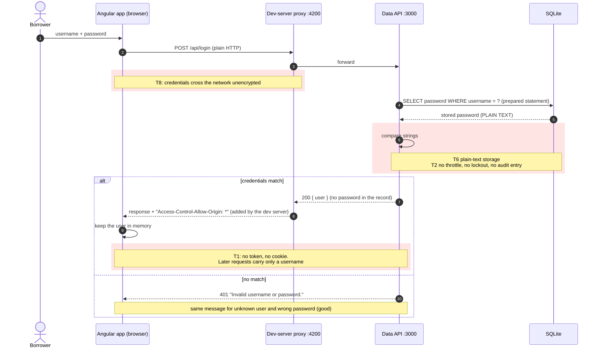
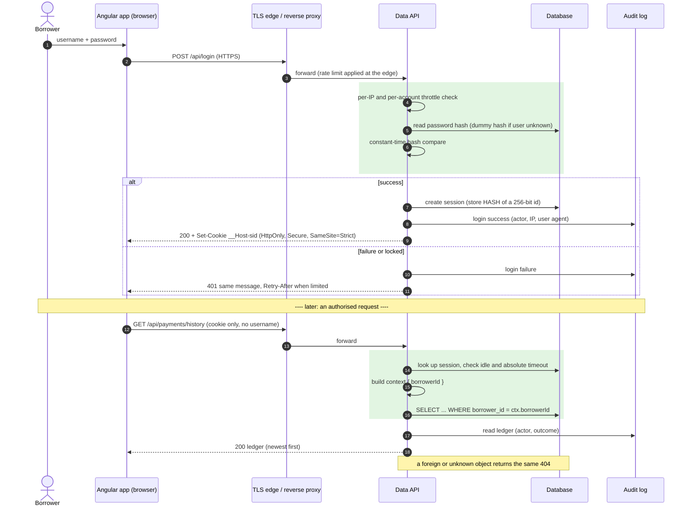
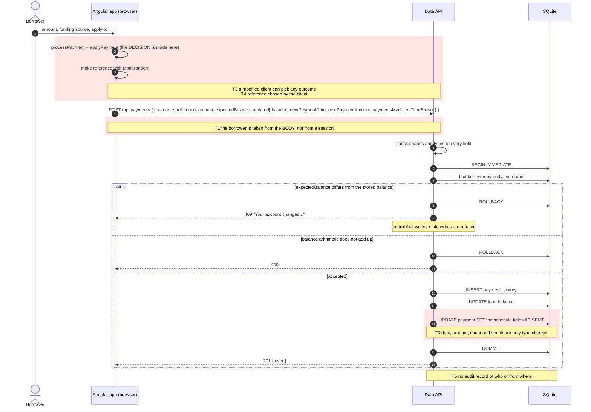
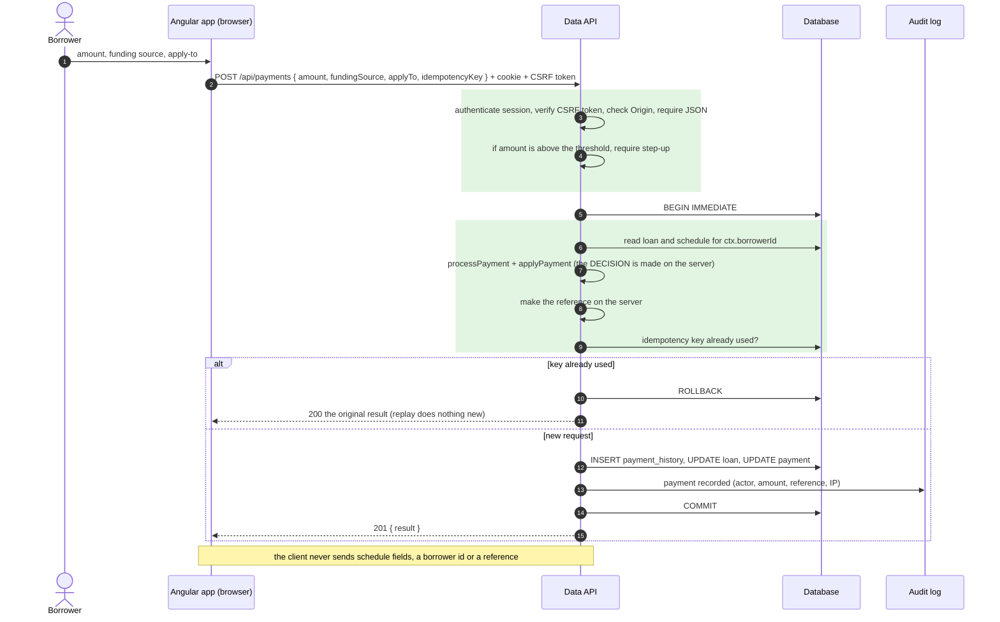
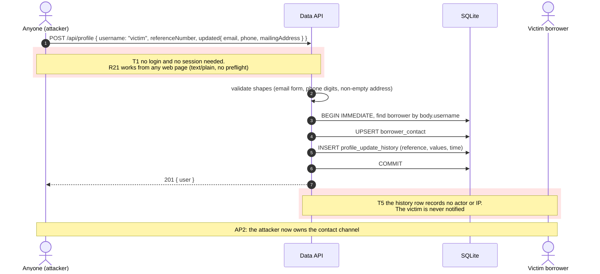
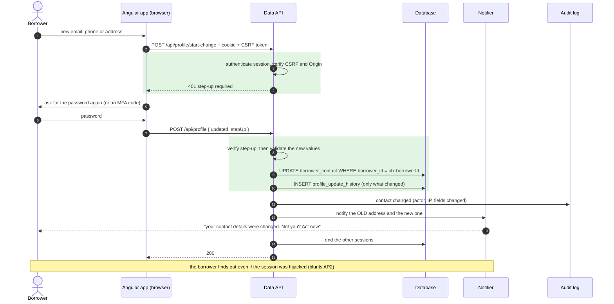
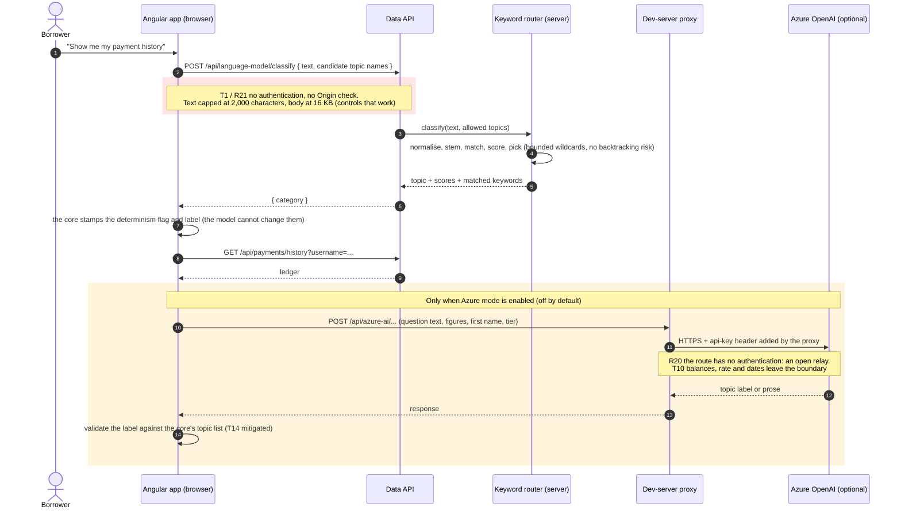

# Security-annotated sequence diagrams

**System:** Hexagonal Student-Loan POC · **Basis:** the code on branch `keyword-search`

The [data-flow diagram](threat-model.png) shows *where* data goes. These diagrams show *in what order* things happen on the three flows that matter most, and **who checks what at each step**. Red shading marks a weakness in the code as it stands; green marks the control a fix would add. Threat IDs (T1…, R21…) refer to the [risk register](itsg-33-risk-register.md).

Each flow has a **"today"** diagram and, where the design changes, a **"target"** diagram that follows [authn-authz-design.md](authn-authz-design.md). PNG renders of every diagram are in [sequence-diagrams/](sequence-diagrams/).

| Diagram | Flow | Shows |
|---|---|---|
| [SD-1](#sd-1--login-today) | Login, today | No session, no throttling, plain-text comparison |
| [SD-2](#sd-2--login-and-an-authorised-request-target) | Login and an authorised request, target | Hashed password, throttling, server-side session, scoped query |
| [SD-3](#sd-3--submit-a-payment-today) | Submit a payment, today | Decisions made in the browser; the API trusts the client's schedule |
| [SD-4](#sd-4--submit-a-payment-target) | Submit a payment, target | The client sends intent; the server decides and records |
| [SD-5](#sd-5--update-contact-details-today) | Update contact details, today | Anyone can change anyone's contact details |
| [SD-6](#sd-6--update-contact-details-target) | Update contact details, target | Session, CSRF, step-up and a notice to the old address |
| [SD-7](#sd-7--ask-a-question-today) | Ask a question, today | The keyword model and the optional Azure path |

---

## SD-1 · Login, today

## SD-2 · Login and an authorised request, target

## SD-3 · Submit a payment, today

## SD-4 · Submit a payment, target

## SD-5 · Update contact details, today

## SD-6 · Update contact details, target

## SD-7 · Ask a question, today

